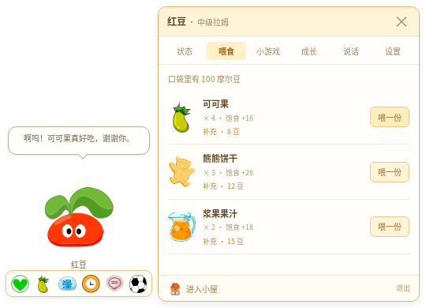

# 拉姆陪伴 · v0.4.0

小小一只拉姆，留在 Windows 桌面上陪你。默认从原版种子盆栽养起，也可以直接选择熟悉的两叶中级拉姆。

[下载 Windows 版](https://github.com/Vinci-217/mole-baby/releases/tag/v0.4.0) · [构建记录](https://github.com/Vinci-217/mole-baby/actions/workflows/windows-build.yml) · [旧版 v0.3.0](https://github.com/Vinci-217/mole-baby/releases/tag/v0.3.0)

下载 `RamuHouse-0.4.0-x64.zip` 后完整解压，运行 `拉姆陪伴.exe`；也可以使用 `RamuHouse-0.4.0-Setup.exe` 安装包。发布附件包含 SHA256 校验文件。



## 在桌面上照料

- **单击拉姆**：下方出现状态、喂食、清洁、休息、说话和小游戏六个小按钮。
- **打开照料内容**：在拉姆右侧显示一个小窗；靠近屏幕右边时显示在左侧。宠物保留在桌面，不会自动切进房间。
- **按住拖动**：长大后的拉姆会随手移动，身体轻微倾斜，松手回稳；左右轻摇有动作和短叫声。叫声可在设置关闭。
- **种子期**：使用真正原版草盆和种子身体。花盆固定，拖拽只让身体轻摇；这一阶段不能散步或参加移动接果游戏。
- **进入小屋**：通过照料窗底部的独立按钮进入。查看完可返回桌面。
- **安静陪伴**：默认开启，不主动频繁说话。设置中可开启桌面散步、改名、备份存档，或开始 25 分钟专注计时。

常驻角色约 `100×108` 像素；透明基础窗口为 `200×240`。照料小窗约 `332×374`，展开时窗口为 `540×390`；正常位置展开、收起保持宠物的屏幕位置。透明空白区域在 Windows 上允许鼠标穿过。

## 四个成长阶段

| 阶段 | 成长值 | 外形与活动 |
| --- | ---: | --- |
| 种子期 | 0 | 草盆中的原版白色胚胎，盆不移动，身体可摆动 |
| 初级 | 60 | 无叶幼体，开始显示所选红、黄、蓝或粉色 |
| 中级 | 180 | 两片嫩叶 |
| 高级 | 420 | 展开的扇叶 |

种子身体来自原 `lamubone.swf` 的 61 帧嵌套时间轴，花盆另层固定；不是把初级角色放进自绘花盆。成年形态继续使用原动作图集与配色规则。待机以安静站立为主，偶尔眨眼，互动动作一次播放后回到待机。当前休息姿态使用原等待帧和 `z` 标记，不声称原图具备所有独立睡眠动作。

喂普通食物、清洁、陪伴和游戏都会积累成长。健康且清醒时每小时最多 18 点自然成长；离线最多计算 24 小时状态变化，拉姆不会死亡。超级拉姆不是普通成长阶段。

## 小游戏反馈

**拉姆接果子**：20 秒，鼠标、触屏或左右方向键控制。拉姆稳定站立，果实底部实际触碰头顶接取线时才计分；接触处出现收拢果子和 `+1 可可果`，漏接显示“没接住”。人物与碰撞共用坐标，并在接触时刻同时插值双方位置，避免“看起来没接到却加分”。种子期不能参加。

**口袋翻翻乐**：45 秒找 6 对图案，开局 3 秒记忆预览。

接到的果子用于本局计分。结算为 `4 + 得分×2` 摩尔豆、`3 + 得分` 成长、**1 份**按得分决定的食物；接到几颗并不代表背包增加几颗。提前退出不领奖，结算防止重复领取。

## 本地存档与声音

`ramu-house-save-v1` 和 `version:1` 存档结构保持兼容，旧宠物的颜色、成长、库存与摩尔豆不变。设置中可导入、导出 JSON；网页预览与 Electron 桌面版使用各自的存储空间。

旧版大窗口位置会迁移为小窗口位置。互动叫声使用本地系统中文语音或合成拟声，带音量和频率限制；不标称官方原声。旧设置若关闭音效，会继续保持关闭，可在新侧窗“设置→互动叫声”开启。对话为本地基础规则，不需要账号、联网服务或 API 密钥。

## 美术与动作资料

背景为参考原页游画法生成的“晨光树洞书桌”，只在小屋里出现。角色、种子盆栽与照料物品优先复用原素材，照料窗改为轻巧的桌面布局。美术规则、参考图与生成模板见 [mole-classic-art skill](skills/mole-classic-art/SKILL.md)；逐项来源见 [ASSETS.md](ASSETS.md)，动作及 QQ 宠物交互资料核对见 [research/companion-references.md](research/companion-references.md)。

## 开发与验证

需要 Node.js 22 或 24：

```bash
npm ci
npm run desktop:dev       # Windows 桌面开发
npm run dev               # 网页预览
npm test                  # 50项养成、存档、接触检测和动作时钟测试
npm run build             # TypeScript及生产构建
npm run test:browser      # 桌面预览、种子、照料、两款游戏、存档全流程
npm run test:desktop:cloud # Linux云端真实Electron窗口与拖拽验证
```

浏览器测试使用独立档案与 5174 端口，可用 `CHROMIUM_PATH` 指定系统 Chromium。云端原生测试使用独立档案、Xorg 与窗口管理器；Linux 测试参数不会关闭 Windows 成品的 renderer sandbox。

```powershell
npm run dist:win:portable # Windows x64 ZIP
npm run dist:win          # Windows NSIS安装器
```

GitHub Actions 在 Windows 上执行测试、构建 ZIP/安装器，并启动实际打包 EXE 检查小窗口与桌面侧窗。版本标签成功后自动发布 Releases，`build-reports` 分支保存构建回执、源码 SHA 与下载校验值。CI 自动启动检查不能替代用户桌面上的长期试用与安装体验。

代码入口：`src/components/DesktopCompanion.tsx`、`Ram.tsx`、`fruit-physics.ts` 与 `electron/main.cjs`。应用启用 contextIsolation 和 renderer sandbox，关闭 Node.js 集成，IPC 校验来源和参数。

《摩尔庄园》非官方同人桌宠，角色及原游戏素材权益归原权利方。
