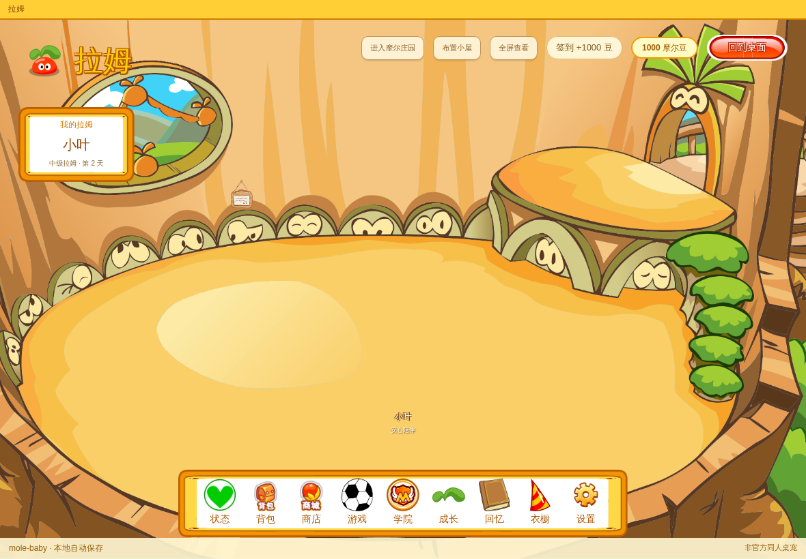
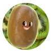
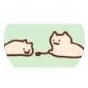

<div align="center">
  
  <h1>拉姆 · mole-baby</h1>
  <p>把摩尔庄园的小拉姆，养在你的桌面上。</p>
  <p>
    <a href="https://github.com/Vinci-217/mole-baby/releases/latest">下载安装</a> ·
    <a href="docs/UPDATES.md">更新说明</a> ·
    <a href="docs/SAVE-DATA.md">存档与备份</a> ·
    <a href="https://github.com/Vinci-217/mole-baby/issues">反馈问题</a>
  </p>
</div>

## 下载

到 [Releases](https://github.com/Vinci-217/mole-baby/releases/latest) 选择与你设备匹配的安装包。

| 平台 | 安装包与使用方式 |
| --- | --- |
| Windows 10 / 11 · 64 位 | 下载 `Setup.exe` 安装；ZIP 需完整解压，再运行包内的「拉姆.exe」或「启动拉姆.cmd」。 |
| Windows 7 SP1 / 8 / 8.1 | 按系统位数选 `legacy-x64` 或 `legacy-ia32`。[兼容说明](docs/WINDOWS.md) |
| macOS 12+ | M 系列选 `arm64.dmg`，Intel 选 `x64.dmg`；打开后拖入「应用程序」。[Mac 指引](docs/MACOS.md) |
| Android 8+ / HarmonyOS 4.x | 安装固定签名 APK，支持覆盖升级。[手机安装与权限说明](docs/ANDROID.md) |

预览分支中的改动不代表已经发版。HarmonyOS NEXT 不运行 Android APK；桌面版关闭窗口后会留在托盘或 Mac 菜单栏，选择「退出拉姆」才会完全退出。

## 可以做什么

- **桌面陪伴**：拖动、摸摸、拖动边角等比缩放、贴边躲藏，以及可开关的散步与专注提醒。
- **慢慢养大**：四种初始颜色，成长解锁形态；照料六项状态，从背包单击使用用品。
- **布置小屋**：切换背景与音乐，自由摆放、复制和缩放家具，用留言板记录待办；桌面足球菜单也能直接打开。
- **经营餐厅**：用摩尔豆备菜、在线烹饪、端盘送餐，经营升级解锁 72 道原版菜谱与 15 套内饰；退出或断网自动打烊，不补离线收益。[餐厅玩法与适配说明](docs/RESTAURANT.md)
- **一起玩耍**：原版道具动作、小游戏、课程和餐厅打工；游戏音效可独立关闭，经历保存在本机回忆里。



更多动作演示收在[动画画廊](docs/README-ARCHIVE.md)，素材出处与适配范围见 [ASSETS.md](ASSETS.md)。

## 存档与更新

拉姆、物品、成长、留言和回忆会自动保存在本机。小屋「设置 → 导出存档」可以备份；换设备时通过「导入存档」恢复。**覆盖更新沿用旧数据，请不要卸载、清除应用数据或删除用户目录。**

Windows / Mac 可在托盘或设置里检查更新，下载和安装分别确认；Android 支持更新检查、Wi-Fi 自动下载与系统安装确认。不同平台的存档位置和恢复方式见[存档说明](docs/SAVE-DATA.md)，升级方式见[更新说明](docs/UPDATES.md)。

## 开发

需要 Node.js 22 与 npm。

```sh
npm ci
npm run dev              # 浏览器预览
npm run desktop:dev      # Electron 桌面调试
npm run build            # 类型检查与生产构建
npm test                 # 养成、存档、窗口与更新测试
```

使用操作见[小屋布置与桌面计时](docs/ROOM-LAYOUT.md)。打包命令见 [package.json](package.json)。[Android 构建](docs/ANDROID.md) · [Mac 签名](docs/MACOS-SIGNING.md) · [课程说明](docs/COURSES.md)

提交问题时，请附上系统、软件版本、复现步骤，以及完整报错文字。涉及存档的问题请先导出备份。

## Token 赞助鸣谢

感谢以下朋友对开发所需 Token 的支持。头像与昵称按提供的名单整理，同一位赞助者合并展示。

| | | |
| :---: | :---: | :---: |
|  **慕容狗尾巴草** |  **太白猕猴桃🥝** |  **参苓** |
|  **cong12110** |  **波子汽水** |  **从而言之y** |

## 素材声明与免责声明

本项目是摩尔庄园爱好者制作的非官方同人桌宠，与淘米公司无隶属或官方合作关系。《摩尔庄园》相关角色、图片、动画、家具、音乐及音效等官方素材，其著作权及相关权利归淘米公司及相应权利人所有。

项目基于官方公开可获取的素材、公开资源归档，以及其他免费公开素材进行学习与同人创作；其他素材按各自原有许可使用。本项目不主张原版素材的所有权，素材来源与本地适配记录见 [ASSETS.md](ASSETS.md)。

**如有侵权，请通过 [GitHub Issues](https://github.com/Vinci-217/mole-baby/issues) 联系作者，作者将在核实后及时删除或调整相关内容。**

感谢淘米公司与《摩尔庄园》原制作团队带来的角色、素材和童年回忆，也感谢公开资源的整理者、Token 赞助者，以及参与测试和反馈的玩家。
