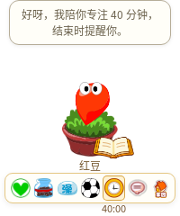
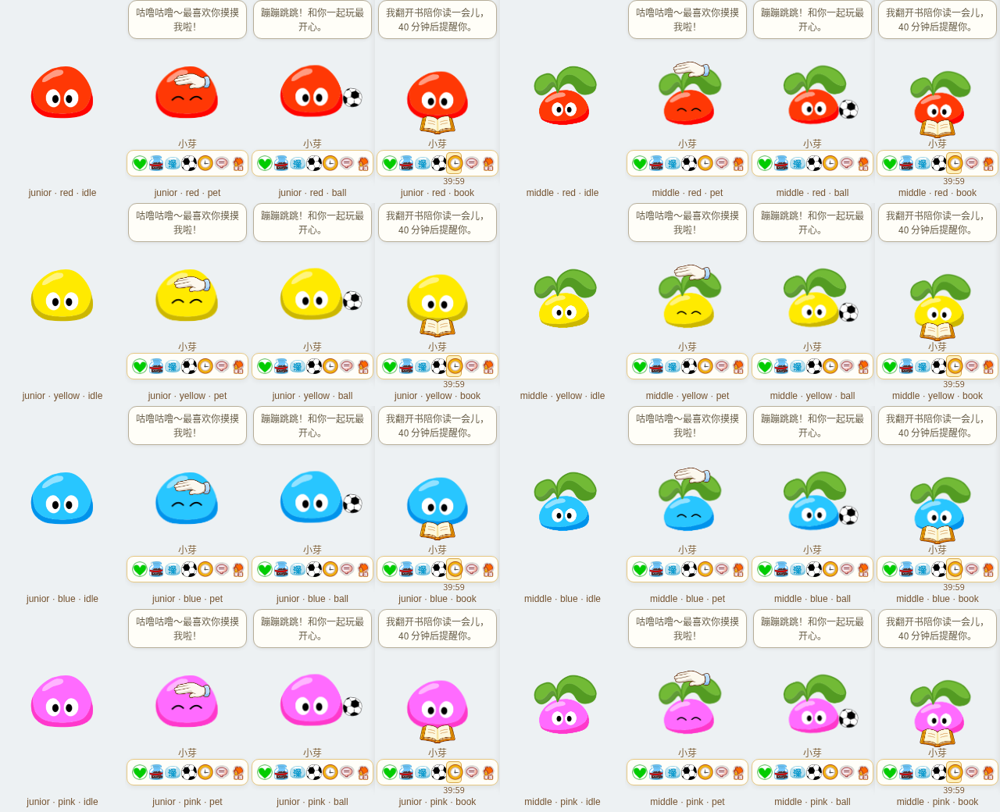

# 拉姆 · mole-baby

小小一只拉姆，留在 Windows 和 macOS 桌面陪你工作、生活。选择粉、黄、蓝、红四色之一，为它起名，从盆栽种子慢慢养大。

[下载 Windows / Mac v0.16.0](https://github.com/Vinci-217/mole-baby/releases/tag/v0.16.0) · [桌面版构建记录](https://github.com/Vinci-217/mole-baby/actions/workflows/windows-build.yml)

| 电脑 | 下载文件 |
| --- | --- |
| Windows x64 | `mole-baby-0.16.0-Setup.exe` 或 `mole-baby-0.16.0-x64.zip` |
| Mac Apple 芯片（M 系列） | `mole-baby-0.16.0-mac-arm64.dmg` |
| Mac Intel | `mole-baby-0.16.0-mac-x64.dmg` |

Mac 最低系统要求 macOS 12，打开 DMG 后将“拉姆”拖到 Applications，再从应用程序打开。也提供各架构 ZIP。Mac 签名与公证状态以各版本发布页顶部为准；本地签名版本首次被系统拦截时，可在“系统设置 → 隐私与安全”确认本次应用并选择“仍要打开”。无需关闭系统安全保护。安装盘内附「Mac 打开说明.html」，应用尚未运行时也能查看并点击打开系统设置；应用内的小屋设置和菜单栏同样提供 Mac 帮助入口。详情见 [Mac 使用说明](docs/MACOS.md) 和 [签名、公证说明](docs/MACOS-SIGNING.md)。

Windows ZIP 完整解压后运行 `拉姆.exe`。附件包含 SHA256 校验文件，旧存档与本机设置继续保留。



默认开启的自然小动作每隔2–4分钟短暂张望，偶尔看看小蝴蝶；不会移动花盆或改变宠物位置，也不会自动开始计时。专注、睡觉、侧边躲藏、安静模式及已保存的安静偏好会暂停自动动作。可在玩耍小窗主动邀请“看看小蝴蝶”；两列卡片保留清楚的大图标。所有阶段和四种颜色沿用原角色图集，高级与神力形态继续悬浮。

欢迎词按本机时间与实际状态表达，第一次领养不冒充重逢；对话后轻轻张望，不自动出现摸头的手。能自然想起实际喂过的食物，删除对应回忆后不再提起；修正“不开心”“没完成”“不累/没有压力”等常见情绪误判。

二、三阶段重新使用原身体、眼睛和叶片分层：待机轻呼吸、眨眼，摸摸闭眼回应，玩球与看书保持原身体比例；照料时身体帧顺序播放，减少反复抽动。道具使用结束后，拉姆上方显示实际增加的饱食、水分、清洁等数值，缓缓上浮淡出；满值只显示实际补充量，不增加虚构成长经验。



## 桌面陪伴

启动后拉姆出现在桌面右下角，使用双叶拉姆图标常驻 Windows 托盘或 Mac 菜单栏。关闭或最小化窗口会收进托盘；从托盘恢复，选择图标菜单里的“退出拉姆”才真正结束程序；Mac 也支持 Command+Q。首次运行先领养，不会闪出小屋。

鼠标移上拉姆，脚下依次显示 **状态、吃、洗澡、玩耍、计时、对话、小屋**；移开后收起，移向按钮有过渡区域，点击拉姆仍是摸摸。键盘聚焦也能展开。基础照料、背包、玩球、专注和聊天在旁边小窗完成；商店、完整小游戏、成长和设置进入小屋使用。角色约 100×108 像素，基础透明窗口 160×240，侧窗展开 500×490；空间不足时自动放在左侧。Windows 和 Mac 透明空白区域可穿透鼠标；Mac 桌宠可跟随桌面空间，小屋留在当前空间。

所有阶段都可手动拖动，包括睡着的拉姆。长大后还能散步、随轻摇摆动；只有拖到屏幕最右侧才会躲起来，左侧或靠近右侧都不吸附，鼠标移上时轻轻倾身探头，种子只摆身体、花盆直立，单击保持躲藏，按住拖动才完整出来；自动探头为随机2–5分钟一次，每次约4.5–7秒。角色两侧透明边距由50缩至30像素，初始距右侧6像素；收起使用约0.85秒缓入缓出，悬停只探头。种子不会自动走动，但可以连同花盆手动拖动，拖到最右侧也可收起与探头，并保持拖放高度。精力低至20时会自己闭眼休息，恢复至85后自然醒来；睡着时名称位置显示「睡着了 · 叫醒」，状态和小屋也可叫醒。提前叫醒有15分钟清醒时间，重启保留，不会立刻睡回去。睡觉使用闭眼帧与轻呼吸；除主动使用换色药水外，四种颜色从种子到神力形态保持一致。

设置可开关散步、角落躲藏、安静陪伴、自然小动作和互动音效，并调节拉姆音量、试听声音。计时时长可自定义 1–240 分钟；点击玩耍右侧的时钟图标或「陪我专注」才启动，悬停快捷栏时在图标旁查看小倒计时，拉姆旁出现翻页书本；没有常驻的「开始计时」长条，到时气泡提醒和提示音，随后停止。取消不提醒，重启不自动计时，睡眠与计时独立。提示音可单独关闭。

它也会偶尔主动说些暖心的话：成长、生活、小小的进步和文化片语，结合当前阶段、本地时间与真实记忆。默认约20分钟一次，可在小屋设置改成约10/20/40分钟或关闭；睡觉、安静模式、打开操作面板和躲到侧边时不打扰。看书时单独聊书本、学习与文化，首次约90秒后，之后按陪伴设置约3/5/10分钟一句；尊重安静偏好。点击气泡可继续聊天；「玩耍 → 听拉姆说一句」可主动邀请。离线即可使用，不自动请求 DeepSeek。

## 背包、商店与动作

32 种用品分食物、饮品、清洁和药水。背包为 4×4 正方形十六格；小屋商店以四本商品书分类，翻开后左页挑物品、右页查看价格并购买。新领养有 100 摩尔豆和空背包，购买后按次消耗，洗澡也需要用品。照料动画期间按钮显示正在照料，防止连续误用。

已从原客户端配置确认 `180027` 叫 **可可果**；咕咕果补水、爽爽果清洁。另有熊熊饼干、巧克力豆、麦香牛奶、运动可乐、泡泡浴、牙膏等。原非零价格和效果有对应来源，活动零价物品采用本地商店价，详见 [用品与状态核对](research/items-states.md)。

第四、第五阶段在桌面和小屋持续悬浮，原 down 图集循环一直播放；摸头时保持原飞行比例，手与角色同步浮动，不切换到比例不同的打招呼片段。

玩球会出现原足球、摸摸有小手轻抚、专注会低头阅读，独立纸页从右向左绕书脊翻动，各成长阶段有不同锚点和身体反应。连续快速摸摸或来回摇晃会短暂头晕，显示三颗头顶环绕的星星，有前后大小与明暗变化，稍后恢复。详见 [分阶段互动设计](research/v9-interactions.md)。

28 种原用品与4种新增换色药水都有动作配方，区分咀嚼、啜饮、可乐气泡、刷牙、泡澡、擦洗和药水等。主体使用原页游帧，按实际用品叠加原图标与动作；**不是官方逐品专属动画**。辅助牙刷为生成 PNG，不用 SVG 重画宠物。详见 [动作来源与实现](research/v6-item-motion.md)。

六项状态为饱食、水分、清洁、心情、健康、精力；饥饿、口渴、脏、难过、生病、困和睡眠有对应表现。衰减速度、阈值及不会死亡的规则是桌宠适配。

## 慢慢长大与小游戏

只有状态良好时的真实陪伴时间累计成长：种子到初级约 24 小时，再到中级约 72 小时，高级再约 168 小时。高级之后再积累 168 小时健康成长，可在「小屋 → 成长」选择神力超级、神奇水系、弹力木系、霹雳火系四种原形态之一；选择后保留，旧高级拉姆不会自动变形。素材与适配规则见 [神力进化记录](research/v8-evolution.md)。摸摸、喂食和游戏不会直接增加成长；旧宠物保留当前阶段。这是参考原版慢养体验的桌宠节奏，未声称还原服务端精确计时，见 [成长研究](research/v6-growth.md)。

商店「药水」书中有红、黄、蓝、粉四种换色药水，每瓶80摩尔豆。购买后在背包「药水」中使用，先喝下再渐变换色；同色不消耗，睡着时先叫醒。阶段、进化形态、名字、库存和记忆保留，所有动作使用同一原身体遮罩配色，眼白、叶片和花盆不染色。瓶装药水和售价是桌宠适配，原配置的变色类道具依据见 [飞行与换色记录](research/v14-flight-recolor.md)。

小屋有 **接果子、翻翻乐、节奏拍拍乐、草地采果、小屋拼拼乐** 五个游戏。接果碰撞、消失、反馈和计分同步；完成一局按实际成绩获得摩尔豆与一份用品，提前退出不领奖，奖励不增加成长。新游戏支持暂停与隐藏冻结。

## 小屋、真实时间与音乐


六个背景：晨光书桌、拉姆小屋、神秘湖木屋、树洞房，以及新创作的星光温室、溪畔树屋。所有场景默认按本地真实时间显示早晨、白天、傍晚和夜晚；可临时预览时段，重启恢复自动时间。新场景为参考旧页游画风生成的四时段插图，来源与提示词有记录，并非训练专用模型。

内置 12 首有来源记录的原页游 BGM，可换曲、调音量、关闭，也能导入不超过 20 MB 的有效本地音频，存入本机 IndexedDB，重启保留。只在小屋播放，回桌面或收进托盘暂停；录音和朗读时降低配乐音量。经典场景存在共用配乐，名称与来源按原地图配置核对，见 [音乐与场景研究](research/v6-scenes-music.md)。

未找到可可靠确认身份的原版拉姆叫声，因此互动、吃喝、泡泡与呼吸音效是本地合成，不冒充原录音。饼干咀嚼、饮品咕噜、刷牙、流水、泡澡、玩球与翻书由可见动作的接触时钟触发；取消动作会停止，不在隐藏窗口补播。翻牌配对、接果、节奏、拼图和实际购买也有对应反馈，原计分和摩尔豆奖励保持不变。系统朗读或原生语音忙碌时让位。

## 对话、记忆与语音

无需密钥也可基本对话。每只拉姆有稳定性格，记住主动告诉它的称呼、喜好、往事、计划与边界，也记录实际照料、成长和游戏经历；对话结合关系与心情，支持旧话题回忆和完成计划。小本子可查看、更改或忘记记忆；删除同步清理相关对话上下文。容量为 64 条事实、120 条经历、80 条消息，不读取电脑文件或屏幕。

在 **小屋 → 设置 → DeepSeek 对话** 输入自己的 API Key，启用 `deepseek-chat`。目前只支持 DeepSeek；Key 只在本机 Electron 主进程保存，Windows 使用系统加密、Mac 使用钥匙串支持的系统加密，不能加密时明确提示本地文件方式。Key 不读回界面，不进网页存储或备份。仅发送对话时访问固定 DeepSeek 接口，支持取消与重试。

Windows 语音输入使用已安装的中文 System.Speech 离线识别，用户点击才开麦，转文字后确认发送；缺少识别引擎或权限会提示，可用 Win+H 听写。回复可选系统中文朗读。浏览器预览取决于浏览器能力。收进托盘会取消录音、待启动录音与朗读。自动化使用模拟 API 和语音进程，真实服务调用、中文识别准确率需要用户本机 Key、语音组件及麦克风验证。

Mac 语音输入使用系统听写：在“系统设置 → 键盘”开启听写，点击“语音输入”会说明用法并聚焦输入框，按系统听写快捷键说话，确认文字后发送。回复可用系统中文朗读。是否离线由 macOS、语言包和系统听写设置决定，应用不把录音发送给 DeepSeek。

完整 Prompt、上下文组织和情感记忆规则见 [对话 Harness](docs/COMPANION_HARNESS.md)。

## 保存、备份与送别

兼容 `ramu-house-save-v1` / `version:1`，保留旧宠物颜色、阶段、摩尔豆和库存。导入导出 JSON 包含宠物记忆，不包含 API Key 或音乐文件。网页预览与桌面版分别保存。

小屋设置可以重命名、备份和送别拉姆，也可以在「当前成长阶段」直接选择种子、初级、中级、高级、神力五个阶段，并随时切换四种神力形态；支持降级，颜色、名字、物品和回忆保留并自动保存。手动切换将成长进度置于所选阶段起点，之后仍按自然成长计时。确认送别会删除这只宠物的存档与本机回忆，并收进托盘；再次打开进入四色选择、起名的新领养流程。API Key 和应用偏好保留。

## 开发与验证

Node.js 22 或 24：

```bash
npm ci
npm run desktop:dev        # Windows / Mac 桌面开发
npm run dev                # 网页开发
npm test                   # 规则、迁移、动画、记忆和 Native 生命周期
npm run build              # TypeScript 与生产构建
npm run test:browser       # 商店、物品、记忆、背景、音乐和完整游戏
npm run test:companion-update # 手动单次计时、提示音与16种进化/颜色组合
npm run test:flight-recolor # 32形态/颜色组合、实际购药、换色像素与持续悬浮
npm run test:layout-stage   # 窄边距、五阶段/四神力切换与存档保留
npm run test:reading-dizzy  # 八形态看书翻页、头顶星星绕圈及视觉截图
npm run test:social         # 八种形态的球/手/书实画面与正方形背包
npm run test:hover-rest    # 原生悬停栏、图标计时、自动休息与叫醒
npm run test:pet-life
npm run test:grounded-care
npm run test:presence      # 主动陪伴频率、静默、文化追问与记忆边界
npm run test:memory        # 对话并发、遗忘和录音取消
npm run test:desktop:cloud # Linux 隔离档案真实 Electron 回归
```

本版已通过生产构建、215 项单元与 Native 生命周期测试，以及浏览器、记忆并发和真实 Electron 桌面回归。Windows 与两种 Mac 原生成品验证由对应版本的 GitHub Actions 记录提供。

浏览器测试使用独立端口 5174，记忆测试使用 5188，可设 `CHROMIUM_PATH`。Linux 原生测试使用独立档案、Xorg 和窗口管理器；云端测试参数不关闭 Windows 成品的 renderer sandbox。

```powershell
npm run dist:win:portable # Windows x64 ZIP
npm run dist:win          # Windows NSIS 安装器
npm run dist:mac          # 在 Mac 上构建当前架构的 DMG + ZIP
npm run dist:mac:arm64    # Apple 芯片
npm run dist:mac:x64      # Intel
```

GitHub Actions 在 Windows、Apple 芯片 Mac 和 Intel Mac 上分别构建并启动实际应用。Mac 另外校验原生架构、本地签名、DMG 挂载和包内容，三个平台全部通过后再统一发布安装包、ZIP 和 SHA256SUMS。构建记录不替代每台电脑的安装和真实麦克风测试。美术规范位于 [mole-classic-art skill](skills/mole-classic-art/SKILL.md)，资源来源见 [ASSETS.md](ASSETS.md)。

《摩尔庄园》非官方同人桌宠，角色与原游戏素材权益归原权利方。
