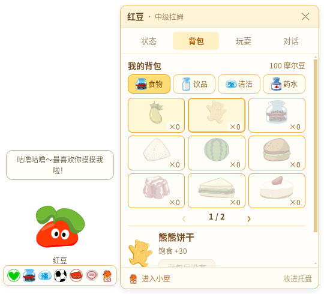
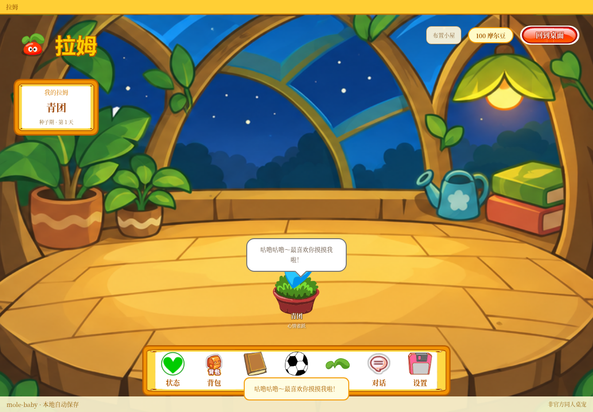

# 拉姆 · mole-baby

小小一只拉姆，留在 Windows 桌面陪你工作、生活。选择粉、黄、蓝、红四色之一，为它起名，从盆栽种子慢慢养大。

[下载 Windows v0.6.3](https://github.com/Vinci-217/mole-baby/releases/tag/v0.6.3) · [Windows 构建记录](https://github.com/Vinci-217/mole-baby/actions/workflows/windows-build.yml)

安装版：`mole-baby-0.6.3-Setup.exe`。免安装版：完整解压 `mole-baby-0.6.3-x64.zip`，运行 `拉姆.exe`。附件包含 SHA256 校验文件。旧版本存档与本机设置继续保留。



## 桌面陪伴

启动后拉姆出现在桌面右下角，使用双叶拉姆图标常驻托盘。关闭或最小化窗口会收进托盘；从托盘恢复，右键菜单“退出拉姆”才真正结束程序。首次运行先领养，不会闪出小屋。

单击拉姆，脚下依次显示 **状态、吃、洗澡、玩耍、休息、对话、小屋**。基础照料、背包、玩球、专注和聊天在旁边小窗完成；商店、完整小游戏、成长和设置进入小屋使用。角色约 100×108 像素，基础透明窗口 200×240，侧窗展开 540×490；空间不足时自动放在左侧。Windows 透明空白区域可穿透鼠标。

长大后能散步、拖动、随轻摇摆动；拖到角落会躲起来，偶尔探头，点击即可出来。种子花盆固定，只摆动身体。睡觉使用闭眼帧、轻呼吸和可见的叫醒入口；四种颜色从种子到高级保持一致。

设置可开关散步、角落躲藏、安静陪伴和互动音效。每 20 / 40 / 60 分钟可提醒站起、喝水、远眺，睡眠、安静与专注时不主动打扰；支持 25 分钟专注计时。

## 背包、商店与动作

28 种用品分食物、饮品、清洁和药水。背包为分页九宫格；小屋商店以四本商品书分类，翻开后左页挑物品、右页查看价格并购买。新领养有 100 摩尔豆和空背包，购买后按次消耗，洗澡也需要用品。照料动画期间按钮显示正在照料，防止连续误用。

已从原客户端配置确认 `180027` 叫 **可可果**；咕咕果补水、爽爽果清洁。另有熊熊饼干、巧克力豆、麦香牛奶、运动可乐、泡泡浴、牙膏等。原非零价格和效果有对应来源，活动零价物品采用本地商店价，详见 [用品与状态核对](research/items-states.md)。

全部 28 种用品有动作配方，区分咀嚼、啜饮、可乐气泡、刷牙、泡澡、擦洗和药水等。主体使用原页游帧，按实际用品叠加原图标与动作；**不是 28 段官方逐品专属动画**。辅助牙刷为生成 PNG，不用 SVG 重画宠物。详见 [动作来源与实现](research/v6-item-motion.md)。

六项状态为饱食、水分、清洁、心情、健康、精力；饥饿、口渴、脏、难过、生病、困和睡眠有对应表现。衰减速度、阈值及不会死亡的规则是桌宠适配。

## 慢慢长大与小游戏

只有状态良好时的真实陪伴时间累计成长：种子到初级约 24 小时，再到中级约 72 小时，高级再约 168 小时。摸摸、喂食和游戏不会直接增加成长；旧宠物保留当前阶段。这是参考原版慢养体验的桌宠节奏，未声称还原服务端精确计时，见 [成长研究](research/v6-growth.md)。

小屋有 **接果子、翻翻乐、节奏拍拍乐、草地采果、小屋拼拼乐** 五个游戏。接果碰撞、消失、反馈和计分同步；完成一局按实际成绩获得摩尔豆与一份用品，提前退出不领奖，奖励不增加成长。新游戏支持暂停与隐藏冻结。

## 小屋、真实时间与音乐



六个背景：晨光书桌、拉姆小屋、神秘湖木屋、树洞房，以及新创作的星光温室、溪畔树屋。所有场景默认按本地真实时间显示早晨、白天、傍晚和夜晚；可临时预览时段，重启恢复自动时间。新场景为参考旧页游画风生成的四时段插图，来源与提示词有记录，并非训练专用模型。

内置 12 首有来源记录的原页游 BGM，可换曲、调音量、关闭，也能导入不超过 20 MB 的有效本地音频，存入本机 IndexedDB，重启保留。只在小屋播放，回桌面或收进托盘暂停；录音和朗读时降低配乐音量。经典场景存在共用配乐，名称与来源按原地图配置核对，见 [音乐与场景研究](research/v6-scenes-music.md)。

未找到可可靠确认身份的原版拉姆叫声，因此互动、吃喝、泡泡与呼吸音效是本地合成，不冒充原录音。

## 对话、记忆与语音

无需密钥也可基本对话。每只拉姆有稳定性格，记住主动告诉它的称呼、喜好、往事、计划与边界，也记录实际照料、成长和游戏经历；对话结合关系与心情，支持旧话题回忆和完成计划。小本子可查看、更改或忘记记忆；删除同步清理相关对话上下文。容量为 64 条事实、120 条经历、80 条消息，不读取电脑文件或屏幕。

在 **小屋 → 设置 → DeepSeek 对话** 输入自己的 API Key，启用 `deepseek-chat`。目前只支持 DeepSeek；Key 只在本机 Electron 主进程保存，Windows 优先使用系统加密，不能加密时明确提示本地文件方式。Key 不读回界面，不进网页存储或备份。仅发送对话时访问固定 DeepSeek 接口，支持取消与重试。

Windows 语音输入使用已安装的中文 System.Speech 离线识别，用户点击才开麦，转文字后确认发送；缺少识别引擎或权限会提示，可用 Win+H 听写。回复可选系统中文朗读。浏览器预览取决于浏览器能力。收进托盘会取消录音、待启动录音与朗读。自动化使用模拟 API 和语音进程，真实服务调用、中文识别准确率需要用户本机 Key、语音组件及麦克风验证。

完整 Prompt、上下文组织和情感记忆规则见 [对话 Harness](docs/COMPANION_HARNESS.md)。

## 保存、备份与送别

兼容 `ramu-house-save-v1` / `version:1`，保留旧宠物颜色、阶段、摩尔豆和库存。导入导出 JSON 包含宠物记忆，不包含 API Key 或音乐文件。网页预览与桌面版分别保存。

小屋设置可以重命名、备份和送别拉姆。确认送别会删除这只宠物的存档与本机回忆，并收进托盘；再次打开进入四色选择、起名的新领养流程。API Key 和应用偏好保留。

## 开发与验证

Node.js 22 或 24：

```bash
npm ci
npm run desktop:dev        # Windows 桌面开发
npm run dev                # 网页开发
npm test                   # 规则、迁移、动画、记忆和 Native 生命周期
npm run build              # TypeScript 与生产构建
npm run test:browser       # 商店、物品、记忆、背景、音乐和完整游戏
npm run test:memory        # 对话并发、遗忘和录音取消
npm run test:desktop:cloud # Linux 隔离档案真实 Electron 回归
```

本版已通过生产构建、155 项单元与 Native 生命周期测试，以及浏览器、记忆并发和真实 Electron 桌面回归。Windows 成品验证由对应版本的 GitHub Actions 记录提供。

浏览器测试使用独立端口 5174，记忆测试使用 5188，可设 `CHROMIUM_PATH`。Linux 原生测试使用独立档案、Xorg 和窗口管理器；云端测试参数不关闭 Windows 成品的 renderer sandbox。

```powershell
npm run dist:win:portable # Windows x64 ZIP
npm run dist:win          # Windows NSIS 安装器
```

GitHub Actions 构建 Windows EXE，检查打包素材、实际启动与核心流程，再发布安装包、ZIP 和 SHA256SUMS。构建记录不替代每台电脑的安装和真实麦克风测试。美术规范位于 [mole-classic-art skill](skills/mole-classic-art/SKILL.md)，资源来源见 [ASSETS.md](ASSETS.md)。

《摩尔庄园》非官方同人桌宠，角色与原游戏素材权益归原权利方。
