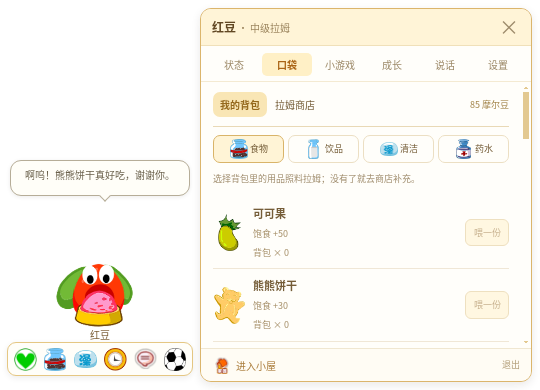

# 拉姆陪伴 · v0.5.0

小小一只拉姆，留在 Windows 桌面上陪你。从四色种子盆栽开始养，也可以选择熟悉的两叶中级形态。

[下载 Windows 版](https://github.com/Vinci-217/mole-baby/releases/tag/v0.5.0) · [构建记录](https://github.com/Vinci-217/mole-baby/actions/workflows/windows-build.yml) · [上一版 v0.4.0](https://github.com/Vinci-217/mole-baby/releases/tag/v0.4.0)

下载 `RamuHouse-0.5.0-x64.zip` 后完整解压，运行 `拉姆陪伴.exe`；或使用 `RamuHouse-0.5.0-Setup.exe` 安装。发布附件包含 SHA256 校验文件。



## 日常陪伴

单击拉姆展开脚下六个小按钮。照料、状态、聊天和设置在旁边的小窗完成；小屋通过底部独立按钮进入。角色约 `100×108` 像素，透明基础窗口 `200×240`，展开照料窗 `540×390`；空间不足时小窗改在左侧，正常展开收起保留宠物屏幕位置。Windows 透明空白处允许鼠标穿过。

长大后可按住拖动，轻摇和放手有动作与短音效。种子花盆固定，只让身体摆动；种子不能散步或参加移动接果游戏。只有粉、黄、蓝、红四种基础色，从种子到高级保持选择的颜色。睡着时使用原素材闭眼帧、轻呼吸和 `z` 标记，脚下显示“睡着了 · 叫醒”，不会让用户猜为什么照料按钮不能用。

设置可开关安静陪伴、互动音效、桌面散步和休息提醒。提醒每 20 / 40 / 60 分钟轮流建议站起、喝水、远眺；睡觉、专注和安静模式时不主动打扰。另有 25 分钟专注计时。旧的静音、安静偏好继续保留。

## 商店与拉姆状态

照料口袋内分“我的背包”和“拉姆商店”，包含 **28 种**原图标用品：食物、饮品、清洁用品、药水。新领养附赠 100 摩尔豆，用品需购买后再用；洗澡也会消耗清洁用品。小游戏可赚豆和用品奖励。

原配置确认 `180027` 就叫 **可可果**；咕咕果解渴、爽爽果清洁，不能把三者图标和作用混用。还可购买巧克力豆、熊熊饼干、麦香牛奶、运动可乐、泡泡浴、青苹果洗面奶、清爽沐浴露等。非零原价与照料效果对照客户端 XML；原活动零价物品设本地商店价，清单与区别见 [原版用品与状态核对](research/items-states.md)。

状态显示饱食、水分、清洁、心情、健康、精力；饥饿、口渴、脏、难过、生病、困和睡眠有对应表现。状态种类参考原配置，衰减速度、触发阈值与不会死亡的规则为桌宠玩法。健康照料可以恢复，万能药水可治疗。

| 成长阶段 | 成长值 | 外形 |
| --- | ---: | --- |
| 种子期 | 0 | 原盆与种子身体分层，花盆不动 |
| 初级 | 60 | 无叶幼体 |
| 中级 | 180 | 两片嫩叶 |
| 高级 | 420 | 展开的扇叶 |

种子身体保留原 61 帧时间轴；原图集与新增原照料动作都用身体遮罩还原四种颜色，不改变眼白、叶片、花盆。待机以安静站立和眨眼为主；吃、喝、清洁等由真实照料事件触发，不用持续跳跃代替反馈。超级拉姆不是普通成长阶段。

## 对话、记忆与语音

无需密钥也能用本地基础对话，记住主动告诉它的称呼、喜好、计划，以及实际照料、成长和游戏的小事。每只宠物有稳定的表达性格；“我们的小本子”可查看、逐条忘记或清空，删除记忆会同时清对话历史。记忆有明确容量，不读取电脑文件、键盘或屏幕。

在 **设置 → DeepSeek 对话** 输入 API Key 即可启用 `deepseek-chat`，目前仅支持 DeepSeek。Key 只在 Electron 主进程存取，Windows 优先使用系统加密，不读回界面，不进入宠物备份。系统加密不可用时会明确显示本地文件保存方式。只有实际发送聊天时才请求 `https://api.deepseek.com/chat/completions`；发送近期对话、可查看记忆和拉姆状态，支持停止等待、错误重试。Key 可随时删除，转回本地对话。

“语音输入”优先使用 Windows 已安装的中文 System.Speech 离线识别：用户点击才开麦，先转文字，确认后发送；离开聊天或取消会结束录音。不具备中文识别引擎/麦克风权限时显示具体提示，也可用系统 `Win + H` 听写。浏览器预览的识别由浏览器能力决定，可能需要联网。回复可勾选系统中文朗读，需要本机中文语音包。DeepSeek 本身只收到文字。

完整 Prompt、上下文组织、记忆提取和边界见 [对话 Harness](docs/COMPANION_HARNESS.md)。自动化验证使用模拟 API 和语音进程；没有真实 Key 和麦克风时，不把真实服务调用或语音识别准确率写为已验证。

## 小屋背景与声音

提供晨光书桌、拉姆小屋、神秘湖木屋、树洞房四个背景，设置或小屋右上角“换背景 · 音乐”可切换，重启保留。晨光书桌是已记录的生成背景，其余是已有原客户端导出。

内置原页游摩尔城堡、宠物店、神秘湖三首音乐，进入小屋播放，回桌面暂停，可换曲、关闭和调音量。也能导入 20 MB 内的有效本地音频，保存于本机 IndexedDB，重启恢复，可删除。录音或朗读时配乐自动降低音量。

没有找到可可靠确认身份的原版拉姆叫声，因此互动、吃、喝、泡泡水声与呼吸使用本地合成音效，不冒充原录音。音乐原文件、哈希、查找记录见 [声音来源](research/audio-sources.md) 与 [ASSETS.md](ASSETS.md)。

## 小游戏与本地保存

**拉姆接果子**：20 秒，鼠标、触屏或方向键控制，果实与实际头顶接取线接触时同步反馈和计分。**口袋翻翻乐**：45 秒找 6 对图案，开局 3 秒预览。每局结算 `4 + 得分×2` 豆、`3 + 得分` 成长、1 份食物或饮品；接果数量只用于计分，提前退出不领奖。

`ramu-house-save-v1` / `version:1` 向后兼容。旧宠物保留颜色、成长、摩尔豆和全部旧物品；补齐水分、健康和新品空槽。可导入、导出 JSON，备份包含宠物记忆，不包含 API Key 或个人音乐文件。小屋设置、音量和语音开关保存在本机独立偏好中。网页预览和桌面版各自保存。

## 开发与验证

需要 Node.js 22 或 24：

```bash
npm ci
npm run desktop:dev       # Windows桌面开发
npm run dev               # 网页开发
npm test                  # 养成/迁移/碰撞/记忆 + 模拟DeepSeek/语音生命周期
npm run build             # TypeScript和生产构建
npm run test:browser      # 商店/照料/记忆/背景/完整小游戏
npm run test:memory       # 对话并发、遗忘和录音取消回归
npm run test:desktop:cloud # Linux独立档案真实Electron窗口与拖拽
```

浏览器测试使用独立档案、5174 端口，可设置 `CHROMIUM_PATH`。Linux 原生测试使用独立档案、Xorg 和窗口管理器，测试参数不会关闭 Windows 成品的 renderer sandbox。

```powershell
npm run dist:win:portable # Windows x64 ZIP
npm run dist:win          # Windows NSIS安装器
```

GitHub Actions 在 Windows 上测试、打包，并启动实际 EXE 验证小窗、商店、睡眠及桥接口。成功标签自动发布 Release，`build-reports` 分支保存源码 SHA、结果和下载校验值。成品自动启动不等于每台用户电脑上的麦克风与长期使用已实测。

美术参考与生成流程见 [mole-classic-art skill](skills/mole-classic-art/SKILL.md)，素材来源见 [ASSETS.md](ASSETS.md)，QQ 宠物交互参考见 [research/companion-references.md](research/companion-references.md)。应用使用 contextIsolation、renderer sandbox、禁用 Node 集成、校验 IPC 来源；不含远程控制能力。

《摩尔庄园》非官方同人桌宠，角色与原游戏素材权益归原权利方。
