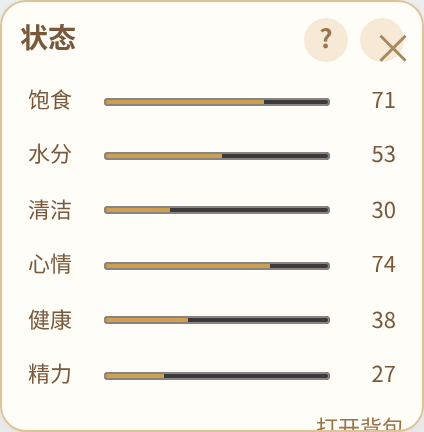
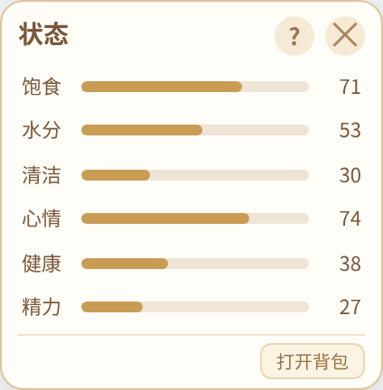
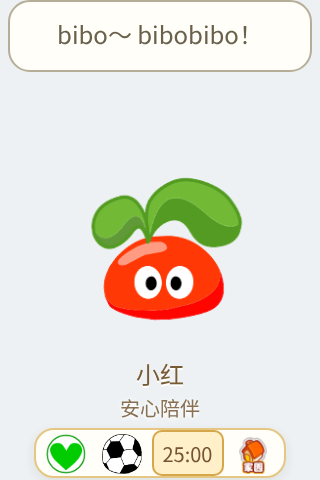

# 桌面状态与状态小窗预览

分支：`preview/desktop-status-ui`。接续窗口与玩耍修复，本轮仍为待确认预览。

拉姆的名字与状态在桌面持续显示。饥饿、口渴、清洁、健康、心情和精力不足会显示具体提醒；同时存在多个需求时并列显示，优先提示生病及更紧迫的需求。点状态文字打开状态小窗。睡着时保留名字，在下面显示“睡梦中 · 叫醒”，点它即可叫醒；上课、打工和外出也有对应状态。

状态小窗保持 212×216，桌宠基础窗口保持 160×240。六条进度条改为浅色圆角轨道；重新分配行距和底部空间，完整显示“打开背包”。帮助内容单独滚动，底部按钮始终保留。

| 修复前 | 修复后 |
| --- | --- |
|  |  |

快捷栏为两行文字留出空间。计时进行时，数字显示在计时按钮内部，避免被窗口裁切或遮住状态文字。

验证：381 项业务测试及 122 项 Node 检查通过；浏览器在 1 倍、2 倍像素密度下完成截图和点击验证；Linux Electron 实际窗口通过；Windows 常规版和兼容版在 100%、125%、150% Chromium 模拟缩放下均通过真实应用界面检查。覆盖六条数值、底部边界、帮助/背包切换、常驻状态、睡眠叫醒、课程文字及计时位置。

[Windows 验收及截图附件](https://github.com/Vinci-217/mole-baby/actions/runs/40831825146)。截图附件需要登录 GitHub，本文图片可直接预览。验收的应用代码为 `318a8c2`；后续只提交本文档和截图。未创建 Release、版本标签或更新 latest 渠道。
