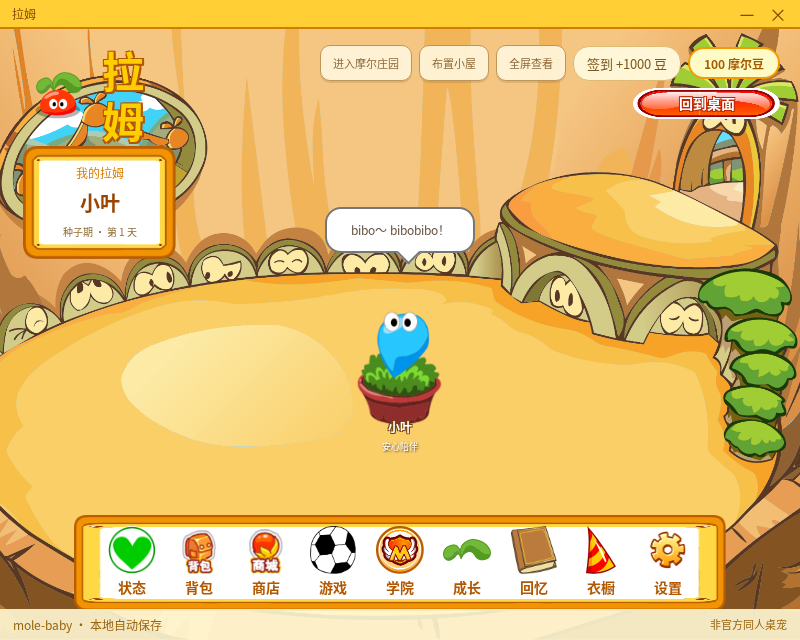
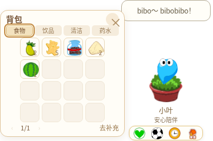

# 小屋缩放与横排背包 · v0.31.7

小屋可拖动四边或四角调整大小，正常最小尺寸 800×640；若屏幕可用区域更小，按实际工作区限制。聚焦窗口边缘后使用方向键按 16 像素调整，Shift 按 64 像素调整。尺寸保存到本地，全屏退出、回桌面再进小屋后恢复。

Windows 沿用既有透明、无边框、软件合成方式，使用界面内的边缘拖动控制，不在小屋和桌面之间切换原生 CanResize 样式。桌面拉姆仍为 160×240 的透明窗口，背包仍为 212×216 的小窗。

以下为真实 Linux Electron 37.10.3 测试窗口，未修改截图；物品数量使用隔离测试存档，用户实际内容以自己的背包为准。正式包还需经过 Windows 与 Mac 原生验收。

## 最小小屋窗口

## 桌面背包

食物、饮品、清洁、药水四项平行排列，直接点击即可切换，也可用左右方向键、Home、End。保留 4×4 正方格、数量、翻页和单击使用。分类切换不使用系统下拉菜单或原生悬浮提示窗口。

检查覆盖了：真实 OS 指针与 DIP 计算、键盘调整、全屏／桌面切换、保存的尺寸、四类对应物品、16 格正方形、紧凑小窗的标题／分类／格子／翻页控件无裁切，以及分类键盘导航。原有用品、动画、侧边收纳、课程、小屋布置与更新确认另行运行完整回归。
