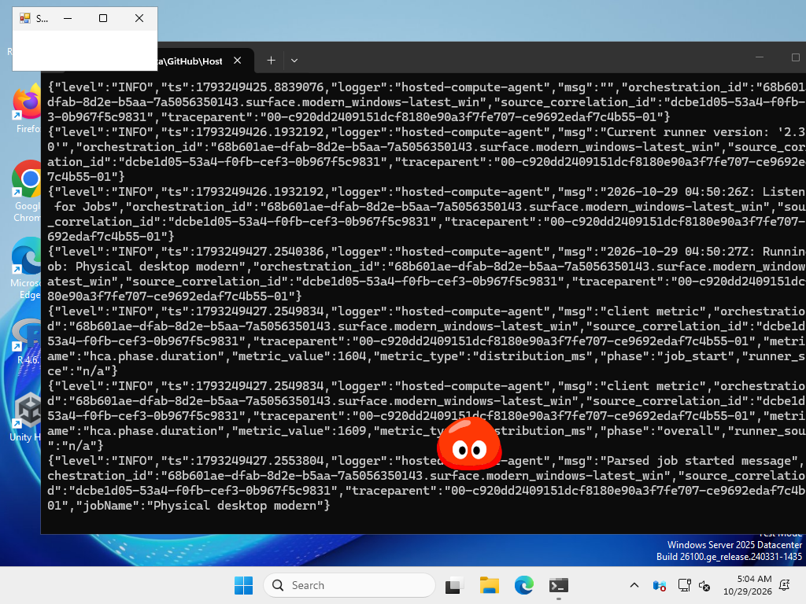
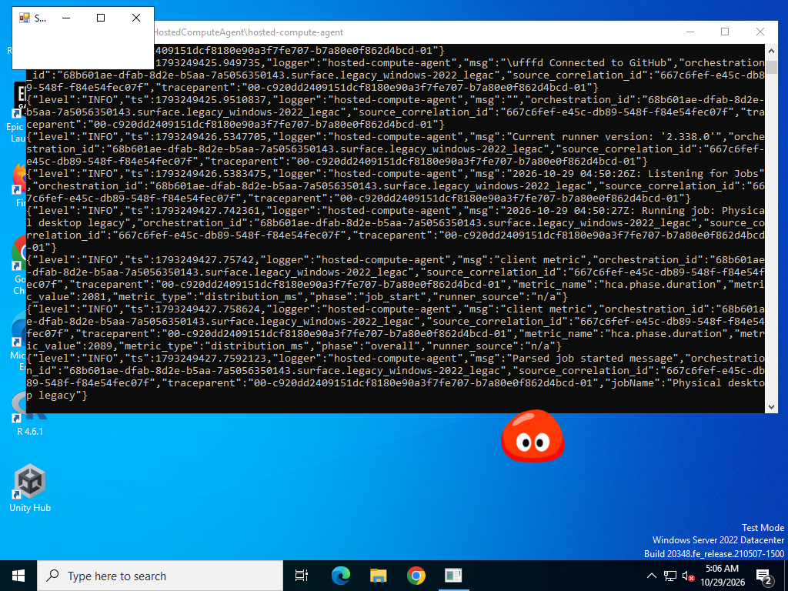
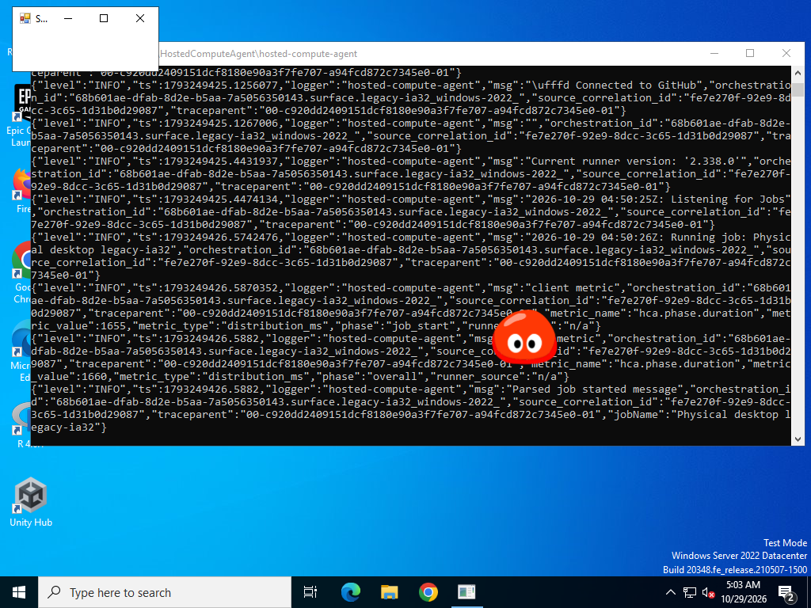

# Windows 窗口与玩耍修复

本轮修复已获发布授权，纳入 v0.31.4。正式安装包请到[最新正式版](https://github.com/Vinci-217/mole-baby/releases/latest)下载。下方保留 `preview/windows-surface-play` 的复现、测量和验收历史；预览附件有保留期限。

[已通过的成品验收与 Windows 预览下载](https://github.com/Vinci-217/mole-baby/actions/runs/40819913152)。在页面底部 Artifacts 中选择 `mole-baby-preview-windows`（64 位 Windows 10/11）、`mole-baby-preview-legacy-x64` 或 `mole-baby-preview-legacy-ia32`。完整解压；GitHub 的 Artifacts 下载需要登录，保留 7 天。

预览可使用独立存档。在解压目录的 PowerShell 中运行以下命令，使用新的测试目录；兼容版把文件名换成 `拉姆兼容版.exe`。也可以在小屋设置导入原来的 JSON 存档。

```powershell
& '.\拉姆.exe' --user-data-dir="$env:LOCALAPPDATA\mole-baby-surface-preview"
```

## 玩耍按钮

复现了两个问题：自主看书被误判为不可打断的互动；状态不足时原版按钮置灰却没有说明。现在自主小动作可让位给手动操作，真实计时、照料及有奖励的表演仍会完成后再允许下一次操作。禁用原因和“查看状态”直接显示在原版动作区。


`npm run build` 后运行 `node scripts/play-menu-regression.cjs`，用实际生产页面检查以上两种情形，并在初级、中级、高级和经典三叶超拉上逐一点击全部 10 种原版玩耍动作。还逐一购买 28 件补齐的用品，核对背包持久化、实际摩尔豆总扣款，并逐件使用，检查扣除一份库存、载入对应原片及真实状态增量。原包缺失的阶段不冒充有原片，测试用品时选用实际提供的阶段。

[已通过的 40 次玩耍及 28 件用品使用记录](previews/windows-surface-play/verified-entries.json)。业务单元测试 378 项、Node 检查 122 项也已通过；它们不能替代下述 Windows 物理桌面验证。

## 窗口尺寸与白条排查

现象：从小屋回到桌面后出现白条，逐渐变长，再进出小屋后重置。条上无可辨认的文字。

在真实 Windows 桌面复现了一个相关的尺寸累积错误：125% 和 150% 的 Chromium 缩放下，调用 `setPosition` 会将系统向外取整的窗口尺寸带到下一次移动。每次移动都会继续加宽；Electron 22 兼容版还会加高。回小屋重新设置尺寸会重置这个累积值。

例如，150% 缩放下的一组 75 秒观察，35.7.5 从约 160×240 增长到 188×301，22.3.27 增长到 200×287；只换到 37.10.3 仍增长到 168×243。三组包含不同的随机走动轨迹，不能用于比较运行时的增长速度；它们共同证明仅升级运行时不能修复尺寸反馈。[原始测量摘要](previews/windows-surface-play/baseline-measurements.json)同时保留白条检测值：云端这些旧代码样本的白条计数也是 0，不能冒称已重现用户所见白条。

修复在 Windows 的拖动、自动走动、边缘收纳移动中明确传入原定的 160×240 逻辑尺寸，不再把系统返回的取整尺寸反馈到下一帧。macOS 和 Linux 保留各自的移动路径。

另外，Electron 上游有已确认的透明窗口失焦后出现原生标题栏问题：[issue 47946](https://github.com/electron/electron/issues/47946)，修复见 [PR 47386](https://github.com/electron/electron/pull/47386)。已经对照原 35.7.5、包含该补丁的 37.10.3 和固定 22.3.27 的兼容版。当前修复预览固定现代运行时为 37.10.3，老系统兼容包继续使用 22.3.27。

## 验证方法与范围

`scripts/windows-surface-repro.cjs` 启动真实打包程序，分别使用 100%、125%、150% Chromium 缩放。每组包含普通小屋返回、全屏小屋返回、外部原生程序获得焦点、自动走动、定时观察和移动后的尺寸检查。其中一组连续观察三分钟。

通过 Win32 `CopyFromScreen` 截取物理桌面，与启动前桌面及页面透明区域对照；同时记录 HWND 样式、真实边界、可见附属窗口、焦点和 Electron 版本。单独创建一个不属于应用的原生白条作为正向探针，要求检测器确实能检出，避免把只检查页面透明度当作没有白条。观察期间不反复调用页面截图，以免强制重绘清掉残留。

已验收的应用代码为 [`2e35329807624d93950ad6dcf791b724ae74555d`](https://github.com/Vinci-217/mole-baby/commit/2e35329807624d93950ad6dcf791b724ae74555d)。随后只补充测试脚本、日志标签和审阅文档。

| 成品 | 实际运行时 | 完整交互回归 | Windows 桌面长时检查 |
| --- | --- | --- | --- |
| Windows 常规 x64 | Electron 37.10.3 / x64 | 通过 | 通过 |
| Windows 兼容 x64 | Electron 22.3.27 / x64 | 通过 | 通过 |
| Windows 兼容 ia32 | Electron 22.3.27 / ia32 | 通过 | 通过 |
| Apple 芯片 Mac | Electron 37.10.3 / arm64 | 通过 | — |
| Intel Mac | Electron 37.10.3 / x64 | 通过 | — |

三个 Windows 成品的边界在 160–161×240–241 逻辑像素之间，随位置出现单像素取整，没有逐次累积。保留的每组记录均检出正向白条探针，正常捕获的白条像素计数为 0。还验证了拖拽、四边收纳、用品与玩耍、课程、窗口切换、托盘及更新提示。两个 Mac 架构额外实际获取了公开更新、下载并校验 DMG，未替换应用。

[修复后窗口测量摘要](previews/windows-surface-play/fixed-measurements.json) · [五平台运行时与回执](previews/windows-surface-play/native-verification.json)。单个平台 Git 回执保留末尾 64 KB 日志；完整测量 JSON 与截图在该次 Actions 的诊断附件内。

以下为原样捕获的云端 Windows 桌面。左上角小窗用于让另一个原生程序获取焦点，终端是云端桌面背景；拉姆位于中间或下方。





云端使用 Windows Server 2025/2022，Electron 报告 GPU 合成为软件路径，HWND DPI 为 96；Chromium 强制缩放不能等同于实际多显示器 DPI 切换。没有完成 Windows 7/8 或用户显卡的实机验证。尺寸累积已经实测并修复，用户所见白条是否同源仍需以实际桌面复测为准，不能仅凭干净的页面截图宣称根治。
