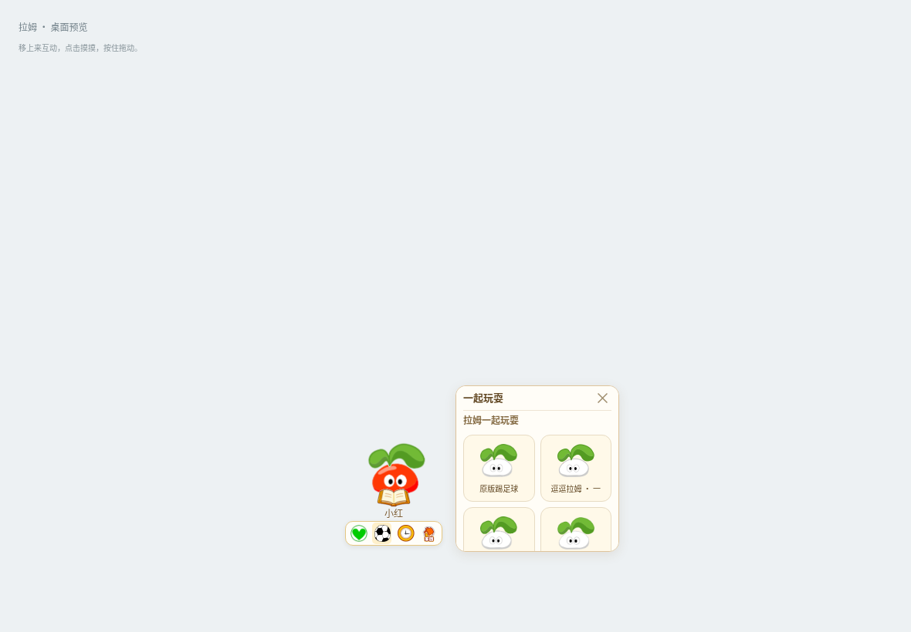
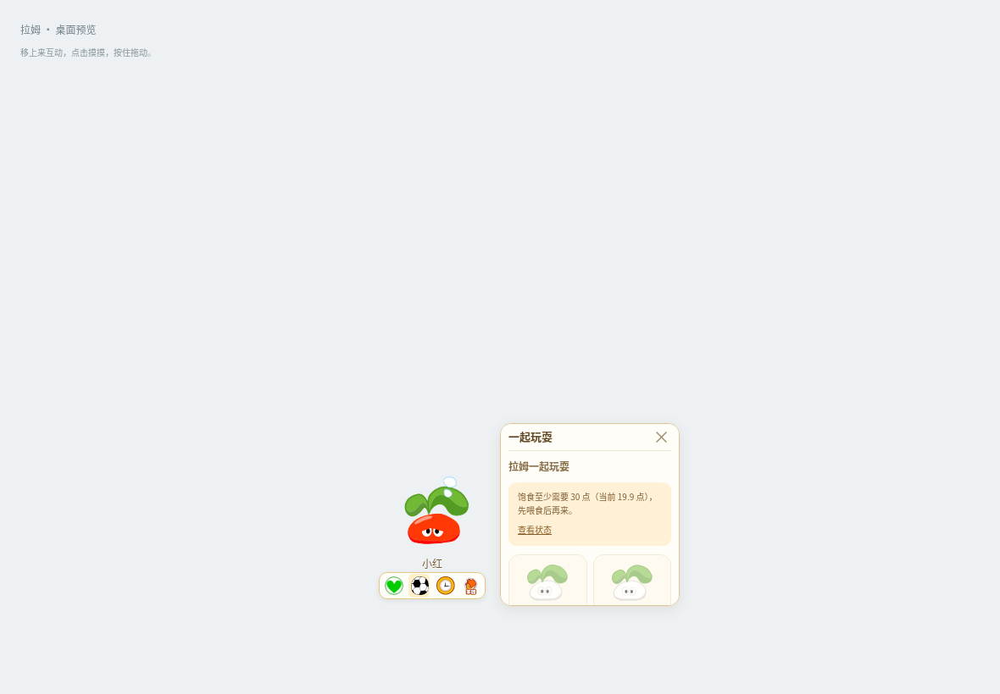

# Windows 白条与玩耍修复预览

分支：`preview/windows-surface-play`。这是待审阅的修复，不更新正式 Release 或自动更新渠道。

## 玩耍按钮

复现了两个问题：自主看书被误判为不可打断的互动；状态不足时原版按钮置灰却没有说明。现在自主小动作可让位给手动操作，真实计时、照料及有奖励的表演仍会完成后再允许下一次操作。禁用原因和“查看状态”直接显示在原版动作区。

`node scripts/play-menu-regression.cjs` 用实际生产页面检查以上两种情形，并播放初级、中级、高级和经典三叶超拉的原片。还逐一购买 28 件新增用品，核对背包持久化及实际摩尔豆总扣款。

## 窗口尺寸与白条排查

现象：从小屋回到桌面后出现白条，逐渐变长，再进出小屋后重置。条上无可辨认的文字。

在真实 Windows 桌面复现了一个相关的尺寸累积错误：125% 和 150% 的 Chromium 缩放下，调用 `setPosition` 会将系统向外取整的窗口尺寸带到下一次移动。每次移动都会继续加宽；Electron 22 兼容版还会加高。回小屋重新设置尺寸会重置这个累积值。

修复在 Windows 的拖动、自动走动、边缘收纳移动中明确传入原定的 160×240 逻辑尺寸，不再把系统返回的取整尺寸反馈到下一帧。macOS 和 Linux 保留各自的移动路径。

另外，Electron 上游有已确认的透明窗口失焦后出现原生标题栏问题：[issue 47946](https://github.com/electron/electron/issues/47946)，修复见 [PR 47386](https://github.com/electron/electron/pull/47386)。预览对照会同时检查原 35.7.5、包含该补丁的 37.10.3 和固定 22.3.27 的兼容版。

## 验证方法与范围

`scripts/windows-surface-repro.cjs` 启动真实打包程序，分别使用 100%、125%、150% Chromium 缩放。每组包含普通小屋返回、全屏小屋返回、外部原生程序获得焦点、自动走动、定时观察和移动后的尺寸检查。其中一组连续观察三分钟。

通过 Win32 `CopyFromScreen` 截取物理桌面，与启动前桌面及页面透明区域对照；同时记录 HWND 样式、真实边界、可见附属窗口、焦点和 Electron 版本。单独创建一个不属于应用的原生白条作为正向探针，要求检测器确实能检出，避免把只检查页面透明度当作没有白条。观察期间不反复调用页面截图，以免强制重绘清掉残留。

云端 Windows Server 2025/2022 的显示驱动和用户的电脑不同；Chromium 强制缩放也不能等同于实际多显示器 DPI 切换。尺寸累积已经实测，用户所见白条是否同源仍需以实际桌面复测为准，不能仅凭干净的页面截图宣称根治。
