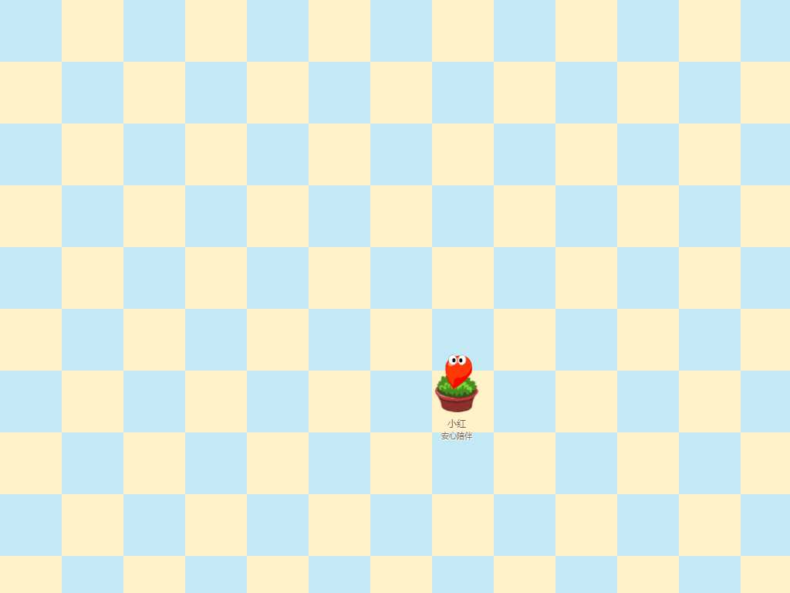
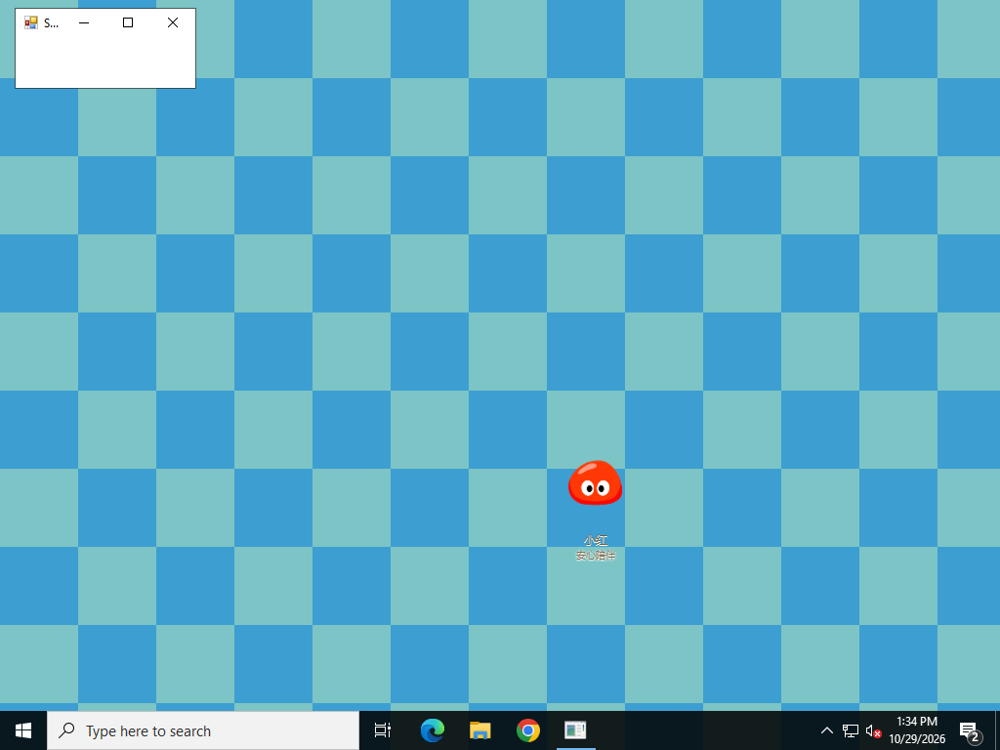
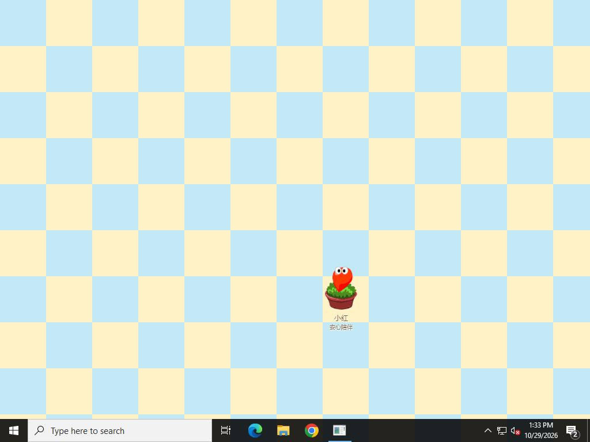

# Windows 拉姆黑色背景修复预览

本轮处理 Windows 上宠物周围持续出现黑色矩形的反馈。改动位于 `preview/windows-transparent-background`，尚未发版；正式 v0.31.4 不包含本修订。

## 修复候选

窗口和桌面页面原本都已设置为透明。照片中角色和名字能够正常绘制，不能仅据照片断言是某一个显卡驱动，但 Windows 常规版与兼容版的绘制路径有明确差异：常规版默认允许 GPU 合成，兼容版已采用软件绘制。

本次在创建窗口、Electron 就绪之前，让两个 Windows 版本都调用 `app.disableHardwareAcceleration()` 并带上 `disable-gpu`，为透明 Canvas2D 桌宠选择兼容绘制路径。保留软件栅格化后备；仅旧 Chromium 的兼容版保留原有 GPU 服务沙箱规避，常规版不关闭该沙箱，页面 sandbox/context isolation 不变。Mac/Linux 的绘制设置不变。

没有更改窗口位置算法、宠物存档、领养或成长数据，也没有用不透明背景图片掩盖问题。此处是显示兼容修复，尚不能把它说成已经证实了反馈者电脑上的唯一故障原因。

## 验证方法

[Windows 原生构建与测量](https://github.com/Vinci-217/mole-baby/actions/workflows/windows-transparent-background.yml)会测试常规 x64、兼容 x64 和兼容 ia32。每个版本使用真正的打包应用和隔离存档，检查：

- 已领养的种子拉姆从全新进程启动，而非只从领养界面进入桌面。
- 浅色、蓝色两套原生桌面底板，检查拉姆周围是否真实透出下面的颜色。
- 普通小屋、全屏小屋返回桌面、外部原生程序获得焦点、隐藏再显示、自动走动和移动。
- 100%、125%、150% Chromium 缩放；其中一段连续观察一分钟。
- 使用 Windows `CopyFromScreen` 的物理桌面图，与页面透明像素及事先采集的底板比较；排除角色整个动画区域，避免采样时刻差造成误报。
- 额外放置一个真实黑色 HWND 和一条白色 HWND 作为阳性对照，确认检测确实看得见 DOM 之外的黑块和白条。阳性对照属于测试注入，不能当成重现了用户故障。

常规版还会在同一台测试机运行**未改动的正式 v0.31.4 ZIP**，先校验原包 SHA-256，再测量原有路径。若该基线没有黑底，报告必须明确“未复现”，不能把正常截图冒充修复前后的对比。

本地完整测试已通过：381 项业务测试、143 项 Node 测试。此前预览 Node 测试的命名与 Vitest 自动发现冲突，已统一改为 `node-test` 并接入主检查入口，没有跳过或删除断言。

## 原生测试结果 · 2026-10-29

[本轮原生验收已全部通过](https://github.com/Vinci-217/mole-baby/actions/runs/40882268188)，构建与测量源代码为 `dcdd1337c9ef9a8bd6e61d3a2822fe9fb3148a67`。后续提交仅整理本文和测试凭据，不改变已测程序。

| 打包版本 | 实际 Electron | Windows 测试机 | 桌面采样 | 异常黑像素 / 白条最长连续像素 |
| --- | --- | --- | --- | --- |
| 常规 x64 | 37.10.3 | Server 2025 · 10.0.26100 | 28 | 0 / 0 |
| 兼容 x64 | 22.3.27 | Server 2022 · 10.0.20348 | 28 | 0 / 0 |
| 兼容 ia32 | 22.3.27 | Server 2022 · 10.0.20348 | 28 | 0 / 0 |

84 次候选包采样中，每次都采集了至少 25,350 个角色以外的透明区域像素，与底板颜色完全匹配，且真正的角色身体始终可见。三种缩放下都确认实际 `gpu_compositing` 为 `disabled_software`，并非只检查了启动参数。黑块、白条的原生 HWND 阳性对照也均被检测到。完整打包应用回归同时通过，覆盖用品、玩耍、侧边互动、小屋、托盘及更新界面等现有流程。

**原故障未在云端复现。** 同机运行经 SHA-256 校验的正式 v0.31.4，28 次基线采样也未出现黑底。该虚拟显示环境中，旧包虽然没有 `disable-gpu` 参数，但 Chromium 已自行回退到软件合成。因此，这个基线不能证明真实硬件上的 GPU 故障已消失；本次修订的作用是让 Windows 启动时主动采用兼容路径，而不再依赖驱动自动回退。反馈者暂时无法参与测试，受影响设备上的最终效果仍待确认。

[完整测量、运行环境与预览包记录](../research/windows-transparency-2026-10-29.json)。Actions 的 `transparency-evidence-*` 附件保留原始物理截图、逐次测量、阳性对照和完整日志。

以下是未修改的物理桌面截图。棋盘格是位于应用下方的原生测试底板；左上角的小窗用于验证切换到其他程序时的显示情况，不属于拉姆界面。

常规 x64：已领养种子拉姆冷启动。

兼容 x64：从全屏小屋返回桌面，外部程序获得焦点，拉姆移动后。

兼容 ia32：已领养种子拉姆冷启动。

## 预览试用

以下是本轮实际验收的完整解压版，需要登录 GitHub，保留至 **2026-11-05**；不是新的正式安装包。

| 使用系统 | 预览下载 |
| --- | --- |
| Windows 10/11 · 64 位 | [常规 x64](https://github.com/Vinci-217/mole-baby/actions/runs/40882268188/artifacts/12901153999) |
| 老系统 · 64 位 | [兼容 x64](https://github.com/Vinci-217/mole-baby/actions/runs/40882268188/artifacts/12901583309) |
| 32 位 Windows | [兼容 ia32](https://github.com/Vinci-217/mole-baby/actions/runs/40882268188/artifacts/12901732764) |

按系统选择 `windows`、`legacy-x64` 或 `legacy-ia32`，先在原版设置导出存档，再从托盘退出原程序。完整解压下载内容，打开其中的 `拉姆.exe` 或 `拉姆兼容版.exe`；无需自己添加 `--disable-gpu`。[包内说明](WINDOWS-TRANSPARENCY-PREVIEW.txt)。

云端 Windows Server 2025/2022 的虚拟显示设备不能覆盖真实显卡、驱动、远程桌面以及 Windows 7/8 的组合；强制 Chromium 缩放也不等同于切换真实多显示器 DPI。反馈者暂时无法参与验证，因此仍需在受影响电脑上试用后确认效果。自动更新 latest、正式 Release 和版本号均未改变。
