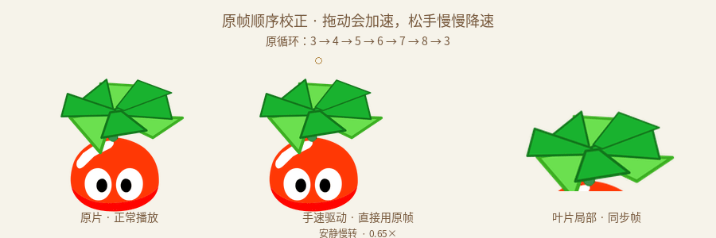
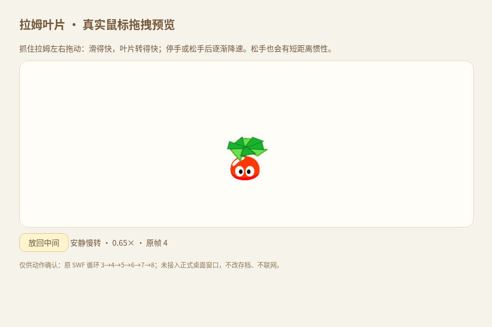
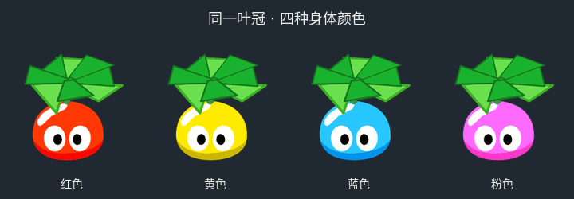
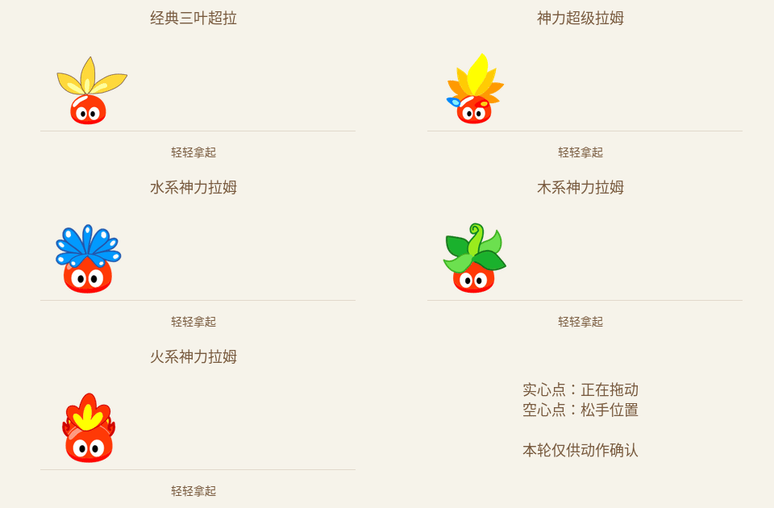

# 叶片旋转与松手惯性 · v2 帧脚本校正 · 待确认

本轮只制作动作预览，没有接入正式应用、修改版本号或发布更新。

上一轮 v1 的叶片补间已撤回。本次重新核对了 SWF 的绑定类和帧脚本，再导出正确的原帧循环。下面均为新版预览。

## 高级拉姆的风扇叶片

左：原片按正确循环、正常速度播放；中：鼠标拖动加速、松手逐渐降速；右：同一时刻的叶片局部。



上一版漏读了 `lamubone_fla.Timeline_315` 的帧脚本：第一帧 `stop()` 并登记 `petBone2`，第九帧会 `gotoAndPlay(3)`。启动后的循环应为 **3→4→5→6→7→8→3**。原来把 1→8 当成循环并按 1/5/7 进行补间，重复了循环之外的停留，也改变了原来的叶片变化。

本次取消人工叶片补间，保留六个原时间帧。身体、眼睛、叶柄和八片叶子从同一源帧输出，按 SWF 的实际 depth 排序。第九帧执行跳转，不输出为可见空白帧。原片只有三组不同的叶片显示姿态，六帧包含原停留；不把 GIF 采样帧说成新增原画，也不把一次六帧循环当成已经测得的 360 度转动。

上一版拖动预览还用了固定转速。本次改为手速驱动同一正向播放时钟：拖得快时平滑加速，停止或松手后慢慢降速，左右换向不重置进度、不倒放原时间轴。左右原图自身包含镜像，身体朝向保留原片。

[查看完整正面透明帧序列](rotor-frame-sequence.png) · [原帧与脚本来源记录](rotor-source.json)

[查看核对到的原帧脚本](../../../research/references/original-flight/frame-scripts/lamubone_fla/Timeline_315.as) · [手速、源帧和连续进度记录](rotor-motion-traces.json)

另用 JPEXS 直接渲染原 SWF 的嵌套帧，独立于候选图集的展开逻辑核对三组叶片姿态；对应帧的叶片轮廓重合率约 96.8%～98.1%，错位帧明显更低。[直接渲染核对记录](direct-source-check.json) · [直接导出的原帧](direct-source-reference.png)。比较全段使用同一比例和位置；JPEXS 不执行 AS3，循环范围来自上面的帧脚本，不能把本检查说成运行了完整原客户端。桌宠不带原片的地面影子。

## 可以用鼠标实际拖动

[下载独立交互预览 HTML](interactive.html)：下载原始文件后用浏览器打开，抓住拉姆左右拖动即可。文件内含原帧图片和逻辑，无需安装软件、不改存档，不请求网络资源。



实际鼠标测试已验证加速、左右换向、松手续转和惯性、降速、减少动态效果；[浏览器检查记录](browser-checks.json)。云端 Chromium 禁止 `file:` 导航，自动检查通过直接载入该自包含 HTML 完成，没有更改浏览器策略；本测试不等于已验证 Windows 原生桌面窗口。



## 五个成长阶段的松手惯性

每段先向右拖动并松手，再向左拖动并松手。位移不是在原位置晃动：空心圆停住以后，角色仍在移动。


- 种子：连花盆短距离滑行，盆不翻滚；不因此获得自主走动能力。
- 初级、中级：使用现有黏滞身体帧，中级保留已绑定的双叶。水平拖拽不增加上下弹跳。
- 高级、超级拉姆：转向移动方向，滑行稍长，减速后回到正面。
- 慢慢放下或先停住再松手，规划为不触发甩出；减少动态效果开启时不滑行。

这套惯性是新的桌宠交互编排，不是原游戏的同名完整动作。所有 GIF 都是逐帧合成后导出。正式接入时需要移动原生窗口；不能只在 160×240 窗口内平移角色，否则仍会裁切。

## 最高阶段的五种形态



单独查看：

| 形态 | GIF |
| --- | --- |
| 种子 | [查看](throw-seed.gif) |
| 初级 | [查看](throw-junior.gif) |
| 中级双叶 | [查看](throw-middle.gif) |
| 高级风扇叶 | [查看](throw-senior.gif) |
| 经典三叶超拉 | [查看](throw-classic.gif) |
| 神力超级拉姆 | [查看](throw-super.gif) |
| 水系 | [查看](throw-water.gif) |
| 木系 | [查看](throw-wood.gif) |
| 火系 | [查看](throw-fire.gif) |

## 来源、验证和范围

公开原件：[Miigon/RecMoleRes 的固定版本](https://github.com/Miigon/RecMoleRes/blob/7a6d6b3c7037a85afb28ad6abd4d7f4adfddb5ff/root/resource/NPC/lamubone.swf)。本轮实际重新下载并比对，SHA-256 为 `01abf65f3e8db098068a830268bd7a7cefefc1edc93a44565788783d23f8a0cf`，与仓库原件一致。它是社区保存的游戏资源，不把社区档案称为官方新发布素材。没有核实文件的首次发布年份。

高级主 Sprite 为 1777，叶片/叶柄子 Sprite 为 1538，绑定类为 `lamubone_fla.Timeline_315`。身体子 Sprite 1534 的 `Timeline_314` 也有第九帧跳回第三帧的脚本。原脚本由 JPEXS 反编译并记录来源散列，当前六帧循环依据这些脚本确定。其它形态继续使用仓库已记录来源的身体、双叶绑定、花盆和飞行图集；没有生成替代角色或新增黑色外描边。

检查入口：[检查回执](checks.json)、[完整位移轨迹](motion-traces.json)、[松手关键帧](release-contact-sheet.png)。原始逐帧 PNG 留在本地工作目录，可用导出脚本重新生成；GIF 和叶片透明图集随预览分支保留，不加入安装包。

```sh
node --test scripts/previews/throw-motion.node-test.mjs
node --test scripts/previews/source-rotor-motion.node-test.mjs
python scripts/art/review-rotor-throw.py --exporter /path/to/SourceExporter-wrapper
node scripts/previews/check-rotor-browser.cjs
```

导出器使用仓库 `scripts/art/SourceExporter.java` 和 JPEXS 库；包装器把参数原样传给 Java 类。Python 依赖沿用 `scripts/art/requirements.txt`，GIF 编码使用 FFmpeg。只重做 GIF 时可以加 `--reuse-export`。

当前预览为无装扮、红色身体；风扇另核对四种基础配色和深色背景。原生窗口移动、屏幕边界吸附、多屏 DPI、衣服跟随、实际 Windows/Mac 动作和不同投掷方向仍需在确认动作后接入验证。

8 项惯性/叶片时钟测试通过，另完成实际鼠标测试。实际 PNG 像素检查中，初级和中级水平拖拽的红色身体底边始终为同一行（153），没有新增上下跳跃。四种配色的眼睛、叶片等非身体遮罩区域保持原 RGBA。透明预览图集为 1152×624，包含三个朝向各六帧。

Windows 黑框的反馈按“可能持续存在”记录，用户暂未提供准确系统/软件版本。当前没有在用户的系统上复现，因此本轮不声称修好了黑框。代码检查确认桌面窗口与页面背景均设为透明；常规 Windows 版使用 GPU 合成，兼容版已使用软件绘制，后续需验证持续透明合成异常，不按普通启动闪屏结案。
