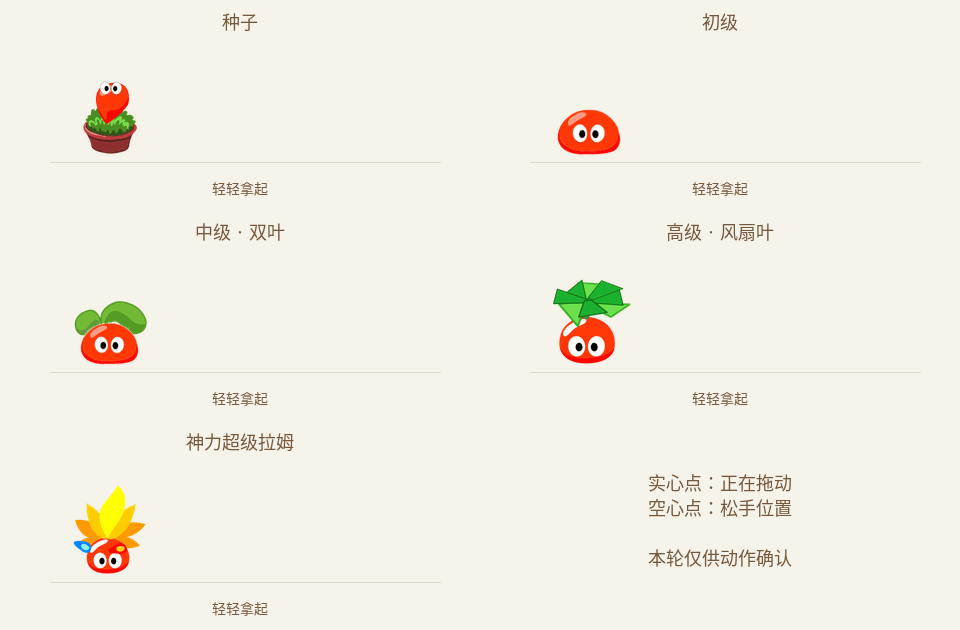

# 叶片旋转与松手惯性 · 待确认

本轮只制作动作预览，没有接入正式应用、修改版本号或发布更新。

先看风扇叶片，再看松手后的位移。惯性图中的实心圆表示正在拖动，空心圆停在松手的位置；拉姆会继续沿原方向移动，逐渐减速。

## 高级拉姆的风扇叶片

左：当前正式版；中：公开 SWF 的原时序；右：本轮候选。


当前正式版把一张叶冠图进行整冠投影旋转。候选改为使用原来的八片叶子、叶柄、遮挡顺序和原放置关键帧，逐片补间，再离线导出透明帧序列。身体、眼睛和嘴没有重画。

候选有每方向 24 个合成姿态，单圈 0.4 秒。它依据原片的 3 组叶片姿态进行补间，不是声称新增了 24 张官方原画。公开 SWF 原可见周期为 8 个时间帧，原片停留和候选补间分别展示，不能把原 SWF 导出中的影子控制周期当成叶片周期。

[查看完整正面透明帧序列](rotor-frame-sequence.png) · [原件及补间来源记录](rotor-source.json)


## 五个成长阶段的松手惯性

每段先向右拖动并松手，再向左拖动并松手。位移不是在原位置晃动：空心圆停住以后，角色仍在移动。



- 种子：连花盆短距离滑行，盆不翻滚；不因此获得自主走动能力。
- 初级、中级：使用现有黏滞身体帧，中级保留已绑定的双叶。水平拖拽不增加上下弹跳。
- 高级、超级拉姆：转向移动方向，滑行稍长，减速后回到正面。
- 慢慢放下或先停住再松手，规划为不触发甩出；减少动态效果开启时不滑行。

这套惯性是新的桌宠交互编排，不是原游戏的同名完整动作。所有 GIF 都是逐帧合成后导出。正式接入时需要移动原生窗口；不能只在 160×240 窗口内平移角色，否则仍会裁切。

## 最高阶段的五种形态


单独查看：

| 形态 | GIF |
| --- | --- |
| 种子 | [查看](throw-seed.gif) |
| 初级 | [查看](throw-junior.gif) |
| 中级双叶 | [查看](throw-middle.gif) |
| 高级风扇叶 | [查看](throw-senior.gif) |
| 经典三叶超拉 | [查看](throw-classic.gif) |
| 神力超级拉姆 | [查看](throw-super.gif) |
| 水系 | [查看](throw-water.gif) |
| 木系 | [查看](throw-wood.gif) |
| 火系 | [查看](throw-fire.gif) |

## 来源、验证和范围

公开原件：[Miigon/RecMoleRes 的固定版本](https://github.com/Miigon/RecMoleRes/blob/7a6d6b3c7037a85afb28ad6abd4d7f4adfddb5ff/root/resource/NPC/lamubone.swf)。本轮实际重新下载并比对，SHA-256 为 `01abf65f3e8db098068a830268bd7a7cefefc1edc93a44565788783d23f8a0cf`，与仓库原件一致。它是社区保存的游戏资源，不把社区档案称为官方新发布素材。没有核实文件的首次发布年份。

高级主 Sprite 为 1777，叶片/叶柄子 Sprite 为 1538；本轮从原 SWF 重新导出。其它形态使用仓库已记录来源的身体、双叶绑定、花盆和飞行图集；没有生成替代角色或新增黑色外描边。

检查入口：[检查回执](checks.json)、[完整位移轨迹](motion-traces.json)、[松手关键帧](release-contact-sheet.png)。原始逐帧 PNG 留在本地工作目录，可用导出脚本重新生成；GIF 和叶片透明图集随预览分支保留，不加入安装包。

```sh
node --test scripts/previews/throw-motion.test.mjs
python scripts/art/review-rotor-throw.py --exporter /path/to/SourceExporter-wrapper
```

导出器使用仓库 `scripts/art/SourceExporter.java` 和 JPEXS 库；包装器把参数原样传给 Java 类。Python 依赖沿用 `scripts/art/requirements.txt`，GIF 编码使用 FFmpeg。只重做 GIF 时可以加 `--reuse-export`。

当前预览为无装扮、红色身体；风扇另核对四种基础配色和深色背景。原生窗口移动、屏幕边界吸附、多屏 DPI、衣服跟随、实际 Windows/Mac 动作和不同投掷方向仍需在确认动作后接入验证。

4 项惯性模型测试通过；实际 PNG 像素检查中，初级和中级水平拖拽的红色身体底边始终为同一行（153），没有新增上下跳跃。候选首帧与原片首帧 RGBA 完全一致，四种配色的眼睛、叶片等非身体遮罩区域保持原 RGBA。透明预览图集不超过 2048×2048。

Windows 黑框的反馈按“可能持续存在”记录，用户暂未提供准确系统/软件版本。当前没有在用户的系统上复现，因此本轮不声称修好了黑框。代码检查确认桌面窗口与页面背景均设为透明；常规 Windows 版使用 GPU 合成，兼容版已使用软件绘制，后续需验证持续透明合成异常，不按普通启动闪屏结案。
