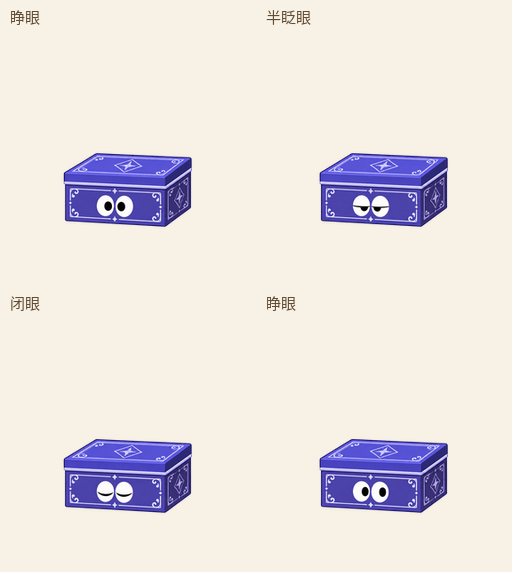
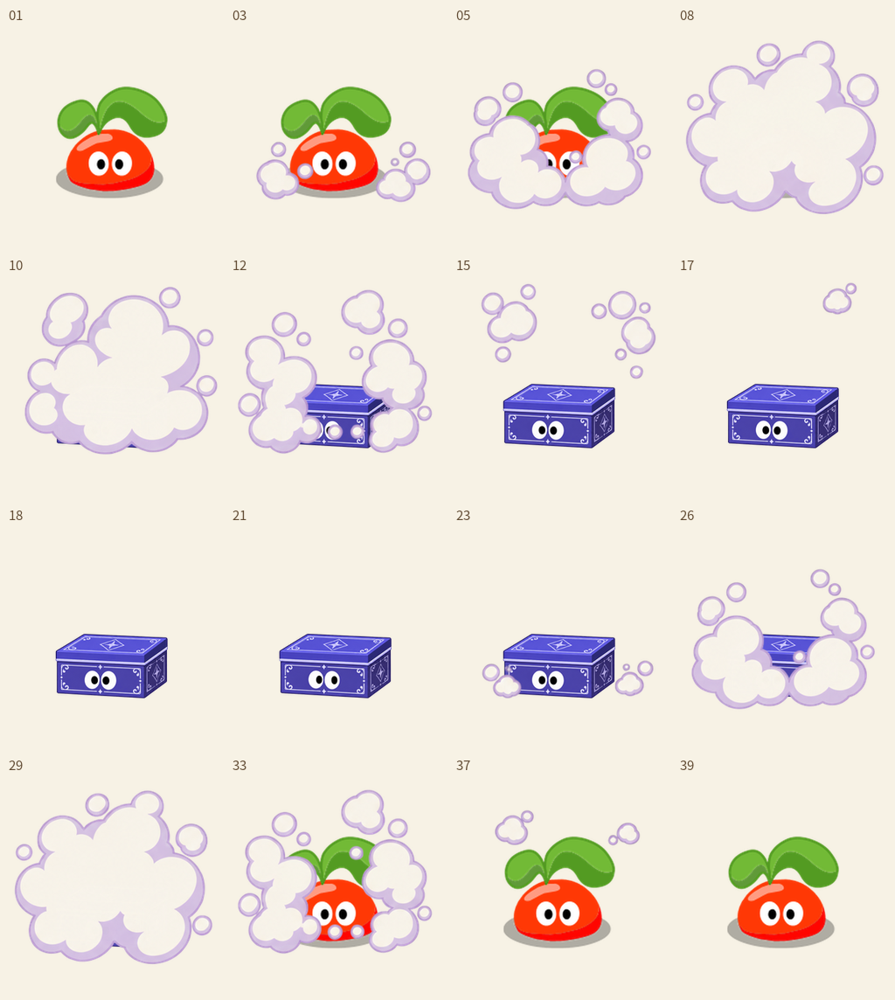
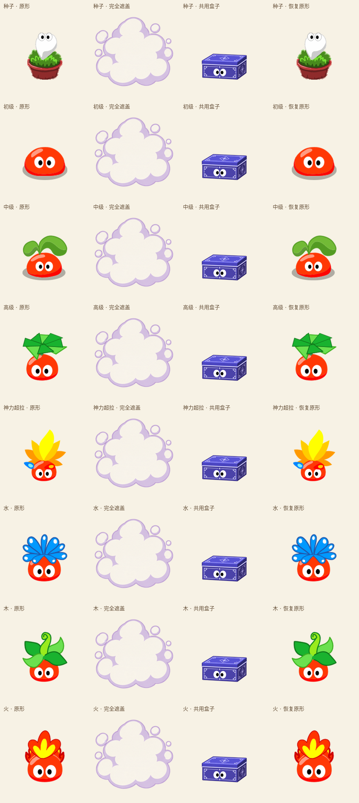

<!-- Generated by scripts/generate-asset-gallery.py. Do not edit. -->
# 拉姆动画和图片素材预览

这个分支用于审阅素材。这里列出分支中 **Git 已跟踪** 的 GIF、PNG、JPG、WebP、SVG 和图标文件；提交新素材后自动更新索引，也可以手动运行 `python scripts/generate-asset-gallery.py`。

## 最新预览：带银色纹样的蓝紫魔术盒 · 各形态共用

拉姆被烟雾遮住，变成带银色角花、边框与星形纹样的蓝紫魔术盒，再次冒烟后恢复原形。盒子只保留拉姆特色的眼睛。各阶段使用原版拉姆，共用 16 格烟雾和 4 格盒子表情，按 39 个时间片编排往返，尚未接入游戏。可查看[本轮说明、各形态动图与共用资源](../research/shared-magic-box-v45.md)。

### 完整往返 · 播放预览

[查看原图](../artifacts/magic-box-shared-v45/preview.gif)

### 蓝紫盒子的银色纹样

[查看原图](../artifacts/magic-box-shared-v45/box-poses.png)

### 完整往返的关键时点

[查看原图](../artifacts/magic-box-shared-v45/sequence.png)

### 各形态共用同一盒子与烟雾

[查看原图](../artifacts/magic-box-shared-v45/forms-overview.png)

## 先前预览：变身魔术和四系法术

变身魔术是新绘的候选：每种变身有 16 张图片模型绘制的姿态，首尾接原拉姆静帧，播放时序由程序编排；随机触发尚未接入游戏。四系法术仍使用原角色静态图和各 4 张新绘关键姿态。参考同系列游戏视觉，未核实《摩尔勇士》完整技能原帧，不能视为官方动作复刻。

### 变身魔术 · 小兔子

[打开 GIF 原文件](../artifacts/transform-v41/rabbit.gif)

### 变身魔术 · 小鸟

[打开 GIF 原文件](../artifacts/transform-v41/bird.gif)

### 变身魔术 · 小树

[打开 GIF 原文件](../artifacts/transform-v41/tree.gif)

### 旋风术

[打开 GIF 原文件](../artifacts/spell-preview/wind.gif)

### 流火术

[打开 GIF 原文件](../artifacts/spell-preview/fire.gif)

### 寒冰术

[打开 GIF 原文件](../artifacts/spell-preview/ice.gif)

### 陨石术

[打开 GIF 原文件](../artifacts/spell-preview/meteor.gif)

## 最近更新素材

- [artifacts/magic-box-shared-v45/box-poses.png](../artifacts/magic-box-shared-v45/box-poses.png)
- [artifacts/magic-box-shared-v45/forms-overview.png](../artifacts/magic-box-shared-v45/forms-overview.png)
- [artifacts/magic-box-shared-v45/forms/fire.gif](../artifacts/magic-box-shared-v45/forms/fire.gif)
- [artifacts/magic-box-shared-v45/forms/junior.gif](../artifacts/magic-box-shared-v45/forms/junior.gif)
- [artifacts/magic-box-shared-v45/forms/middle.gif](../artifacts/magic-box-shared-v45/forms/middle.gif)
- [artifacts/magic-box-shared-v45/forms/seed.gif](../artifacts/magic-box-shared-v45/forms/seed.gif)
- [artifacts/magic-box-shared-v45/forms/senior.gif](../artifacts/magic-box-shared-v45/forms/senior.gif)
- [artifacts/magic-box-shared-v45/forms/super.gif](../artifacts/magic-box-shared-v45/forms/super.gif)
- [artifacts/magic-box-shared-v45/forms/water.gif](../artifacts/magic-box-shared-v45/forms/water.gif)
- [artifacts/magic-box-shared-v45/forms/wood.gif](../artifacts/magic-box-shared-v45/forms/wood.gif)
- [artifacts/magic-box-shared-v45/preview-100px.gif](../artifacts/magic-box-shared-v45/preview-100px.gif)
- [artifacts/magic-box-shared-v45/preview.gif](../artifacts/magic-box-shared-v45/preview.gif)

## 全部素材分类

共 1038 个已跟踪图片文件。每页最多 24 项，按路径排序。

### 历史动画（64）

项目中已跟踪的其他 GIF，包括应用内动作、历史方案与原素材。

[第 1 页](pages/animations-001.md) · [第 2 页](pages/animations-002.md) · [第 3 页](pages/animations-003.md)

### 游戏图片素材（745）

游戏使用的角色、场景、道具、界面、图集与图标。

[第 1 页](pages/game-001.md) · [第 2 页](pages/game-002.md) · [第 3 页](pages/game-003.md) · [第 4 页](pages/game-004.md) · [第 5 页](pages/game-005.md) · [第 6 页](pages/game-006.md) · [第 7 页](pages/game-007.md) · [第 8 页](pages/game-008.md) · [第 9 页](pages/game-009.md) · [第 10 页](pages/game-010.md) · [第 11 页](pages/game-011.md) · [第 12 页](pages/game-012.md) · [第 13 页](pages/game-013.md) · [第 14 页](pages/game-014.md) · [第 15 页](pages/game-015.md) · [第 16 页](pages/game-016.md) · [第 17 页](pages/game-017.md) · [第 18 页](pages/game-018.md) · [第 19 页](pages/game-019.md) · [第 20 页](pages/game-020.md) · [第 21 页](pages/game-021.md) · [第 22 页](pages/game-022.md) · [第 23 页](pages/game-023.md) · [第 24 页](pages/game-024.md) · [第 25 页](pages/game-025.md) · [第 26 页](pages/game-026.md) · [第 27 页](pages/game-027.md) · [第 28 页](pages/game-028.md) · [第 29 页](pages/game-029.md) · [第 30 页](pages/game-030.md) · [第 31 页](pages/game-031.md) · [第 32 页](pages/game-032.md)

### 设计参考和其他图片（218）

设计参考板、历史预览与其他已跟踪图片；部分是精灵图，并非独立动画。

[第 1 页](pages/references-001.md) · [第 2 页](pages/references-002.md) · [第 3 页](pages/references-003.md) · [第 4 页](pages/references-004.md) · [第 5 页](pages/references-005.md) · [第 6 页](pages/references-006.md) · [第 7 页](pages/references-007.md) · [第 8 页](pages/references-008.md) · [第 9 页](pages/references-009.md) · [第 10 页](pages/references-010.md)

## 其他说明

[经典拉姆素材库及来源](../research/references/ramu-2008-2010/README.md) · [画风与动画审查](../skills/mole-classic-art/SKILL.md) · [项目现有动画说明](../README.md#全部现有动画全部展开)
