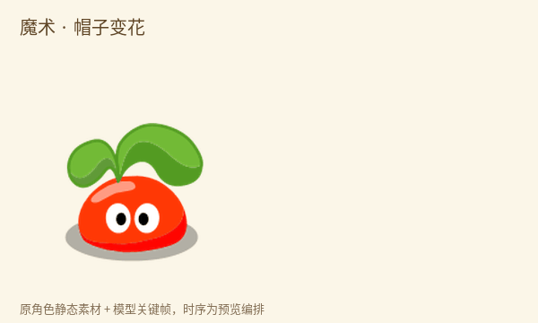
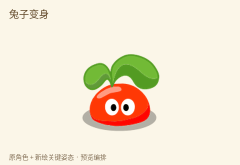

<!-- Generated by scripts/generate-asset-gallery.py. Do not edit. -->
# 历史动画 · 3/3

[返回素材首页](../README.md) · [上一页](animations-002.md)

本页 16 个文件，点击图片或「查看原图」可打开原文件。

### <code>artifacts/spell-preview/magic.gif</code>

[查看原图](../../artifacts/spell-preview/magic.gif)

### <code>artifacts/transform-preview/bird.gif</code>

[查看原图](../../artifacts/transform-preview/bird.gif)

### <code>artifacts/transform-preview/rabbit.gif</code>

[查看原图](../../artifacts/transform-preview/rabbit.gif)

### <code>artifacts/transform-preview/tree.gif</code>

[查看原图](../../artifacts/transform-preview/tree.gif)

### <code>artifacts/v21-original-actions.gif</code>

[查看原图](../../artifacts/v21-original-actions.gif)

### <code>artifacts/v22-moods-wardrobe.gif</code>

[查看原图](../../artifacts/v22-moods-wardrobe.gif)

### <code>artifacts/v29-bouncy-pull.gif</code>

[查看原图](../../artifacts/v29-bouncy-pull.gif)

### <code>artifacts/v30-preview/butterfly.gif</code>

[查看原图](../../artifacts/v30-preview/butterfly.gif)

### <code>artifacts/v30-preview/drag.gif</code>

[查看原图](../../artifacts/v30-preview/drag.gif)

### <code>artifacts/v30-preview/move.gif</code>

[查看原图](../../artifacts/v30-preview/move.gif)

### <code>artifacts/v30-preview/pet.gif</code>

[查看原图](../../artifacts/v30-preview/pet.gif)

### <code>artifacts/v36-nojump/original-vs-grounded.gif</code>

[查看原图](../../artifacts/v36-nojump/original-vs-grounded.gif)

### <code>artifacts/v37-bound/bound-sequence.gif</code>

[查看原图](../../artifacts/v37-bound/bound-sequence.gif)

### <code>artifacts/v38-school/crown/bound-sequence.gif</code>

[查看原图](../../artifacts/v38-school/crown/bound-sequence.gif)

### <code>public/assets/original/seed/source-motion.gif</code>

[查看原图](../../public/assets/original/seed/source-motion.gif)

### <code>research/references/ramu-2008-2010/images/source-motion.gif</code>

[查看原图](../../research/references/ramu-2008-2010/images/source-motion.gif)

[返回素材首页](../README.md) · [上一页](animations-002.md)
