<!-- Generated by scripts/generate-asset-gallery.py. Do not edit. -->
# 游戏图片素材 · 3/32

[返回素材首页](../README.md) · [上一页](game-002.md) · [下一页](game-004.md)

本页 24 个文件，点击图片或「查看原图」可打开原文件。

### <code>public/assets/generated/v12-turning-page.png</code>

<a href="../../public/assets/generated/v12-turning-page.png">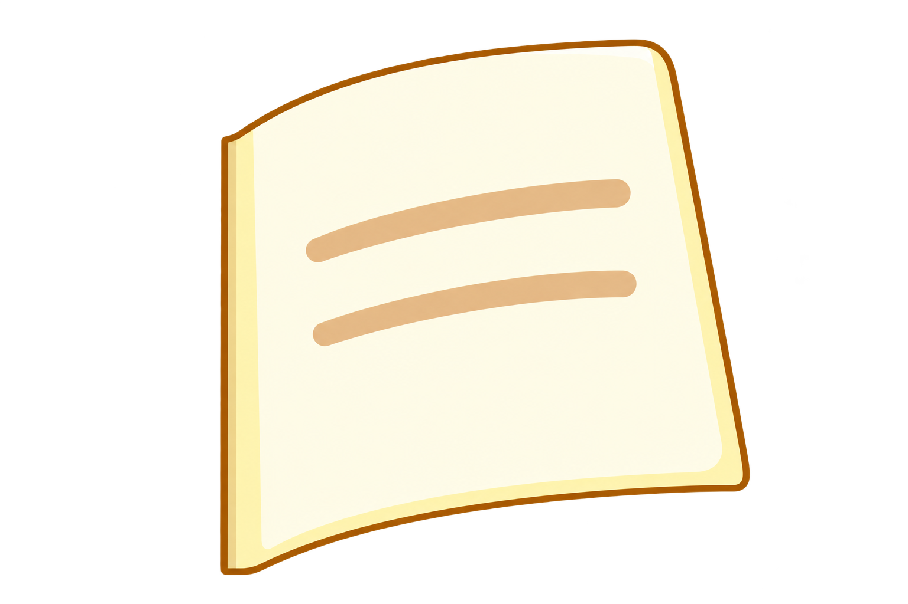</a>

[查看原图](../../public/assets/generated/v12-turning-page.png)

### <code>public/assets/generated/v15-butterfly.png</code>

<a href="../../public/assets/generated/v15-butterfly.png">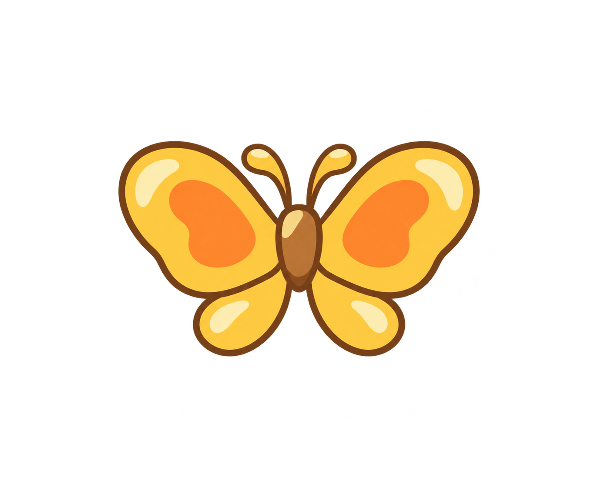</a>

[查看原图](../../public/assets/generated/v15-butterfly.png)

### <code>public/assets/generated/v18-berry-picnic.png</code>

<a href="../../public/assets/generated/v18-berry-picnic.png">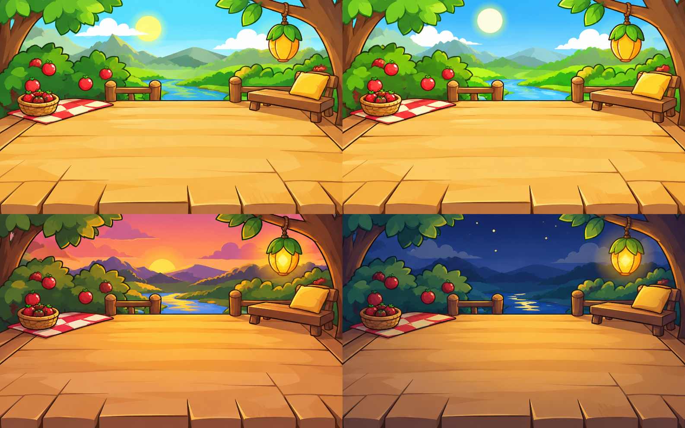</a>

[查看原图](../../public/assets/generated/v18-berry-picnic.png)

### <code>public/assets/generated/v18-seashell-cottage.png</code>

<a href="../../public/assets/generated/v18-seashell-cottage.png">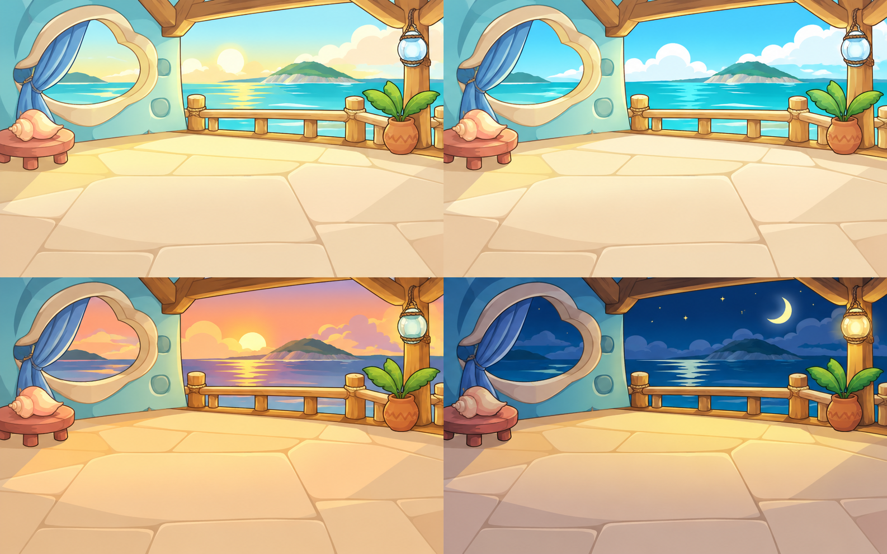</a>

[查看原图](../../public/assets/generated/v18-seashell-cottage.png)

### <code>public/assets/generated/v18-sky-observatory.png</code>

<a href="../../public/assets/generated/v18-sky-observatory.png">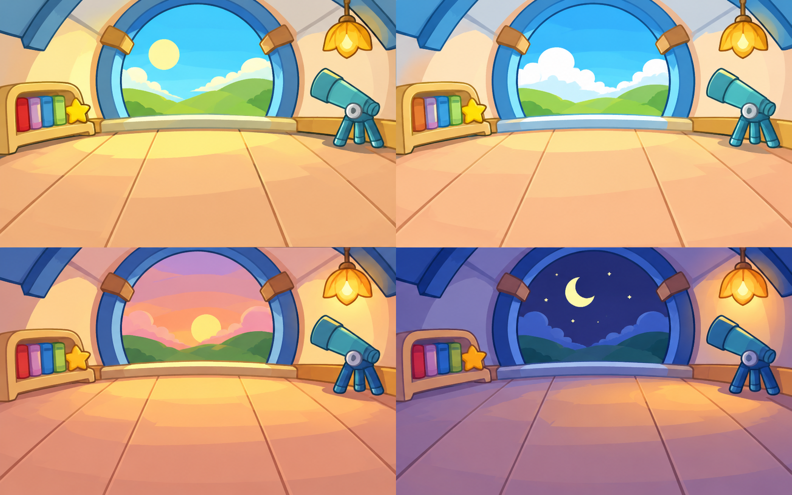</a>

[查看原图](../../public/assets/generated/v18-sky-observatory.png)

### <code>public/assets/generated/v27-care-props.png</code>

<a href="../../public/assets/generated/v27-care-props.png">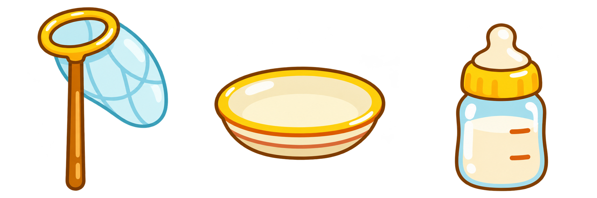</a>

[查看原图](../../public/assets/generated/v27-care-props.png)

### <code>public/assets/generated/v6-creek-treehouse.png</code>

<a href="../../public/assets/generated/v6-creek-treehouse.png">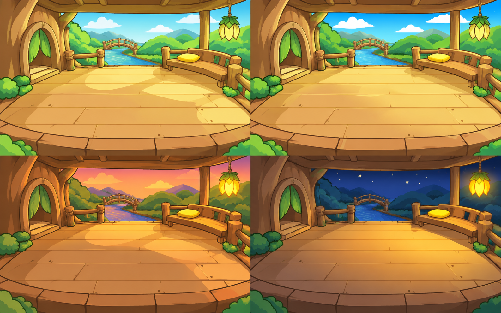</a>

[查看原图](../../public/assets/generated/v6-creek-treehouse.png)

### <code>public/assets/generated/v6-starlight-greenhouse.png</code>

<a href="../../public/assets/generated/v6-starlight-greenhouse.png">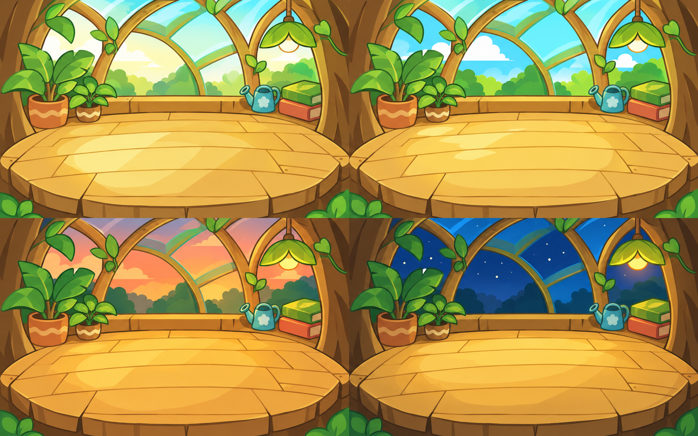</a>

[查看原图](../../public/assets/generated/v6-starlight-greenhouse.png)

### <code>public/assets/generated/v9-petting-hand.png</code>

[查看原图](../../public/assets/generated/v9-petting-hand.png)

### <code>public/assets/generated/v9-study-book.png</code>

[查看原图](../../public/assets/generated/v9-study-book.png)

### <code>public/assets/original/affection/fire-mask.png</code>

<a href="../../public/assets/original/affection/fire-mask.png">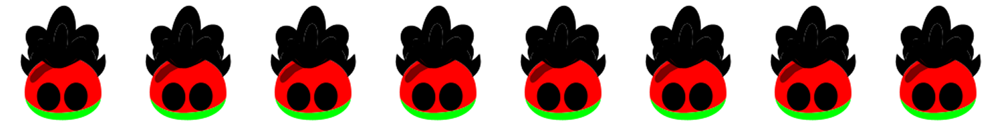</a>

[查看原图](../../public/assets/original/affection/fire-mask.png)

### <code>public/assets/original/affection/fire-neutral.png</code>

[查看原图](../../public/assets/original/affection/fire-neutral.png)

### <code>public/assets/original/affection/junior-mask.png</code>

<a href="../../public/assets/original/affection/junior-mask.png">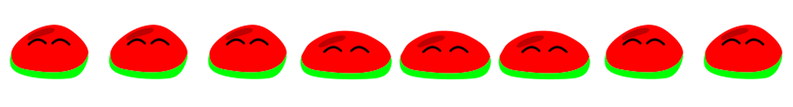</a>

[查看原图](../../public/assets/original/affection/junior-mask.png)

### <code>public/assets/original/affection/junior-neutral.png</code>

[查看原图](../../public/assets/original/affection/junior-neutral.png)

### <code>public/assets/original/affection/middle-mask.png</code>

<a href="../../public/assets/original/affection/middle-mask.png">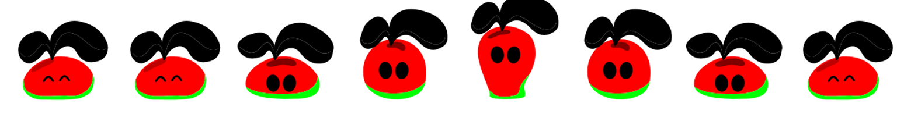</a>

[查看原图](../../public/assets/original/affection/middle-mask.png)

### <code>public/assets/original/affection/middle-neutral.png</code>

<a href="../../public/assets/original/affection/middle-neutral.png">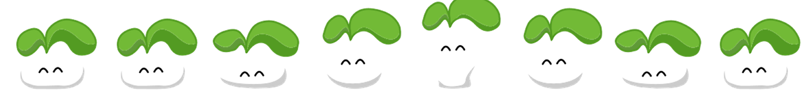</a>

[查看原图](../../public/assets/original/affection/middle-neutral.png)

### <code>public/assets/original/affection/senior-mask.png</code>

<a href="../../public/assets/original/affection/senior-mask.png">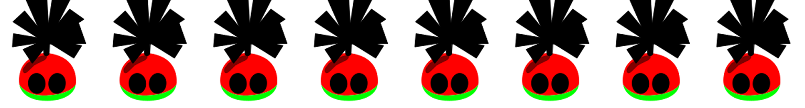</a>

[查看原图](../../public/assets/original/affection/senior-mask.png)

### <code>public/assets/original/affection/senior-neutral.png</code>

[查看原图](../../public/assets/original/affection/senior-neutral.png)

### <code>public/assets/original/affection/super-mask.png</code>

<a href="../../public/assets/original/affection/super-mask.png">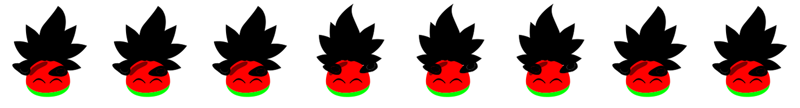</a>

[查看原图](../../public/assets/original/affection/super-mask.png)

### <code>public/assets/original/affection/super-neutral.png</code>

<a href="../../public/assets/original/affection/super-neutral.png">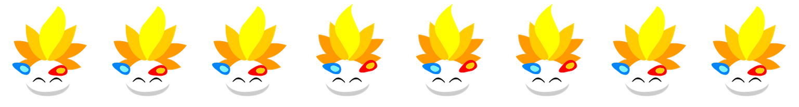</a>

[查看原图](../../public/assets/original/affection/super-neutral.png)

### <code>public/assets/original/affection/water-mask.png</code>

<a href="../../public/assets/original/affection/water-mask.png">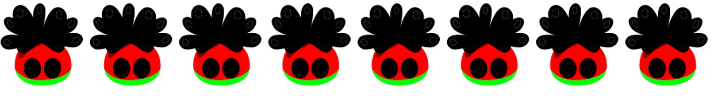</a>

[查看原图](../../public/assets/original/affection/water-mask.png)

### <code>public/assets/original/affection/water-neutral.png</code>

[查看原图](../../public/assets/original/affection/water-neutral.png)

### <code>public/assets/original/affection/wood-mask.png</code>

<a href="../../public/assets/original/affection/wood-mask.png">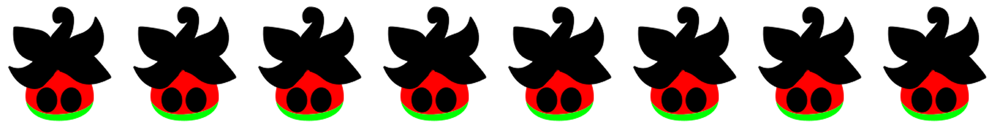</a>

[查看原图](../../public/assets/original/affection/wood-mask.png)

### <code>public/assets/original/affection/wood-neutral.png</code>

[查看原图](../../public/assets/original/affection/wood-neutral.png)

[返回素材首页](../README.md) · [上一页](game-002.md) · [下一页](game-004.md)
