<!-- Generated by scripts/generate-asset-gallery.py. Do not edit. -->
# 游戏图片素材 · 12/32

[返回素材首页](../README.md) · [上一页](game-011.md) · [下一页](game-013.md)

本页 24 个文件，点击图片或「查看原图」可打开原文件。

### <code>public/assets/original/seed/body-mask.png</code>

<a href="../../public/assets/original/seed/body-mask.png">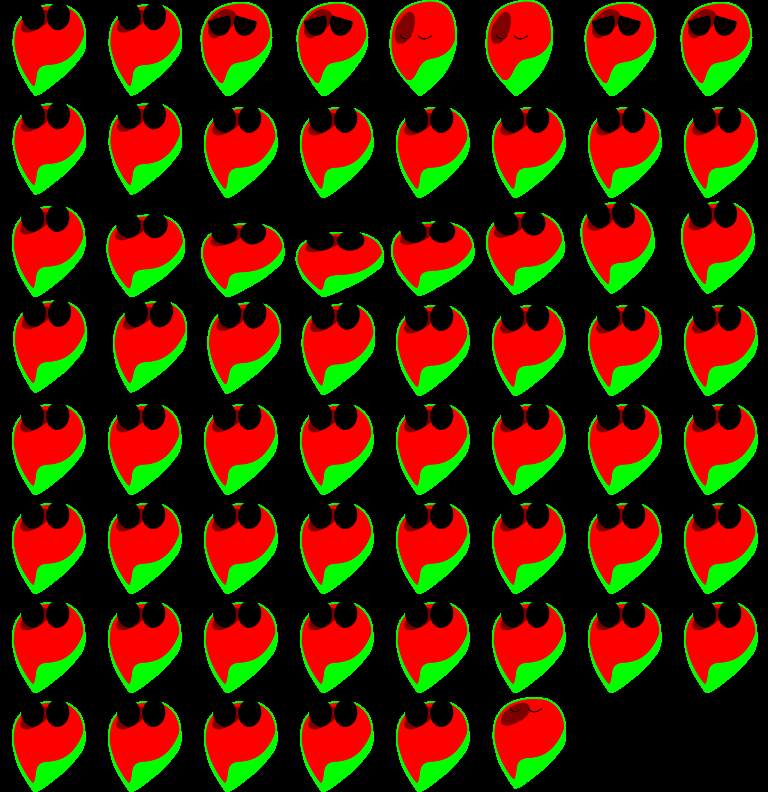</a>

[查看原图](../../public/assets/original/seed/body-mask.png)

### <code>public/assets/original/seed/body-still.png</code>

<a href="../../public/assets/original/seed/body-still.png">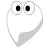</a>

[查看原图](../../public/assets/original/seed/body-still.png)

### <code>public/assets/original/seed/body.png</code>

<a href="../../public/assets/original/seed/body.png">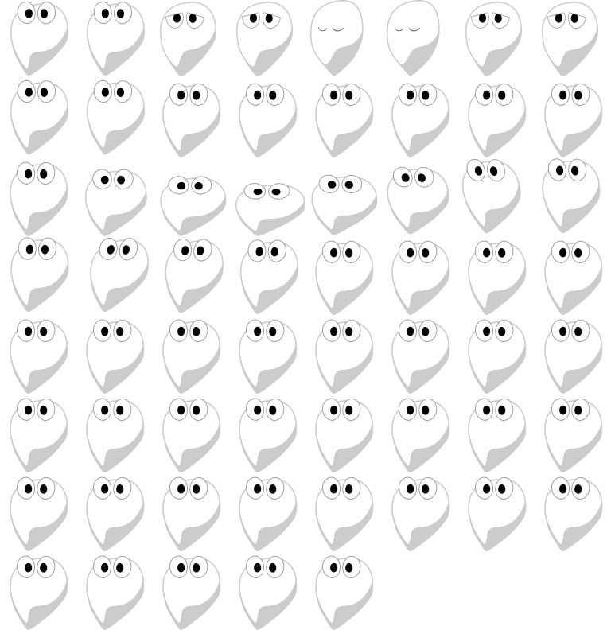</a>

[查看原图](../../public/assets/original/seed/body.png)

### <code>public/assets/original/seed/pot.png</code>

[查看原图](../../public/assets/original/seed/pot.png)

### <code>public/assets/original/slumber/fire-mask.png</code>

<a href="../../public/assets/original/slumber/fire-mask.png">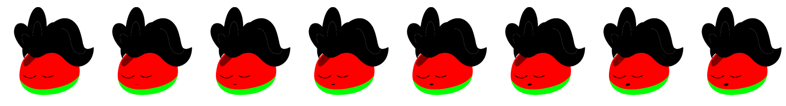</a>

[查看原图](../../public/assets/original/slumber/fire-mask.png)

### <code>public/assets/original/slumber/fire-neutral.png</code>

<a href="../../public/assets/original/slumber/fire-neutral.png">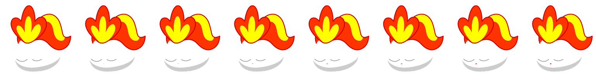</a>

[查看原图](../../public/assets/original/slumber/fire-neutral.png)

### <code>public/assets/original/slumber/junior-mask.png</code>

<a href="../../public/assets/original/slumber/junior-mask.png">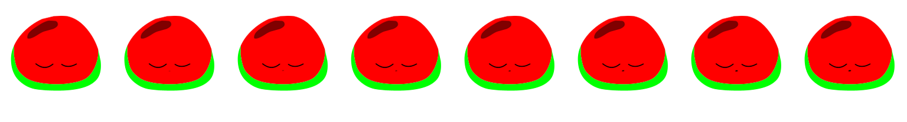</a>

[查看原图](../../public/assets/original/slumber/junior-mask.png)

### <code>public/assets/original/slumber/junior-neutral.png</code>

<a href="../../public/assets/original/slumber/junior-neutral.png"></a>

[查看原图](../../public/assets/original/slumber/junior-neutral.png)

### <code>public/assets/original/slumber/middle-mask.png</code>

<a href="../../public/assets/original/slumber/middle-mask.png">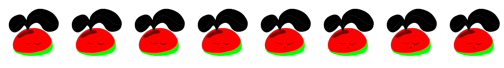</a>

[查看原图](../../public/assets/original/slumber/middle-mask.png)

### <code>public/assets/original/slumber/middle-neutral.png</code>

<a href="../../public/assets/original/slumber/middle-neutral.png">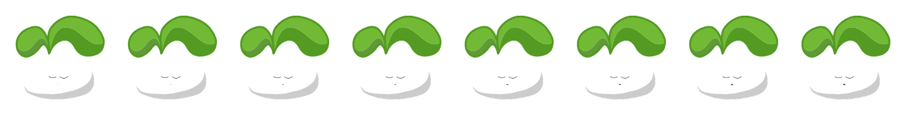</a>

[查看原图](../../public/assets/original/slumber/middle-neutral.png)

### <code>public/assets/original/slumber/seed-mask.png</code>

<a href="../../public/assets/original/slumber/seed-mask.png">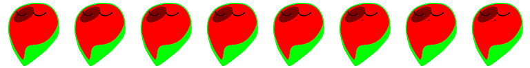</a>

[查看原图](../../public/assets/original/slumber/seed-mask.png)

### <code>public/assets/original/slumber/seed-neutral.png</code>

[查看原图](../../public/assets/original/slumber/seed-neutral.png)

### <code>public/assets/original/slumber/senior-mask.png</code>

<a href="../../public/assets/original/slumber/senior-mask.png">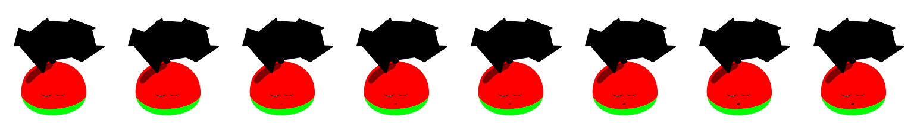</a>

[查看原图](../../public/assets/original/slumber/senior-mask.png)

### <code>public/assets/original/slumber/senior-neutral.png</code>

<a href="../../public/assets/original/slumber/senior-neutral.png">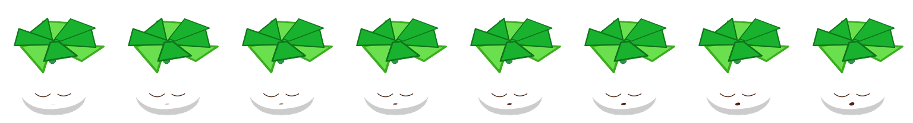</a>

[查看原图](../../public/assets/original/slumber/senior-neutral.png)

### <code>public/assets/original/slumber/super-mask.png</code>

<a href="../../public/assets/original/slumber/super-mask.png">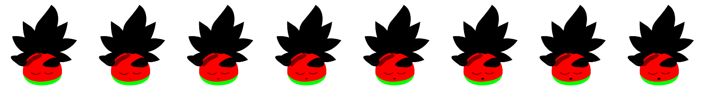</a>

[查看原图](../../public/assets/original/slumber/super-mask.png)

### <code>public/assets/original/slumber/super-neutral.png</code>

<a href="../../public/assets/original/slumber/super-neutral.png">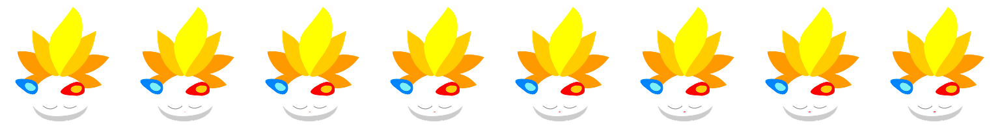</a>

[查看原图](../../public/assets/original/slumber/super-neutral.png)

### <code>public/assets/original/slumber/water-mask.png</code>

<a href="../../public/assets/original/slumber/water-mask.png">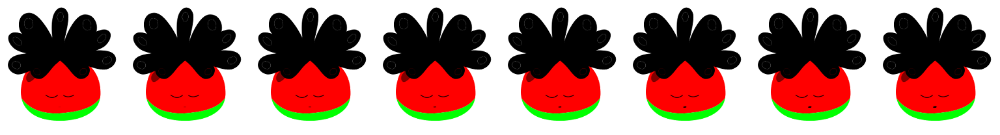</a>

[查看原图](../../public/assets/original/slumber/water-mask.png)

### <code>public/assets/original/slumber/water-neutral.png</code>

<a href="../../public/assets/original/slumber/water-neutral.png">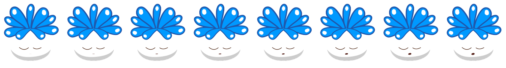</a>

[查看原图](../../public/assets/original/slumber/water-neutral.png)

### <code>public/assets/original/slumber/wood-mask.png</code>

<a href="../../public/assets/original/slumber/wood-mask.png">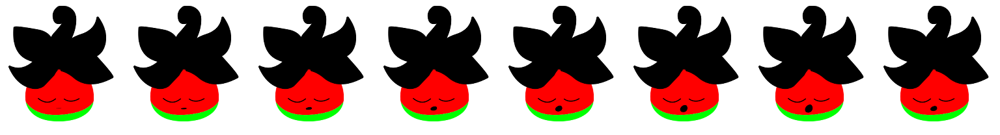</a>

[查看原图](../../public/assets/original/slumber/wood-mask.png)

### <code>public/assets/original/slumber/wood-neutral.png</code>

<a href="../../public/assets/original/slumber/wood-neutral.png">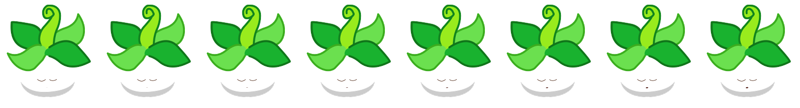</a>

[查看原图](../../public/assets/original/slumber/wood-neutral.png)

### <code>public/assets/original/slumber/z.png</code>

[查看原图](../../public/assets/original/slumber/z.png)

### <code>public/assets/original/ui/button-blue-pressed.png</code>

[查看原图](../../public/assets/original/ui/button-blue-pressed.png)

### <code>public/assets/original/ui/button-blue.png</code>

[查看原图](../../public/assets/original/ui/button-blue.png)

### <code>public/assets/original/ui/button-gold.png</code>

[查看原图](../../public/assets/original/ui/button-gold.png)

[返回素材首页](../README.md) · [上一页](game-011.md) · [下一页](game-013.md)
