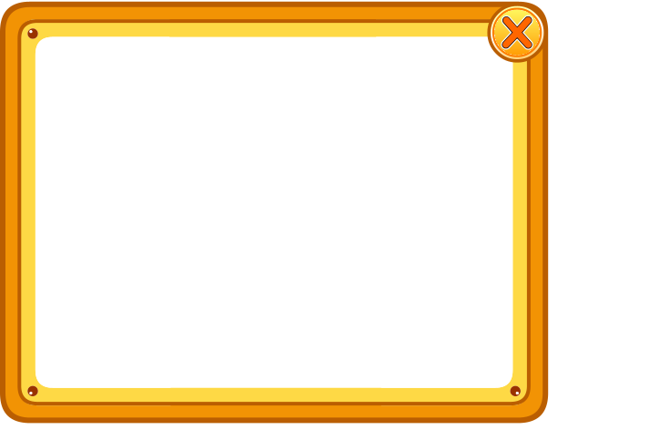
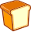
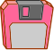
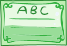
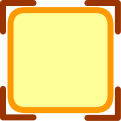
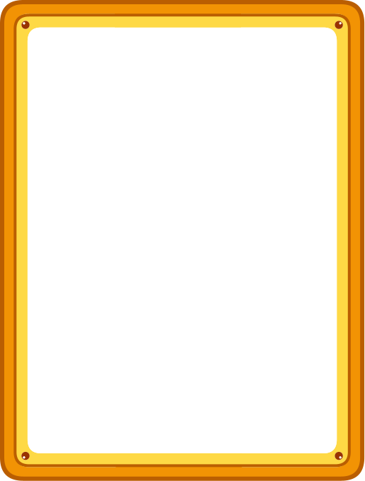
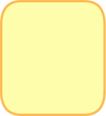

<!-- Generated by scripts/generate-asset-gallery.py. Do not edit. -->
# 游戏图片素材 · 13/32

[返回素材首页](../README.md) · [上一页](game-012.md) · [下一页](game-014.md)

本页 24 个文件，点击图片或「查看原图」可打开原文件。

### <code>public/assets/original/ui/button-orange.png</code>

[查看原图](../../public/assets/original/ui/button-orange.png)

### <code>public/assets/original/ui/close-hover.png</code>

[查看原图](../../public/assets/original/ui/close-hover.png)

### <code>public/assets/original/ui/close-normal.png</code>

[查看原图](../../public/assets/original/ui/close-normal.png)

### <code>public/assets/original/ui/close-pressed.png</code>

[查看原图](../../public/assets/original/ui/close-pressed.png)

### <code>public/assets/original/ui/dialog-gold.png</code>

[查看原图](../../public/assets/original/ui/dialog-gold.png)

### <code>public/assets/original/ui/icon-book-large.png</code>

[查看原图](../../public/assets/original/ui/icon-book-large.png)

### <code>public/assets/original/ui/icon-book.png</code>

[查看原图](../../public/assets/original/ui/icon-book.png)

### <code>public/assets/original/ui/icon-bottle.png</code>

[查看原图](../../public/assets/original/ui/icon-bottle.png)

### <code>public/assets/original/ui/icon-cap.png</code>

[查看原图](../../public/assets/original/ui/icon-cap.png)

### <code>public/assets/original/ui/icon-clean.png</code>

[查看原图](../../public/assets/original/ui/icon-clean.png)

### <code>public/assets/original/ui/icon-clock.png</code>

[查看原图](../../public/assets/original/ui/icon-clock.png)

### <code>public/assets/original/ui/icon-food.png</code>

[查看原图](../../public/assets/original/ui/icon-food.png)

### <code>public/assets/original/ui/icon-happy.png</code>

[查看原图](../../public/assets/original/ui/icon-happy.png)

### <code>public/assets/original/ui/icon-medal.png</code>

[查看原图](../../public/assets/original/ui/icon-medal.png)

### <code>public/assets/original/ui/icon-save.png</code>

[查看原图](../../public/assets/original/ui/icon-save.png)

### <code>public/assets/original/ui/icon-ticket.png</code>

[查看原图](../../public/assets/original/ui/icon-ticket.png)

### <code>public/assets/original/ui/icon-water.png</code>

[查看原图](../../public/assets/original/ui/icon-water.png)

### <code>public/assets/original/ui/item-slot-fill.png</code>

[查看原图](../../public/assets/original/ui/item-slot-fill.png)

### <code>public/assets/original/ui/item-slot-selected.png</code>

[查看原图](../../public/assets/original/ui/item-slot-selected.png)

### <code>public/assets/original/ui/item-slot.png</code>

[查看原图](../../public/assets/original/ui/item-slot.png)

### <code>public/assets/original/ui/page-arrow.png</code>

[查看原图](../../public/assets/original/ui/page-arrow.png)

### <code>public/assets/original/ui/panel-empty.png</code>

[查看原图](../../public/assets/original/ui/panel-empty.png)

### <code>public/assets/original/ui/pet-highlight.png</code>

[查看原图](../../public/assets/original/ui/pet-highlight.png)

### <code>public/assets/original/ui/pet-magic-fire.png</code>

[查看原图](../../public/assets/original/ui/pet-magic-fire.png)

[返回素材首页](../README.md) · [上一页](game-012.md) · [下一页](game-014.md)
