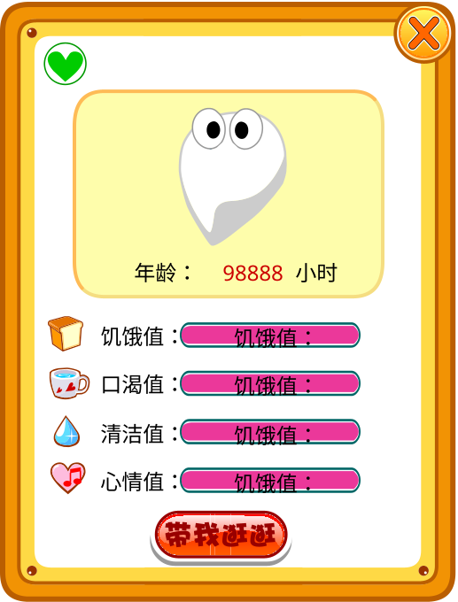
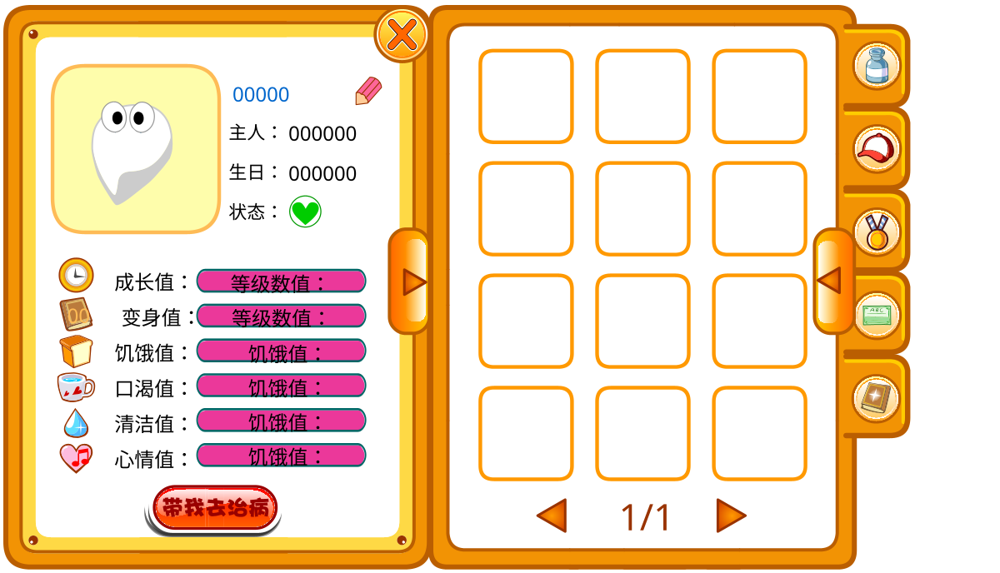
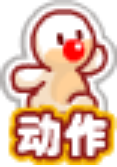
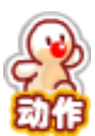
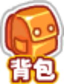
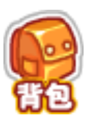

<!-- Generated by scripts/generate-asset-gallery.py. Do not edit. -->
# 游戏图片素材 · 14/32

[返回素材首页](../README.md) · [上一页](game-013.md) · [下一页](game-015.md)

本页 24 个文件，点击图片或「查看原图」可打开原文件。

### <code>public/assets/original/ui/pet-magic-green.png</code>

[查看原图](../../public/assets/original/ui/pet-magic-green.png)

### <code>public/assets/original/ui/pet-magic-leaf.png</code>

[查看原图](../../public/assets/original/ui/pet-magic-leaf.png)

### <code>public/assets/original/ui/pet-magic-water.png</code>

[查看原图](../../public/assets/original/ui/pet-magic-water.png)

### <code>public/assets/original/ui/reference-classic-pet-panel.png</code>

[查看原图](../../public/assets/original/ui/reference-classic-pet-panel.png)

### <code>public/assets/original/ui/reference-pet-panel.png</code>

[查看原图](../../public/assets/original/ui/reference-pet-panel.png)

### <code>public/assets/original/ui/speech-bubble.png</code>

[查看原图](../../public/assets/original/ui/speech-bubble.png)

### <code>public/assets/original/ui/sprout.png</code>

[查看原图](../../public/assets/original/ui/sprout.png)

### <code>public/assets/original/ui/status-fill-blue.png</code>

[查看原图](../../public/assets/original/ui/status-fill-blue.png)

### <code>public/assets/original/ui/status-fill-orange.png</code>

[查看原图](../../public/assets/original/ui/status-fill-orange.png)

### <code>public/assets/original/ui/status-fill-pink.png</code>

[查看原图](../../public/assets/original/ui/status-fill-pink.png)

### <code>public/assets/original/ui/status-health.png</code>

[查看原图](../../public/assets/original/ui/status-health.png)

### <code>public/assets/original/ui/status-sick.png</code>

[查看原图](../../public/assets/original/ui/status-sick.png)

### <code>public/assets/original/ui/status-sleep.png</code>

[查看原图](../../public/assets/original/ui/status-sleep.png)

### <code>public/assets/original/ui/status-track.png</code>

[查看原图](../../public/assets/original/ui/status-track.png)

### <code>public/assets/original/ui/tab-orange.png</code>

[查看原图](../../public/assets/original/ui/tab-orange.png)

### <code>public/assets/original/ui/tab-yellow.png</code>

[查看原图](../../public/assets/original/ui/tab-yellow.png)

### <code>public/assets/original/ui/toolbar-actions-hover.png</code>

[查看原图](../../public/assets/original/ui/toolbar-actions-hover.png)

### <code>public/assets/original/ui/toolbar-actions-normal.png</code>

[查看原图](../../public/assets/original/ui/toolbar-actions-normal.png)

### <code>public/assets/original/ui/toolbar-actions-pressed.png</code>

[查看原图](../../public/assets/original/ui/toolbar-actions-pressed.png)

### <code>public/assets/original/ui/toolbar-bag-hover.png</code>

[查看原图](../../public/assets/original/ui/toolbar-bag-hover.png)

### <code>public/assets/original/ui/toolbar-bag-normal.png</code>

[查看原图](../../public/assets/original/ui/toolbar-bag-normal.png)

### <code>public/assets/original/ui/toolbar-bag-pressed.png</code>

[查看原图](../../public/assets/original/ui/toolbar-bag-pressed.png)

### <code>public/assets/original/ui/toolbar-circle-hover.png</code>

[查看原图](../../public/assets/original/ui/toolbar-circle-hover.png)

### <code>public/assets/original/ui/toolbar-circle-pressed.png</code>

[查看原图](../../public/assets/original/ui/toolbar-circle-pressed.png)

[返回素材首页](../README.md) · [上一页](game-013.md) · [下一页](game-015.md)
