<!-- Generated by scripts/generate-asset-gallery.py. Do not edit. -->
# 游戏图片素材 · 31/32

[返回素材首页](../README.md) · [上一页](game-030.md) · [下一页](game-032.md)

本页 24 个文件，点击图片或「查看原图」可打开原文件。

### <code>public/assets/original/wardrobe/wizard-cap.png</code>

[查看原图](../../public/assets/original/wardrobe/wizard-cap.png)

### <code>public/assets/original/yawn/fire-mask.png</code>

<a href="../../public/assets/original/yawn/fire-mask.png">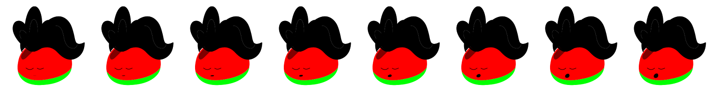</a>

[查看原图](../../public/assets/original/yawn/fire-mask.png)

### <code>public/assets/original/yawn/fire-neutral.png</code>

<a href="../../public/assets/original/yawn/fire-neutral.png">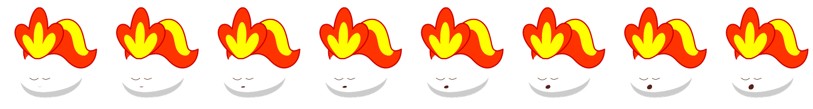</a>

[查看原图](../../public/assets/original/yawn/fire-neutral.png)

### <code>public/assets/original/yawn/junior-mask.png</code>

<a href="../../public/assets/original/yawn/junior-mask.png">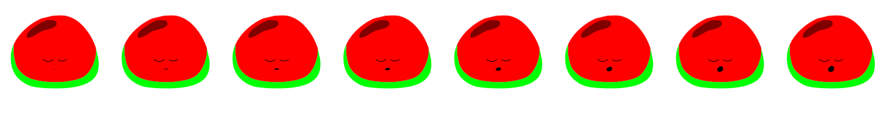</a>

[查看原图](../../public/assets/original/yawn/junior-mask.png)

### <code>public/assets/original/yawn/junior-neutral.png</code>

<a href="../../public/assets/original/yawn/junior-neutral.png"></a>

[查看原图](../../public/assets/original/yawn/junior-neutral.png)

### <code>public/assets/original/yawn/middle-mask.png</code>

<a href="../../public/assets/original/yawn/middle-mask.png">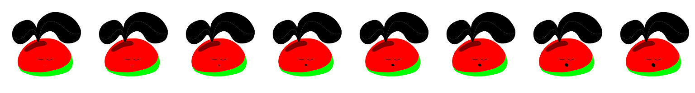</a>

[查看原图](../../public/assets/original/yawn/middle-mask.png)

### <code>public/assets/original/yawn/middle-neutral.png</code>

[查看原图](../../public/assets/original/yawn/middle-neutral.png)

### <code>public/assets/original/yawn/seed-mask.png</code>

<a href="../../public/assets/original/yawn/seed-mask.png">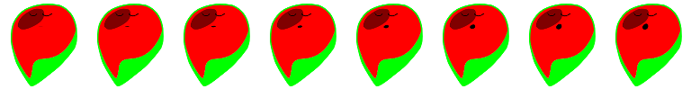</a>

[查看原图](../../public/assets/original/yawn/seed-mask.png)

### <code>public/assets/original/yawn/seed-neutral.png</code>

[查看原图](../../public/assets/original/yawn/seed-neutral.png)

### <code>public/assets/original/yawn/senior-mask.png</code>

<a href="../../public/assets/original/yawn/senior-mask.png">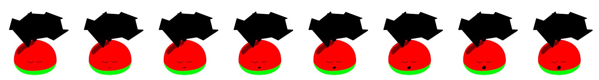</a>

[查看原图](../../public/assets/original/yawn/senior-mask.png)

### <code>public/assets/original/yawn/senior-neutral.png</code>

[查看原图](../../public/assets/original/yawn/senior-neutral.png)

### <code>public/assets/original/yawn/super-mask.png</code>

<a href="../../public/assets/original/yawn/super-mask.png">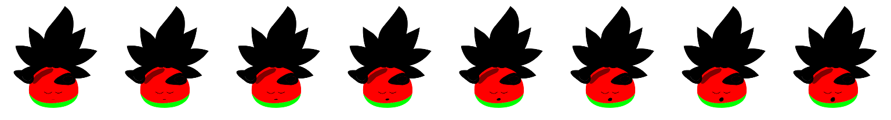</a>

[查看原图](../../public/assets/original/yawn/super-mask.png)

### <code>public/assets/original/yawn/super-neutral.png</code>

<a href="../../public/assets/original/yawn/super-neutral.png">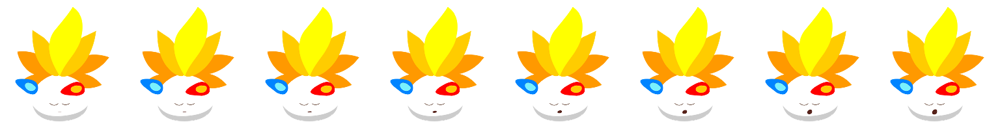</a>

[查看原图](../../public/assets/original/yawn/super-neutral.png)

### <code>public/assets/original/yawn/water-mask.png</code>

<a href="../../public/assets/original/yawn/water-mask.png">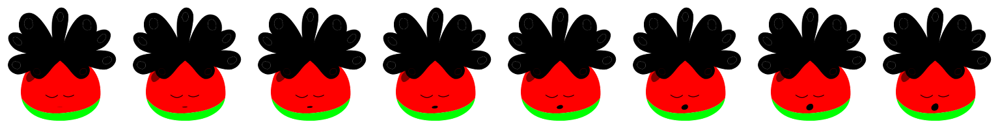</a>

[查看原图](../../public/assets/original/yawn/water-mask.png)

### <code>public/assets/original/yawn/water-neutral.png</code>

<a href="../../public/assets/original/yawn/water-neutral.png">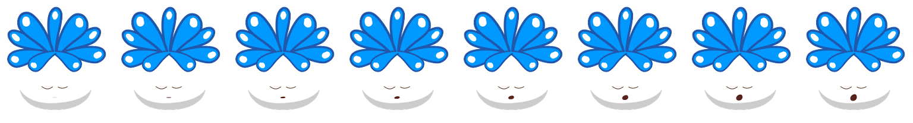</a>

[查看原图](../../public/assets/original/yawn/water-neutral.png)

### <code>public/assets/original/yawn/wood-mask.png</code>

<a href="../../public/assets/original/yawn/wood-mask.png">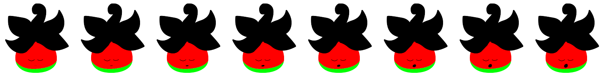</a>

[查看原图](../../public/assets/original/yawn/wood-mask.png)

### <code>public/assets/original/yawn/wood-neutral.png</code>

[查看原图](../../public/assets/original/yawn/wood-neutral.png)

### <code>public/assets/original/yawn/z.png</code>

[查看原图](../../public/assets/original/yawn/z.png)

### <code>public/favicon.png</code>

<a href="../../public/favicon.png">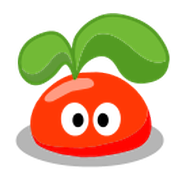</a>

[查看原图](../../public/favicon.png)

- <a href="../../public/icons/ramu.icns"><code>public/icons/ramu.icns</code></a>（图标文件，点击下载查看）

- <a href="../../public/icons/ramu.ico"><code>public/icons/ramu.ico</code></a>（图标文件，点击下载查看）

### <code>public/icons/ramu.png</code>

<a href="../../public/icons/ramu.png">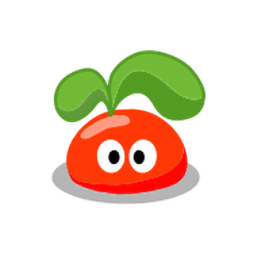</a>

[查看原图](../../public/icons/ramu.png)

### <code>public/icons/tray-mac.png</code>

<a href="../../public/icons/tray-mac.png">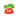</a>

[查看原图](../../public/icons/tray-mac.png)

### <code>public/icons/tray-mac@2x.png</code>

[查看原图](../../public/icons/tray-mac%402x.png)

[返回素材首页](../README.md) · [上一页](game-030.md) · [下一页](game-032.md)
