<!-- Generated by scripts/generate-asset-gallery.py. Do not edit. -->
# 设计参考和其他图片 · 1/8

[返回素材首页](../README.md) · [下一页](references-002.md)

本页 24 个文件，点击图片或「查看原图」可打开原文件。

### <code>artifacts/animation-gallery/speech-fixed.png</code>

<a href="../../artifacts/animation-gallery/speech-fixed.png">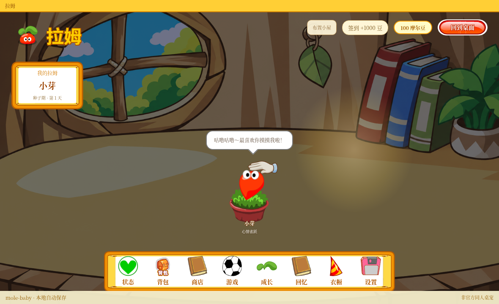</a>

[查看原图](../../artifacts/animation-gallery/speech-fixed.png)

### <code>artifacts/transform-concepts/bird.png</code>

[查看原图](../../artifacts/transform-concepts/bird.png)

### <code>artifacts/transform-concepts/cat.png</code>

[查看原图](../../artifacts/transform-concepts/cat.png)

### <code>artifacts/transform-concepts/rabbit.png</code>

[查看原图](../../artifacts/transform-concepts/rabbit.png)

### <code>artifacts/transform-concepts/tree.png</code>

[查看原图](../../artifacts/transform-concepts/tree.png)

### <code>artifacts/v10-native-presence.png</code>

[查看原图](../../artifacts/v10-native-presence.png)

### <code>artifacts/v11-auto-sleep.png</code>

<a href="../../artifacts/v11-auto-sleep.png">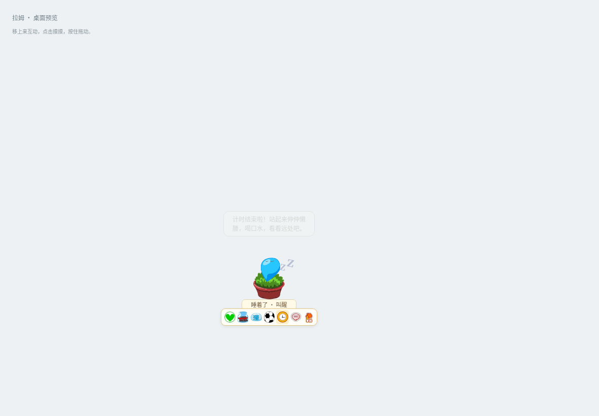</a>

[查看原图](../../artifacts/v11-auto-sleep.png)

### <code>artifacts/v11-hover-timer.png</code>

<a href="../../artifacts/v11-hover-timer.png">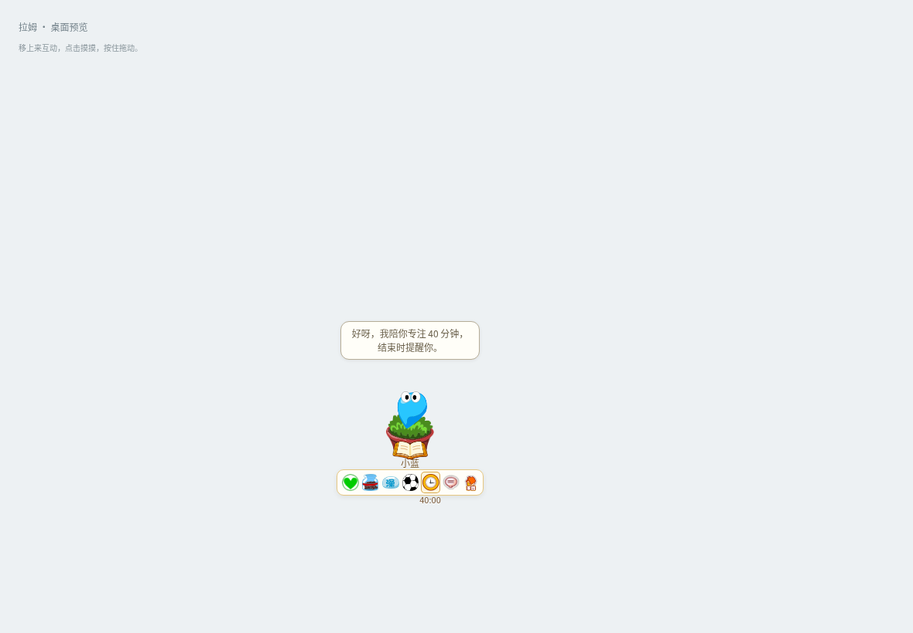</a>

[查看原图](../../artifacts/v11-hover-timer.png)

### <code>artifacts/v11-native-timer.png</code>

[查看原图](../../artifacts/v11-native-timer.png)

### <code>artifacts/v12-reading-dizzy.png</code>

<a href="../../artifacts/v12-reading-dizzy.png">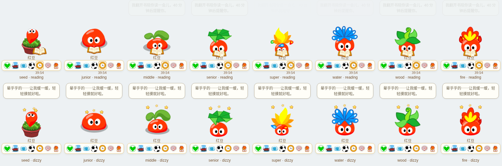</a>

[查看原图](../../artifacts/v12-reading-dizzy.png)

### <code>artifacts/v13-compact.png</code>

[查看原图](../../artifacts/v13-compact.png)

### <code>artifacts/v13-stage-settings.png</code>

<a href="../../artifacts/v13-stage-settings.png">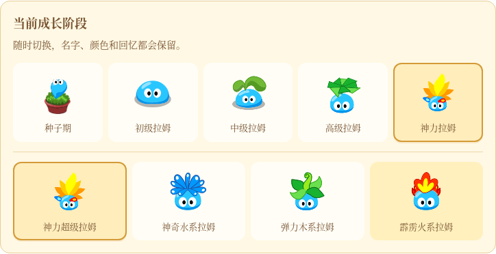</a>

[查看原图](../../artifacts/v13-stage-settings.png)

### <code>artifacts/v14-flight-colors.png</code>

<a href="../../artifacts/v14-flight-colors.png">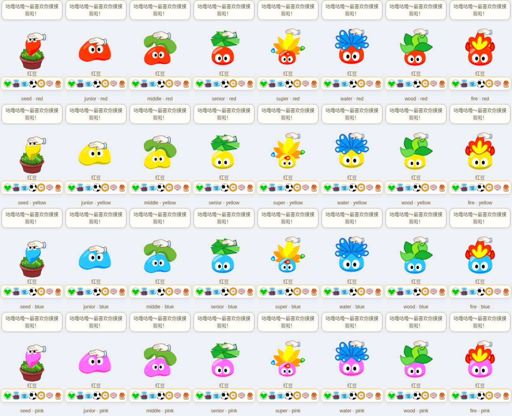</a>

[查看原图](../../artifacts/v14-flight-colors.png)

### <code>artifacts/v15-life-colors.png</code>

<a href="../../artifacts/v15-life-colors.png">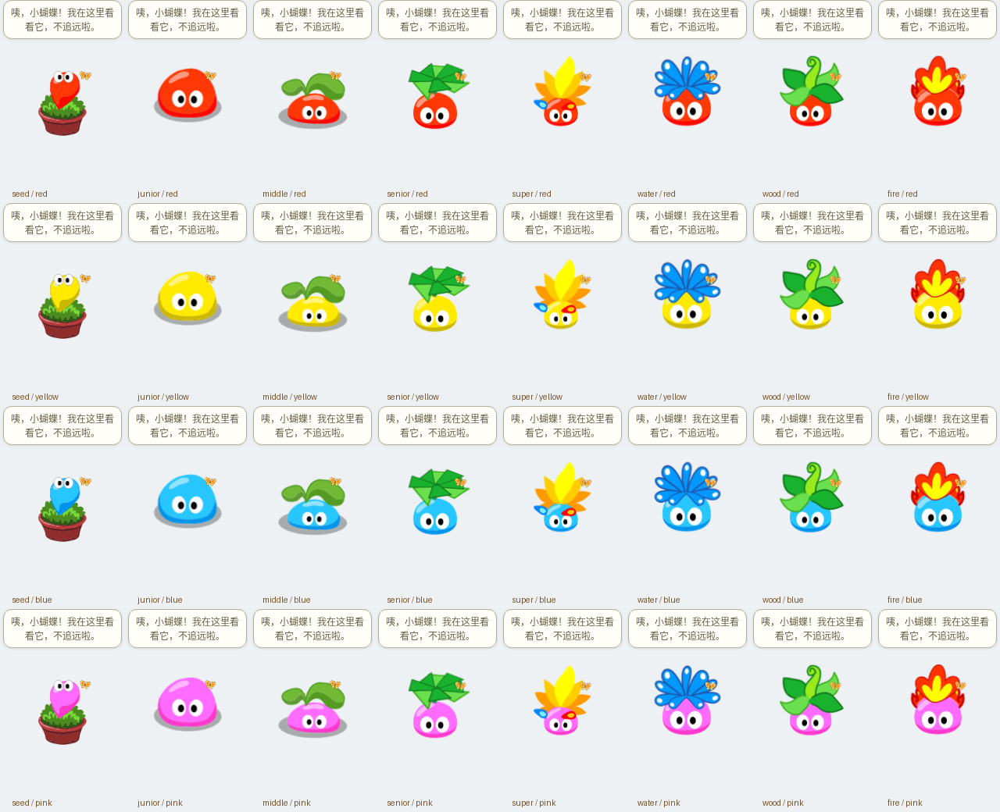</a>

[查看原图](../../artifacts/v15-life-colors.png)

### <code>artifacts/v15-play-pocket.png</code>

<a href="../../artifacts/v15-play-pocket.png">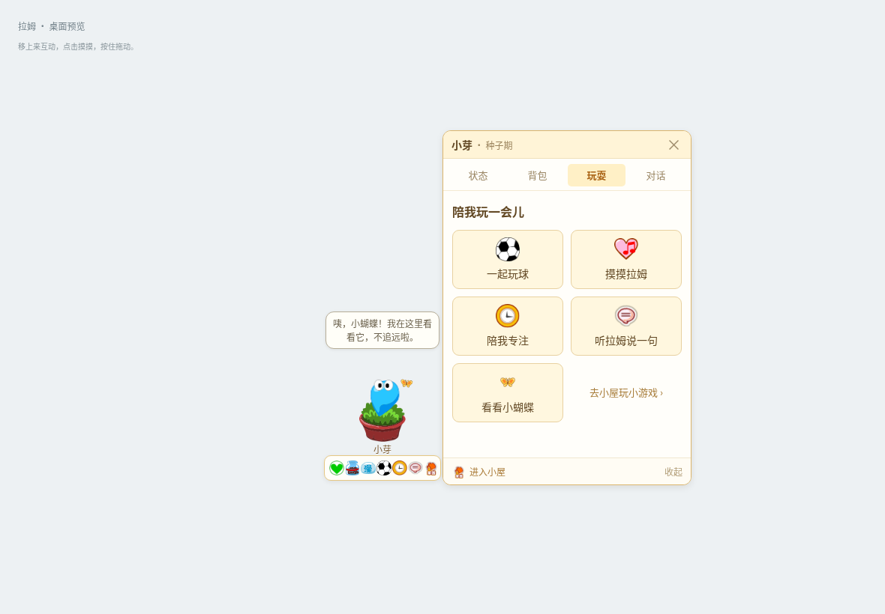</a>

[查看原图](../../artifacts/v15-play-pocket.png)

### <code>artifacts/v16-care-gain.png</code>

[查看原图](../../artifacts/v16-care-gain.png)

### <code>artifacts/v16-grounded-colors.png</code>

[查看原图](../../artifacts/v16-grounded-colors.png)

### <code>artifacts/v17-attention.png</code>

[查看原图](../../artifacts/v17-attention.png)

### <code>artifacts/v171-mac-menu-preview.png</code>

<a href="../../artifacts/v171-mac-menu-preview.png">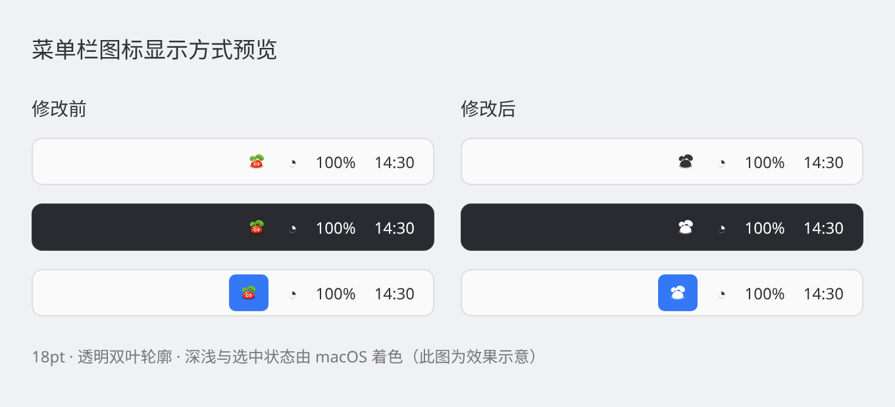</a>

[查看原图](../../artifacts/v171-mac-menu-preview.png)

### <code>artifacts/v173-flight-facing.png</code>

<a href="../../artifacts/v173-flight-facing.png">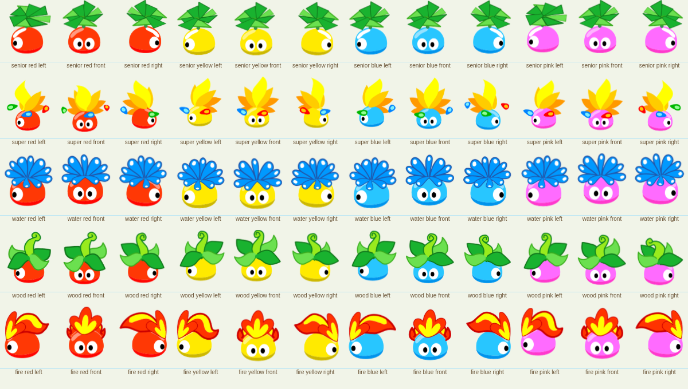</a>

[查看原图](../../artifacts/v173-flight-facing.png)

### <code>artifacts/v18-decor-compact.png</code>

<a href="../../artifacts/v18-decor-compact.png">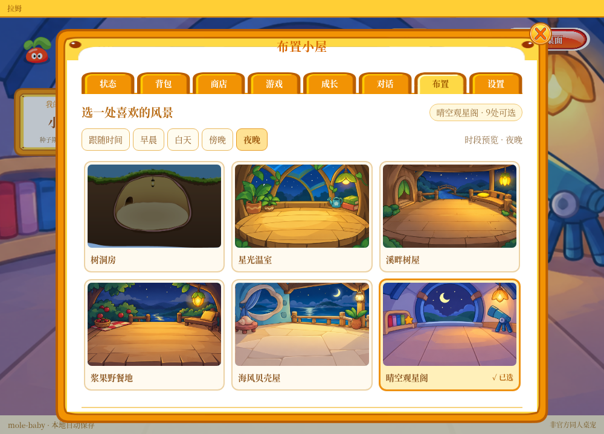</a>

[查看原图](../../artifacts/v18-decor-compact.png)

### <code>artifacts/v18-decor.png</code>

<a href="../../artifacts/v18-decor.png">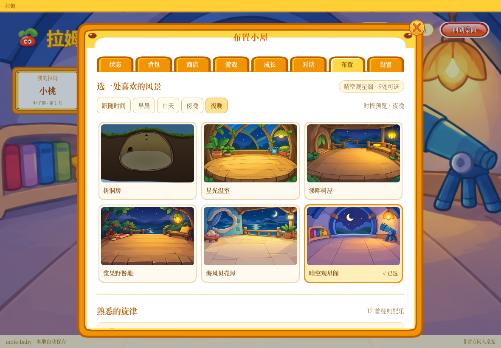</a>

[查看原图](../../artifacts/v18-decor.png)

### <code>artifacts/v18-room-compact.png</code>

<a href="../../artifacts/v18-room-compact.png">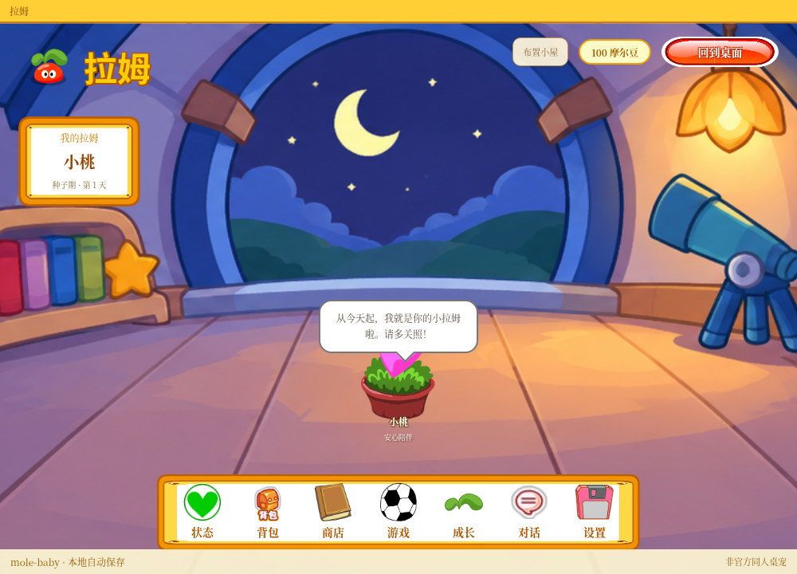</a>

[查看原图](../../artifacts/v18-room-compact.png)

### <code>artifacts/v18-room.png</code>

<a href="../../artifacts/v18-room.png">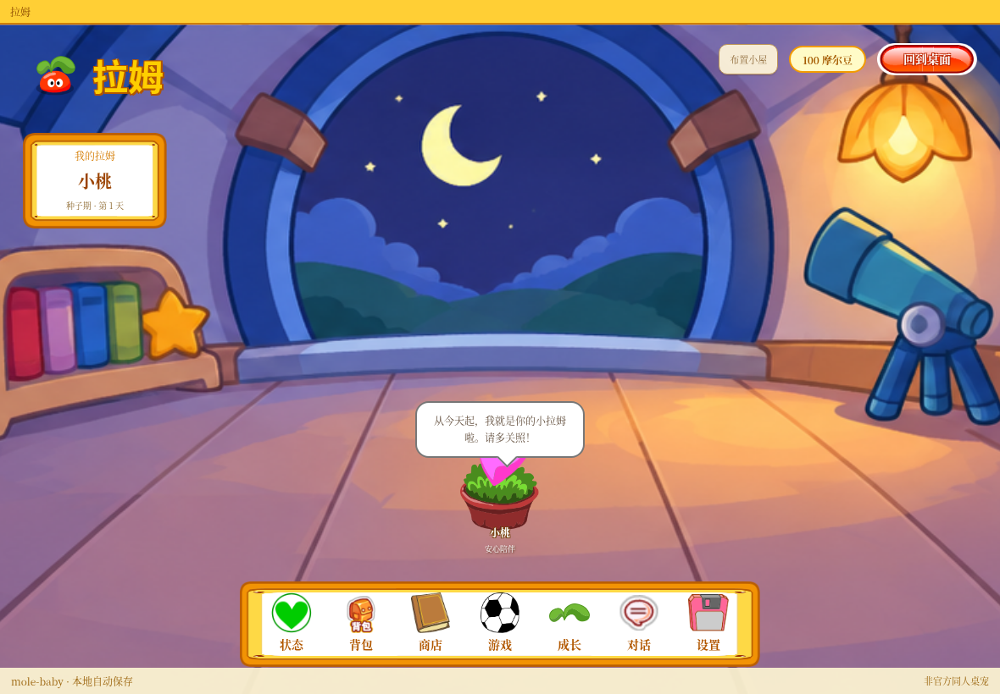</a>

[查看原图](../../artifacts/v18-room.png)

[返回素材首页](../README.md) · [下一页](references-002.md)
