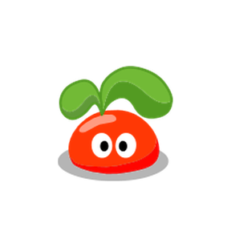
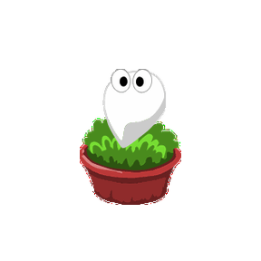
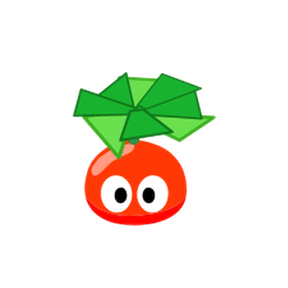
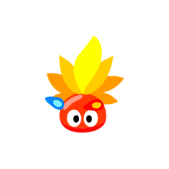
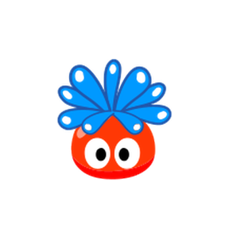
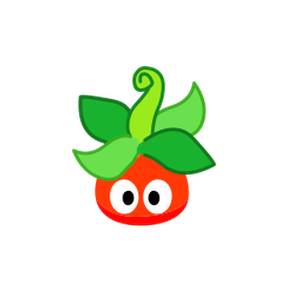

<!-- Generated by scripts/generate-asset-gallery.py. Do not edit. -->
# 设计参考和其他图片 · 2/10

[返回素材首页](../README.md) · [上一页](references-001.md) · [下一页](references-003.md)

本页 24 个文件，点击图片或「查看原图」可打开原文件。

### <code>artifacts/magic-box-shared-v45/subjects/middle.png</code>

[查看原图](../../artifacts/magic-box-shared-v45/subjects/middle.png)

### <code>artifacts/magic-box-shared-v45/subjects/seed.png</code>

[查看原图](../../artifacts/magic-box-shared-v45/subjects/seed.png)

### <code>artifacts/magic-box-shared-v45/subjects/senior.png</code>

[查看原图](../../artifacts/magic-box-shared-v45/subjects/senior.png)

### <code>artifacts/magic-box-shared-v45/subjects/super.png</code>

[查看原图](../../artifacts/magic-box-shared-v45/subjects/super.png)

### <code>artifacts/magic-box-shared-v45/subjects/water.png</code>

[查看原图](../../artifacts/magic-box-shared-v45/subjects/water.png)

### <code>artifacts/magic-box-shared-v45/subjects/wood.png</code>

[查看原图](../../artifacts/magic-box-shared-v45/subjects/wood.png)

### <code>artifacts/transform-concepts/bird.png</code>

[查看原图](../../artifacts/transform-concepts/bird.png)

### <code>artifacts/transform-concepts/cat.png</code>

[查看原图](../../artifacts/transform-concepts/cat.png)

### <code>artifacts/transform-concepts/rabbit.png</code>

[查看原图](../../artifacts/transform-concepts/rabbit.png)

### <code>artifacts/transform-concepts/tree.png</code>

[查看原图](../../artifacts/transform-concepts/tree.png)

### <code>artifacts/transform-redraw-v43/bird.png</code>

[查看原图](../../artifacts/transform-redraw-v43/bird.png)

### <code>artifacts/transform-redraw-v43/cat.png</code>

[查看原图](../../artifacts/transform-redraw-v43/cat.png)

### <code>artifacts/transform-redraw-v43/rabbit.png</code>

[查看原图](../../artifacts/transform-redraw-v43/rabbit.png)

### <code>artifacts/transform-redraw-v43/tree.png</code>

[查看原图](../../artifacts/transform-redraw-v43/tree.png)

### <code>artifacts/v10-native-presence.png</code>

[查看原图](../../artifacts/v10-native-presence.png)

### <code>artifacts/v11-auto-sleep.png</code>

[查看原图](../../artifacts/v11-auto-sleep.png)

### <code>artifacts/v11-hover-timer.png</code>

[查看原图](../../artifacts/v11-hover-timer.png)

### <code>artifacts/v11-native-timer.png</code>

[查看原图](../../artifacts/v11-native-timer.png)

### <code>artifacts/v12-reading-dizzy.png</code>

[查看原图](../../artifacts/v12-reading-dizzy.png)

### <code>artifacts/v13-compact.png</code>

[查看原图](../../artifacts/v13-compact.png)

### <code>artifacts/v13-stage-settings.png</code>

[查看原图](../../artifacts/v13-stage-settings.png)

### <code>artifacts/v14-flight-colors.png</code>

[查看原图](../../artifacts/v14-flight-colors.png)

### <code>artifacts/v15-life-colors.png</code>

[查看原图](../../artifacts/v15-life-colors.png)

### <code>artifacts/v15-play-pocket.png</code>

[查看原图](../../artifacts/v15-play-pocket.png)

[返回素材首页](../README.md) · [上一页](references-001.md) · [下一页](references-003.md)
