<!-- Generated by scripts/generate-asset-gallery.py. Do not edit. -->
# 设计参考和其他图片 · 2/6

[返回素材首页](../README.md) · [上一页](references-001.md) · [下一页](references-003.md)

本页 24 个文件，点击图片或「查看原图」可打开原文件。

### <code>artifacts/v19-invitation.png</code>

<a href="../../artifacts/v19-invitation.png">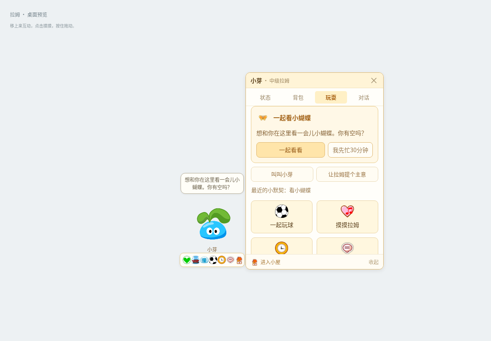</a>

[查看原图](../../artifacts/v19-invitation.png)

### <code>artifacts/v19-name-response.png</code>

<a href="../../artifacts/v19-name-response.png">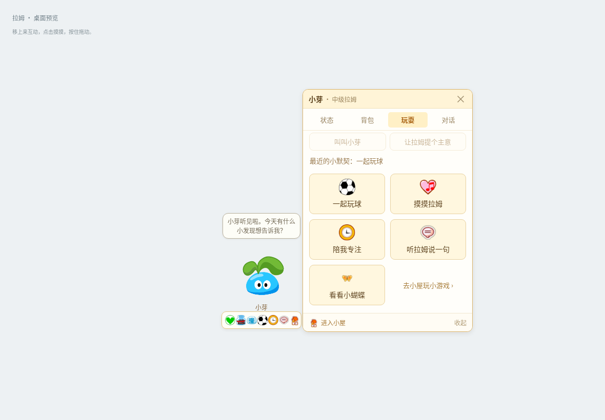</a>

[查看原图](../../artifacts/v19-name-response.png)

### <code>artifacts/v20-ball.png</code>

<a href="../../artifacts/v20-ball.png">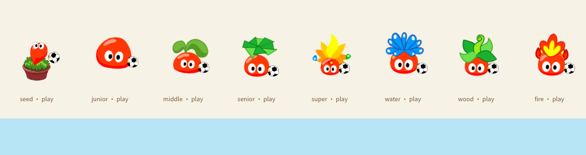</a>

[查看原图](../../artifacts/v20-ball.png)

### <code>artifacts/v20-pet.png</code>

<a href="../../artifacts/v20-pet.png">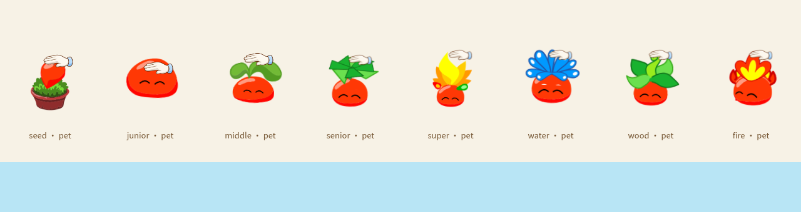</a>

[查看原图](../../artifacts/v20-pet.png)

### <code>artifacts/v20-sleep.png</code>

<a href="../../artifacts/v20-sleep.png">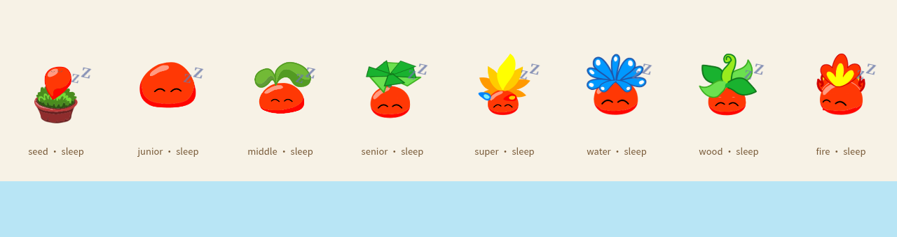</a>

[查看原图](../../artifacts/v20-sleep.png)

### <code>artifacts/v21-football.png</code>

<a href="../../artifacts/v21-football.png">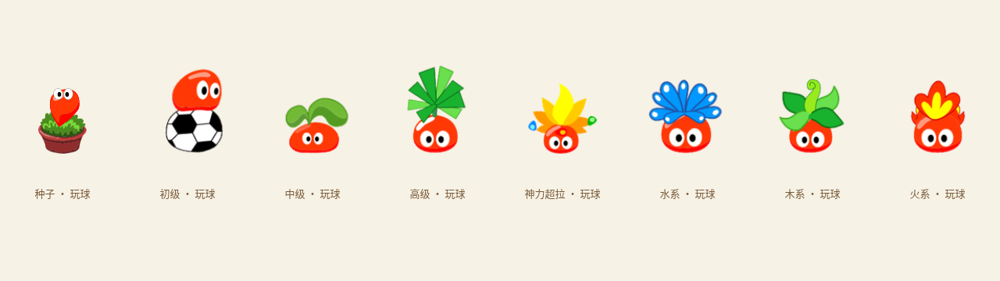</a>

[查看原图](../../artifacts/v21-football.png)

### <code>artifacts/v21-pet.png</code>

<a href="../../artifacts/v21-pet.png">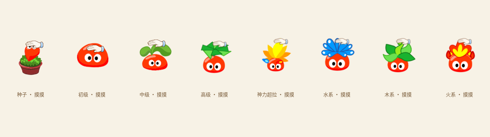</a>

[查看原图](../../artifacts/v21-pet.png)

### <code>artifacts/v21-sleep.png</code>

<a href="../../artifacts/v21-sleep.png">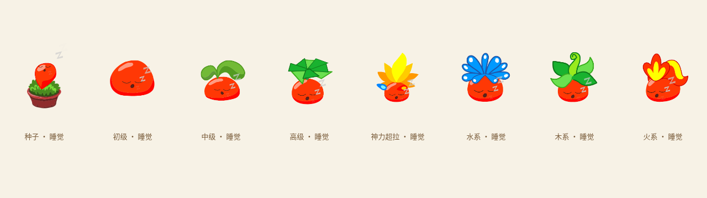</a>

[查看原图](../../artifacts/v21-sleep.png)

### <code>artifacts/v22-moods.png</code>

<a href="../../artifacts/v22-moods.png">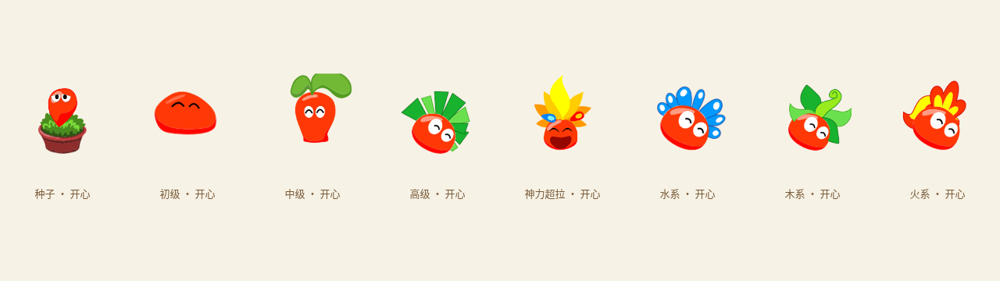</a>

[查看原图](../../artifacts/v22-moods.png)

### <code>artifacts/v22-sleep.png</code>

[查看原图](../../artifacts/v22-sleep.png)

### <code>artifacts/v22-wardrobe.png</code>

<a href="../../artifacts/v22-wardrobe.png">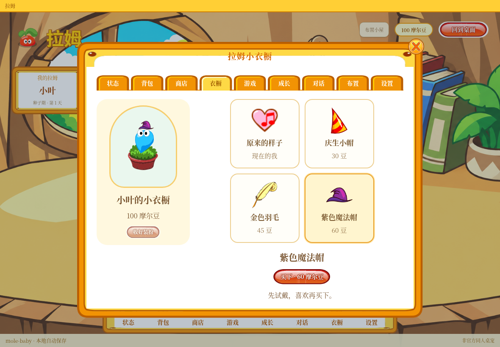</a>

[查看原图](../../artifacts/v22-wardrobe.png)

### <code>artifacts/v23-classic-backpack.png</code>

<a href="../../artifacts/v23-classic-backpack.png">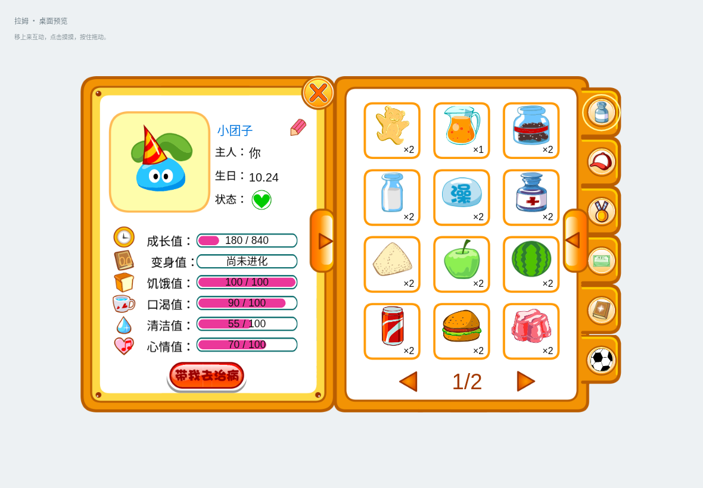</a>

[查看原图](../../artifacts/v23-classic-backpack.png)

### <code>artifacts/v23-native-backpack.png</code>

<a href="../../artifacts/v23-native-backpack.png">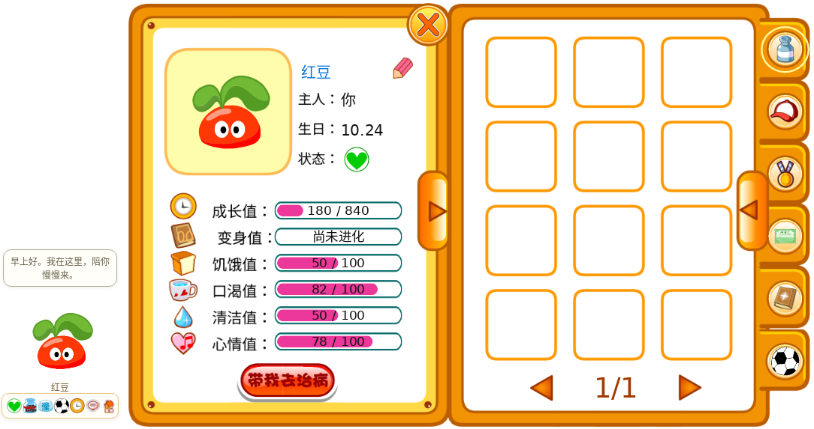</a>

[查看原图](../../artifacts/v23-native-backpack.png)

### <code>artifacts/v24-outfits.png</code>

<a href="../../artifacts/v24-outfits.png">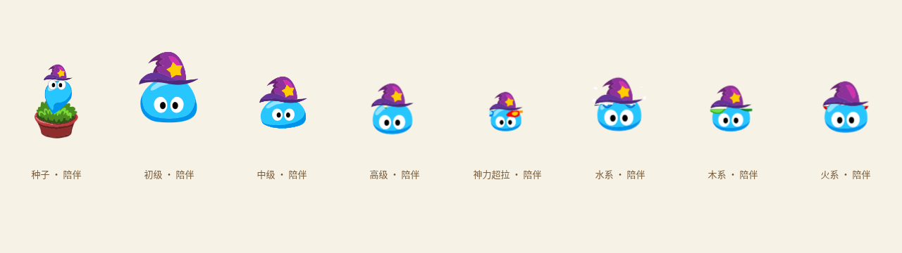</a>

[查看原图](../../artifacts/v24-outfits.png)

### <code>artifacts/v24-wardrobe.png</code>

<a href="../../artifacts/v24-wardrobe.png">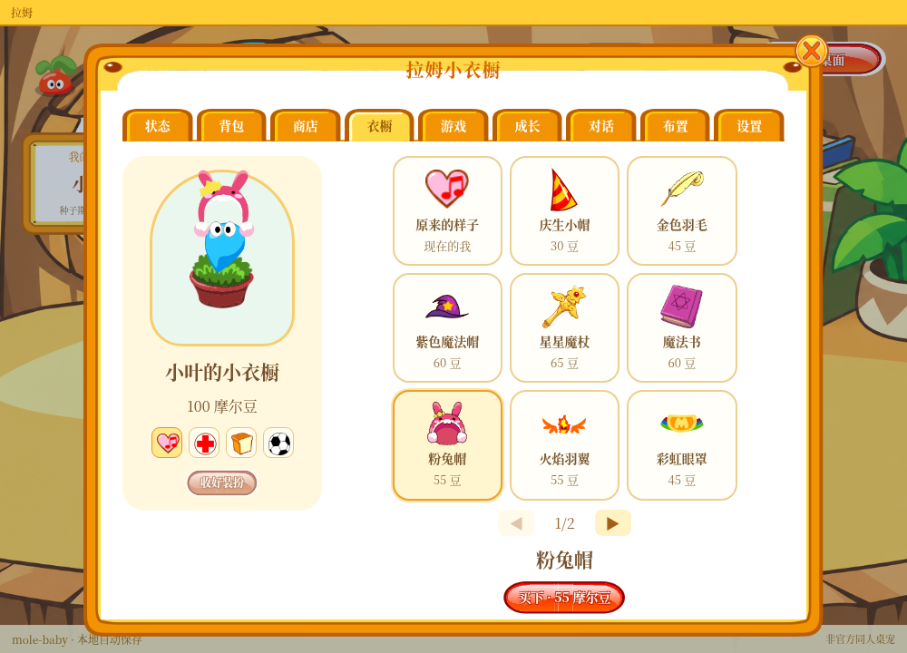</a>

[查看原图](../../artifacts/v24-wardrobe.png)

### <code>artifacts/v25-compact-pocket.png</code>

[查看原图](../../artifacts/v25-compact-pocket.png)

### <code>artifacts/v25-native-pocket.png</code>

<a href="../../artifacts/v25-native-pocket.png">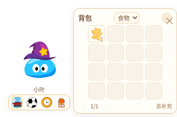</a>

[查看原图](../../artifacts/v25-native-pocket.png)

### <code>artifacts/v25-room-profile.png</code>

[查看原图](../../artifacts/v25-room-profile.png)

### <code>artifacts/v26-away.png</code>

<a href="../../artifacts/v26-away.png">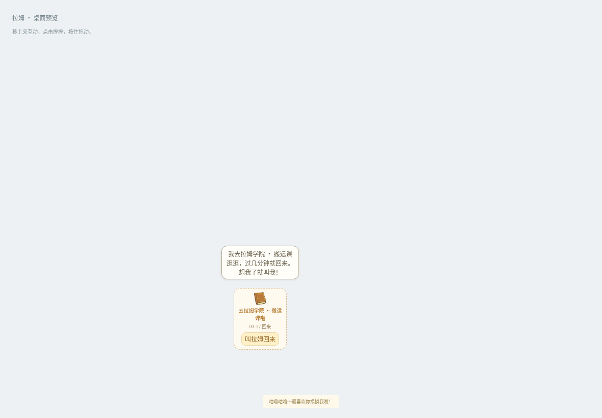</a>

[查看原图](../../artifacts/v26-away.png)

### <code>artifacts/v26-compact-pocket.png</code>

<a href="../../artifacts/v26-compact-pocket.png">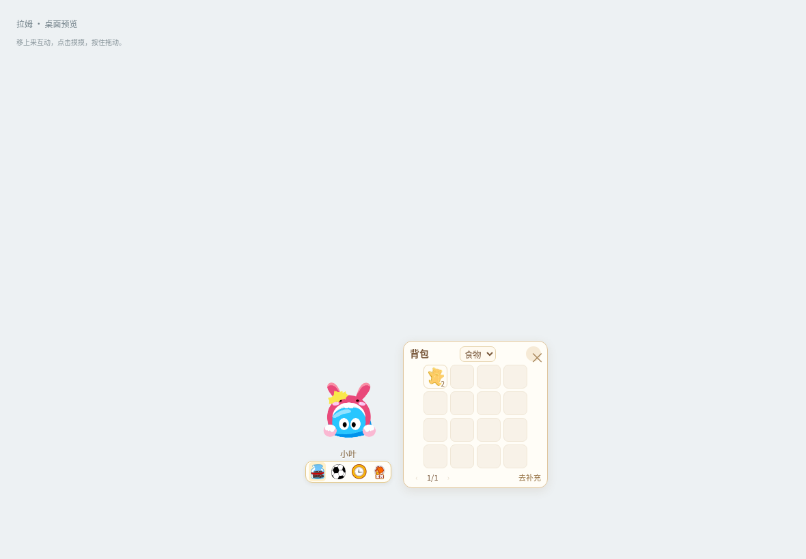</a>

[查看原图](../../artifacts/v26-compact-pocket.png)

### <code>artifacts/v26-food.png</code>

<a href="../../artifacts/v26-food.png">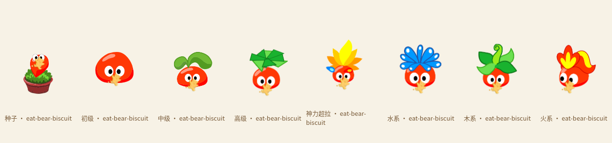</a>

[查看原图](../../artifacts/v26-food.png)

### <code>artifacts/v26-native-pocket.png</code>

<a href="../../artifacts/v26-native-pocket.png">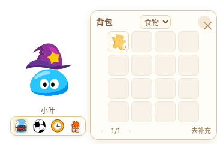</a>

[查看原图](../../artifacts/v26-native-pocket.png)

### <code>artifacts/v26-pastimes.png</code>

<a href="../../artifacts/v26-pastimes.png">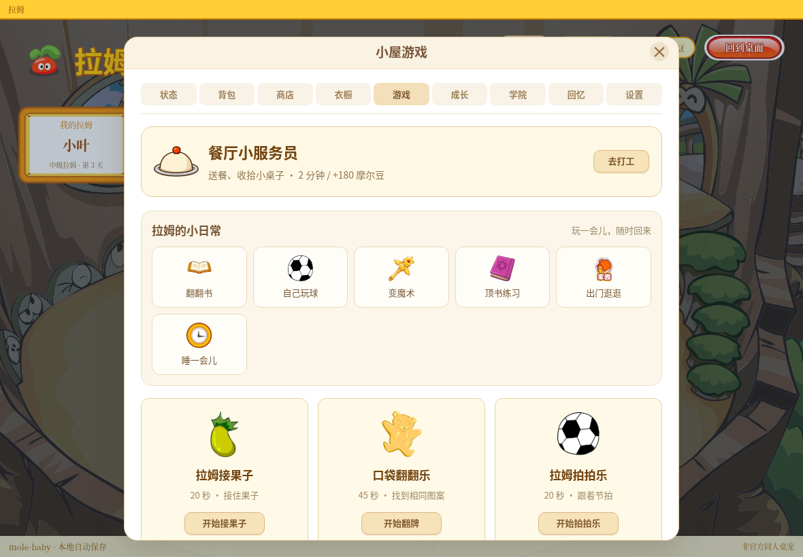</a>

[查看原图](../../artifacts/v26-pastimes.png)

### <code>artifacts/v26-room-profile.png</code>

<a href="../../artifacts/v26-room-profile.png">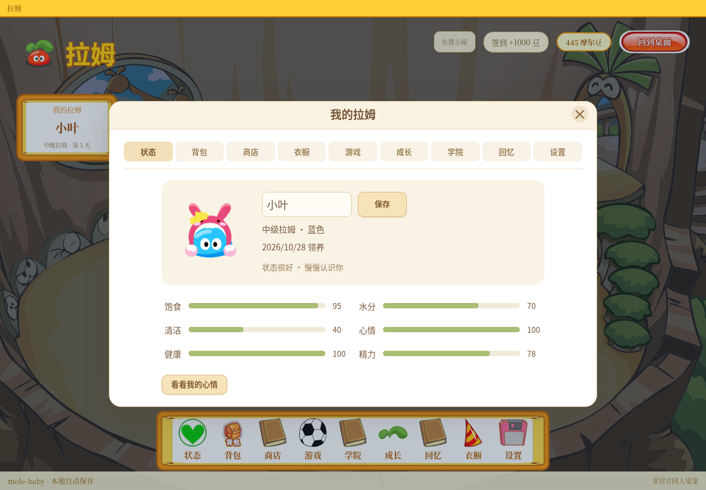</a>

[查看原图](../../artifacts/v26-room-profile.png)

[返回素材首页](../README.md) · [上一页](references-001.md) · [下一页](references-003.md)
