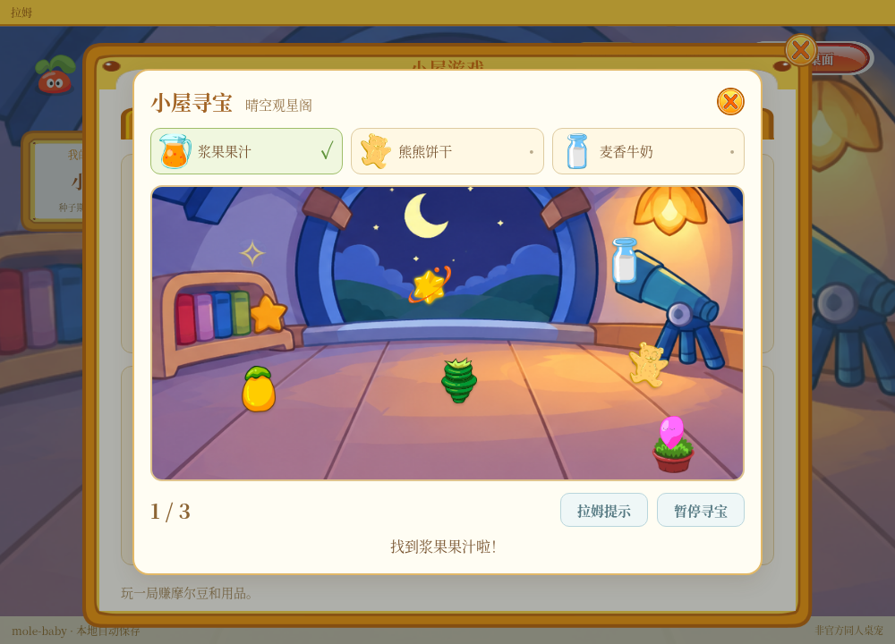
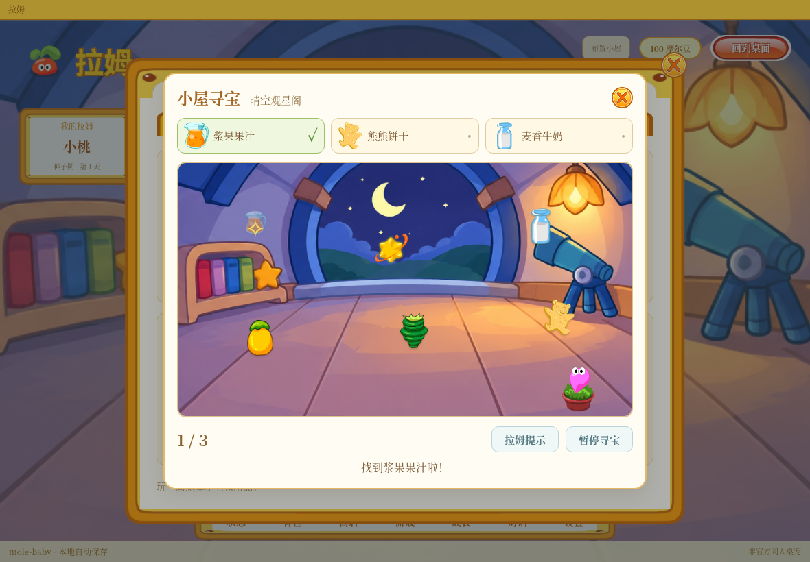
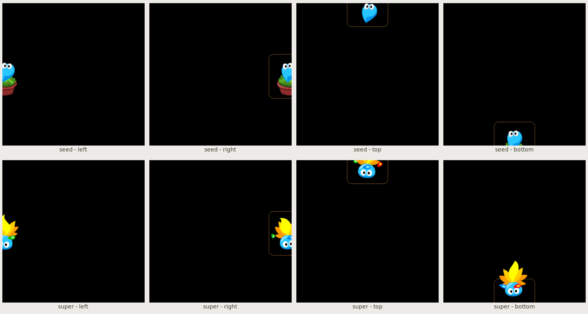
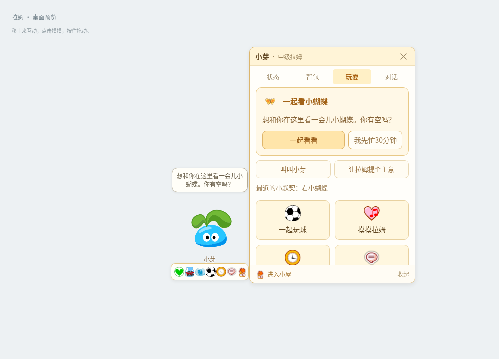

<!-- Generated by scripts/generate-asset-gallery.py. Do not edit. -->
# 设计参考和其他图片 · 3/10

[返回素材首页](../README.md) · [上一页](references-002.md) · [下一页](references-004.md)

本页 24 个文件，点击图片或「查看原图」可打开原文件。

### <code>artifacts/v16-care-gain.png</code>

[查看原图](../../artifacts/v16-care-gain.png)

### <code>artifacts/v16-grounded-colors.png</code>

[查看原图](../../artifacts/v16-grounded-colors.png)

### <code>artifacts/v17-attention.png</code>

[查看原图](../../artifacts/v17-attention.png)

### <code>artifacts/v171-mac-menu-preview.png</code>

[查看原图](../../artifacts/v171-mac-menu-preview.png)

### <code>artifacts/v173-flight-facing.png</code>

[查看原图](../../artifacts/v173-flight-facing.png)

### <code>artifacts/v18-decor-compact.png</code>

[查看原图](../../artifacts/v18-decor-compact.png)

### <code>artifacts/v18-decor.png</code>

[查看原图](../../artifacts/v18-decor.png)

### <code>artifacts/v18-room-compact.png</code>

[查看原图](../../artifacts/v18-room-compact.png)

### <code>artifacts/v18-room.png</code>

[查看原图](../../artifacts/v18-room.png)

### <code>artifacts/v18-treasure-compact.png</code>

[查看原图](../../artifacts/v18-treasure-compact.png)

### <code>artifacts/v18-treasure.png</code>

[查看原图](../../artifacts/v18-treasure.png)

### <code>artifacts/v19-edge-peeks.png</code>

[查看原图](../../artifacts/v19-edge-peeks.png)

### <code>artifacts/v19-invitation-compact.png</code>

[查看原图](../../artifacts/v19-invitation-compact.png)

### <code>artifacts/v19-invitation.png</code>

[查看原图](../../artifacts/v19-invitation.png)

### <code>artifacts/v19-name-response.png</code>

[查看原图](../../artifacts/v19-name-response.png)

### <code>artifacts/v20-ball.png</code>

[查看原图](../../artifacts/v20-ball.png)

### <code>artifacts/v20-pet.png</code>

[查看原图](../../artifacts/v20-pet.png)

### <code>artifacts/v20-sleep.png</code>

[查看原图](../../artifacts/v20-sleep.png)

### <code>artifacts/v21-football.png</code>

[查看原图](../../artifacts/v21-football.png)

### <code>artifacts/v21-pet.png</code>

[查看原图](../../artifacts/v21-pet.png)

### <code>artifacts/v21-sleep.png</code>

[查看原图](../../artifacts/v21-sleep.png)

### <code>artifacts/v22-moods.png</code>

[查看原图](../../artifacts/v22-moods.png)

### <code>artifacts/v22-sleep.png</code>

[查看原图](../../artifacts/v22-sleep.png)

### <code>artifacts/v22-wardrobe.png</code>

[查看原图](../../artifacts/v22-wardrobe.png)

[返回素材首页](../README.md) · [上一页](references-002.md) · [下一页](references-004.md)
