<!-- Generated by scripts/generate-asset-gallery.py. Do not edit. -->
# 设计参考和其他图片 · 3/8

[返回素材首页](../README.md) · [上一页](references-002.md) · [下一页](references-004.md)

本页 24 个文件，点击图片或「查看原图」可打开原文件。

### <code>artifacts/v26-sleep.png</code>

<a href="../../artifacts/v26-sleep.png">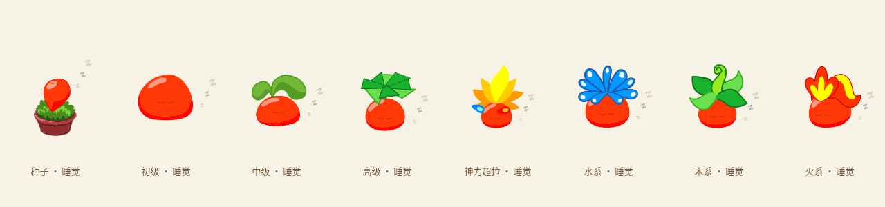</a>

[查看原图](../../artifacts/v26-sleep.png)

### <code>artifacts/v26-wardrobe.png</code>

<a href="../../artifacts/v26-wardrobe.png">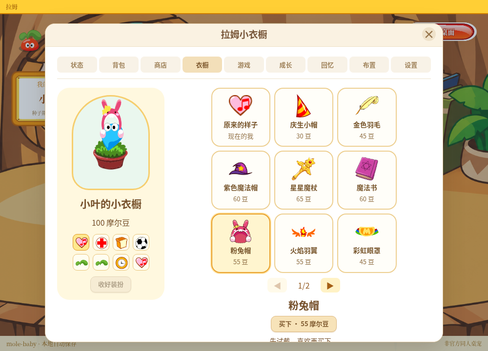</a>

[查看原图](../../artifacts/v26-wardrobe.png)

### <code>artifacts/v27-bubble-bath.png</code>

[查看原图](../../artifacts/v27-bubble-bath.png)

### <code>artifacts/v27-drink-berry-juice.png</code>

[查看原图](../../artifacts/v27-drink-berry-juice.png)

### <code>artifacts/v27-drink-color-blue.png</code>

<a href="../../artifacts/v27-drink-color-blue.png">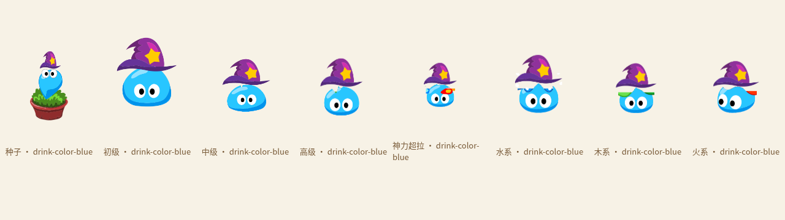</a>

[查看原图](../../artifacts/v27-drink-color-blue.png)

### <code>artifacts/v27-eat-bear-biscuit.png</code>

[查看原图](../../artifacts/v27-eat-bear-biscuit.png)

### <code>artifacts/v27-elastic-pull.png</code>

[查看原图](../../artifacts/v27-elastic-pull.png)

### <code>artifacts/v27-watch-butterfly.png</code>

[查看原图](../../artifacts/v27-watch-butterfly.png)

### <code>artifacts/v28-dizzy-eyes.png</code>

[查看原图](../../artifacts/v28-dizzy-eyes.png)

### <code>artifacts/v28-edge-bottom.png</code>

[查看原图](../../artifacts/v28-edge-bottom.png)

### <code>artifacts/v28-edge-left.png</code>

[查看原图](../../artifacts/v28-edge-left.png)

### <code>artifacts/v28-edge-right.png</code>

[查看原图](../../artifacts/v28-edge-right.png)

### <code>artifacts/v28-edge-top.png</code>

[查看原图](../../artifacts/v28-edge-top.png)

### <code>artifacts/v29-source-spring-poses.png</code>

<a href="../../artifacts/v29-source-spring-poses.png">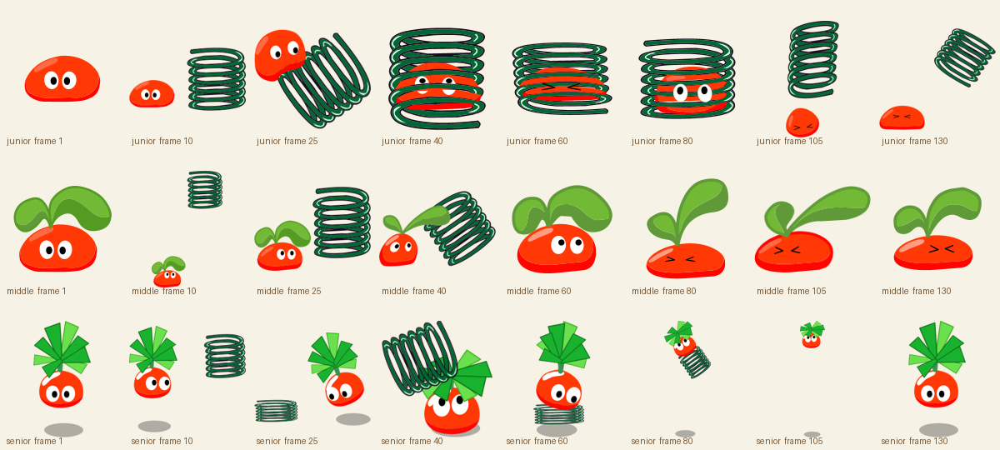</a>

[查看原图](../../artifacts/v29-source-spring-poses.png)

### <code>artifacts/v3-adoption.png</code>

<a href="../../artifacts/v3-adoption.png">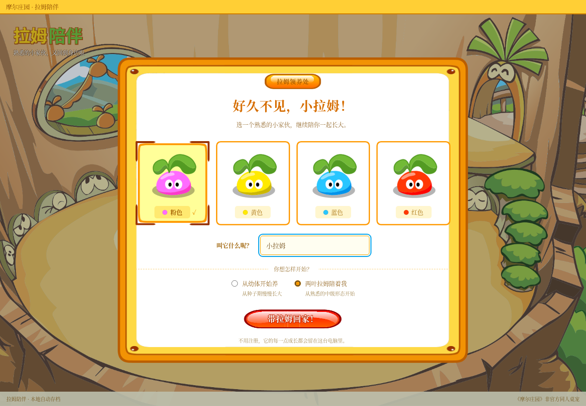</a>

[查看原图](../../artifacts/v3-adoption.png)

### <code>artifacts/v3-food.png</code>

<a href="../../artifacts/v3-food.png">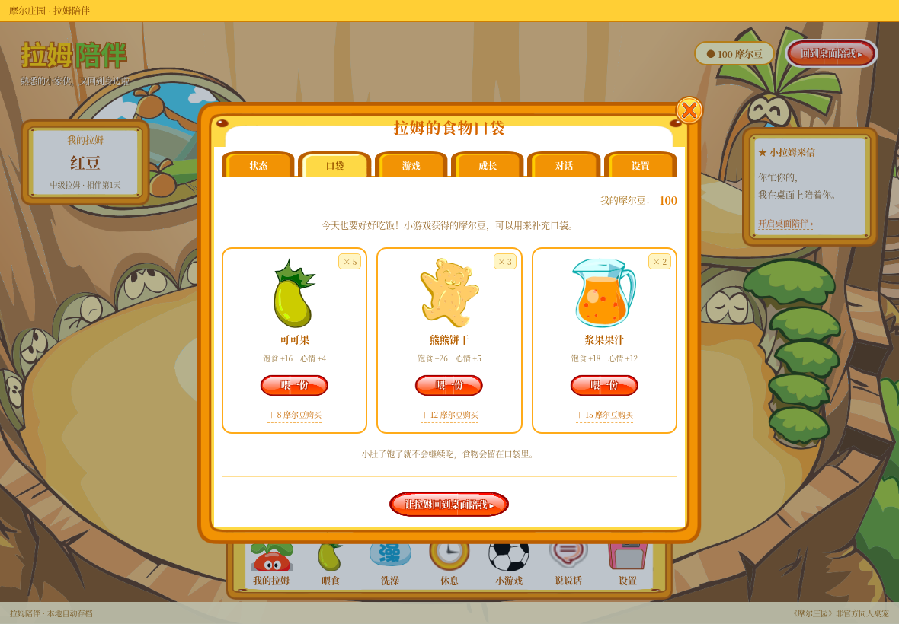</a>

[查看原图](../../artifacts/v3-food.png)

### <code>artifacts/v3-home.png</code>

<a href="../../artifacts/v3-home.png">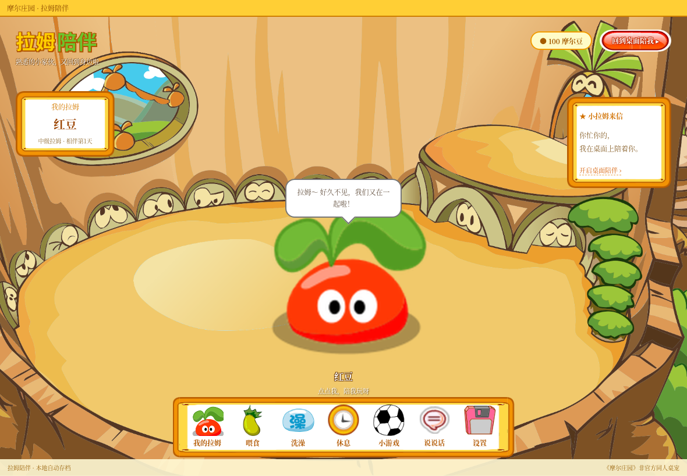</a>

[查看原图](../../artifacts/v3-home.png)

### <code>artifacts/v3-native-pet.png</code>

[查看原图](../../artifacts/v3-native-pet.png)

### <code>artifacts/v30-source/butterfly-0.png</code>

<a href="../../artifacts/v30-source/butterfly-0.png">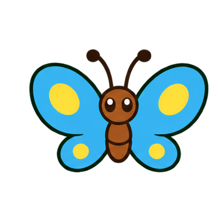</a>

[查看原图](../../artifacts/v30-source/butterfly-0.png)

### <code>artifacts/v30-source/butterfly-1.png</code>

<a href="../../artifacts/v30-source/butterfly-1.png">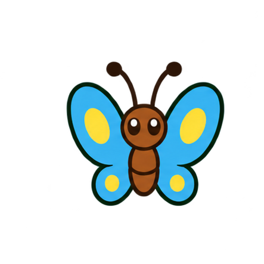</a>

[查看原图](../../artifacts/v30-source/butterfly-1.png)

### <code>artifacts/v30-source/butterfly-2.png</code>

<a href="../../artifacts/v30-source/butterfly-2.png">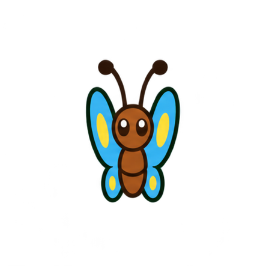</a>

[查看原图](../../artifacts/v30-source/butterfly-2.png)

### <code>artifacts/v30-source/butterfly-3.png</code>

<a href="../../artifacts/v30-source/butterfly-3.png">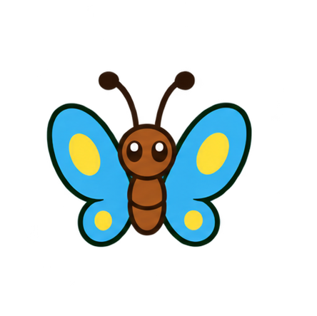</a>

[查看原图](../../artifacts/v30-source/butterfly-3.png)

### <code>artifacts/v30-source/hand-leave.png</code>

[查看原图](../../artifacts/v30-source/hand-leave.png)

### <code>artifacts/v30-source/hand-ready.png</code>

[查看原图](../../artifacts/v30-source/hand-ready.png)

[返回素材首页](../README.md) · [上一页](references-002.md) · [下一页](references-004.md)
