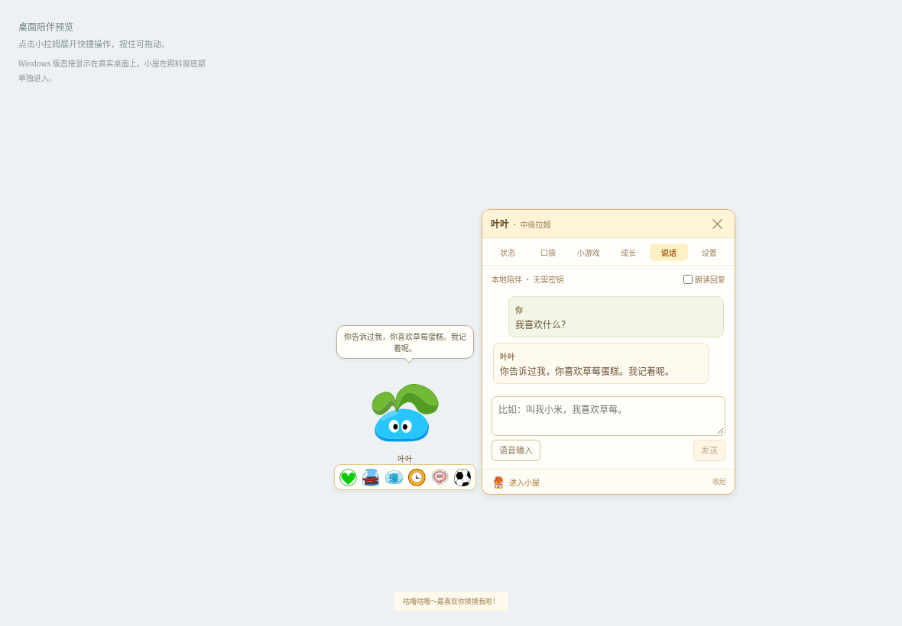
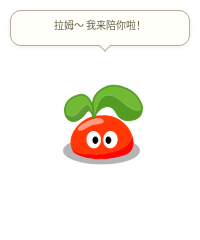
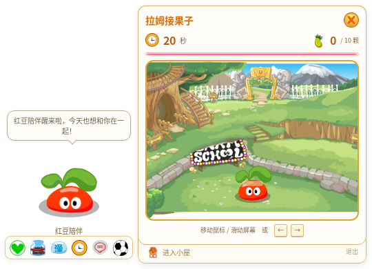
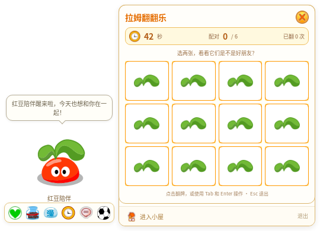
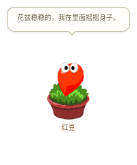
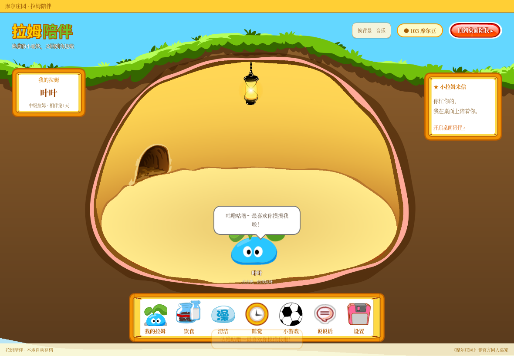
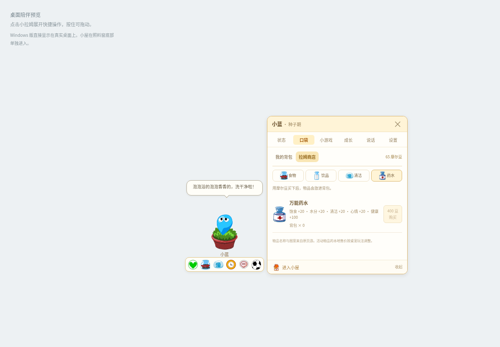
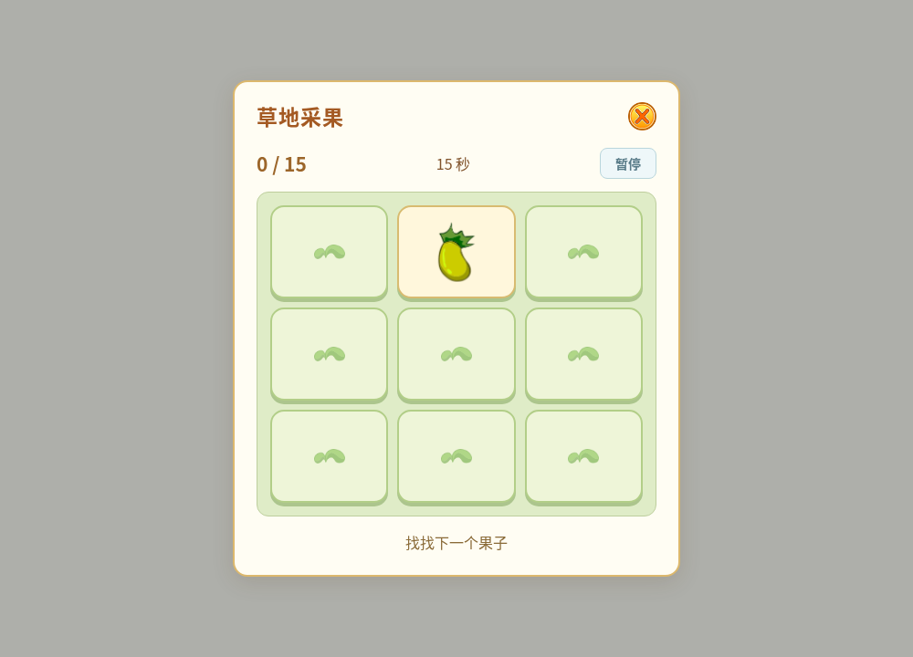

<!-- Generated by scripts/generate-asset-gallery.py. Do not edit. -->
# 设计参考和其他图片 · 5/6

[返回素材首页](../README.md) · [上一页](references-004.md) · [下一页](references-006.md)

本页 24 个文件，点击图片或「查看原图」可打开原文件。

### <code>artifacts/v38-school/furnished-room.png</code>

[查看原图](../../artifacts/v38-school/furnished-room.png)

### <code>artifacts/v38-school/furnishing-editor.png</code>

[查看原图](../../artifacts/v38-school/furnishing-editor.png)

### <code>artifacts/v38-school/restaurant-on-desktop.png</code>

[查看原图](../../artifacts/v38-school/restaurant-on-desktop.png)

### <code>artifacts/v38-school/wind-in-room.png</code>

[查看原图](../../artifacts/v38-school/wind-in-room.png)

### <code>artifacts/v4-compact-food.png</code>

[查看原图](../../artifacts/v4-compact-food.png)

### <code>artifacts/v4-contact-game.png</code>

[查看原图](../../artifacts/v4-contact-game.png)

### <code>artifacts/v4-food.png</code>

[查看原图](../../artifacts/v4-food.png)

### <code>artifacts/v4-home.png</code>

[查看原图](../../artifacts/v4-home.png)

### <code>artifacts/v4-native-compact.png</code>

[查看原图](../../artifacts/v4-native-compact.png)

### <code>artifacts/v4-native-seed.png</code>

[查看原图](../../artifacts/v4-native-seed.png)

### <code>artifacts/v4-native-sidecar.png</code>

[查看原图](../../artifacts/v4-native-sidecar.png)

### <code>artifacts/v5-memory-chat.png</code>

[查看原图](../../artifacts/v5-memory-chat.png)

### <code>artifacts/v5-native-compact.png</code>

[查看原图](../../artifacts/v5-native-compact.png)

### <code>artifacts/v5-native-fruit-game.png</code>

[查看原图](../../artifacts/v5-native-fruit-game.png)

### <code>artifacts/v5-native-memory-game.png</code>

[查看原图](../../artifacts/v5-native-memory-game.png)

### <code>artifacts/v5-native-seed.png</code>

[查看原图](../../artifacts/v5-native-seed.png)

### <code>artifacts/v5-native-sidecar.png</code>

[查看原图](../../artifacts/v5-native-sidecar.png)

### <code>artifacts/v5-room-background.png</code>

[查看原图](../../artifacts/v5-room-background.png)

### <code>artifacts/v5-shop.png</code>

[查看原图](../../artifacts/v5-shop.png)

### <code>artifacts/v6-game-orchard.png</code>

[查看原图](../../artifacts/v6-game-orchard.png)

### <code>artifacts/v6-game-puzzle.png</code>

[查看原图](../../artifacts/v6-game-puzzle.png)

### <code>artifacts/v6-game-rhythm.png</code>

[查看原图](../../artifacts/v6-game-rhythm.png)

### <code>artifacts/v6-native-compact.png</code>

[查看原图](../../artifacts/v6-native-compact.png)

### <code>artifacts/v6-native-seed.png</code>

[查看原图](../../artifacts/v6-native-seed.png)

[返回素材首页](../README.md) · [上一页](references-004.md) · [下一页](references-006.md)
