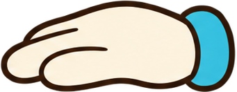
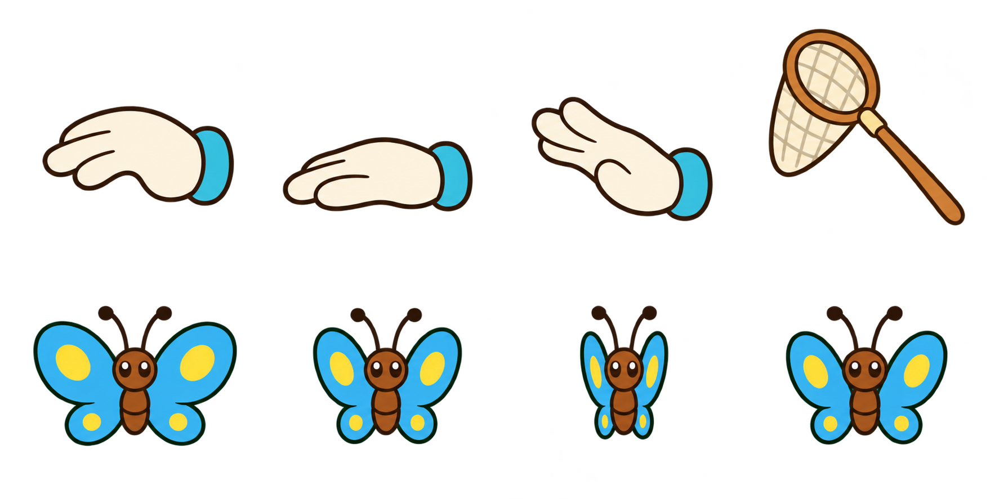
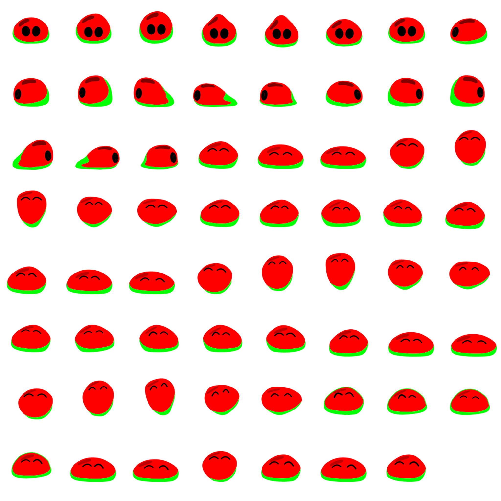
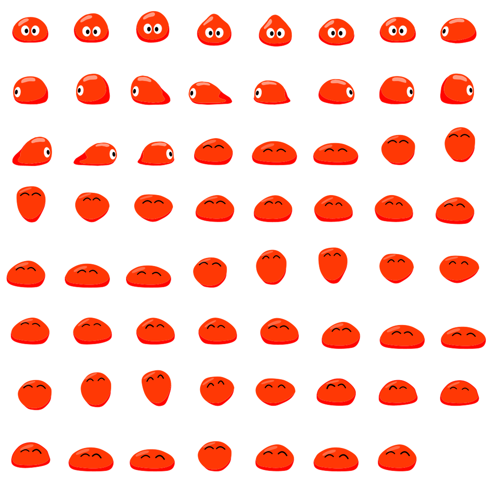
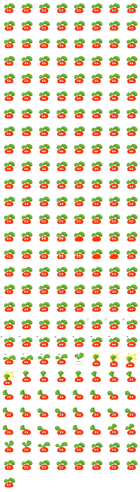
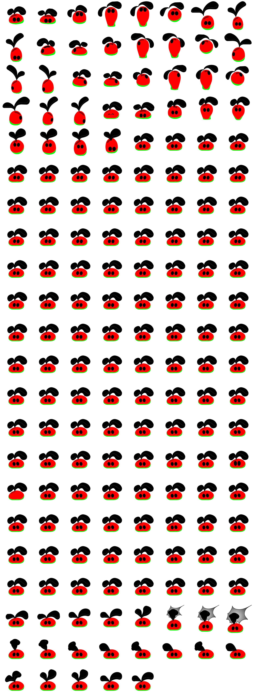
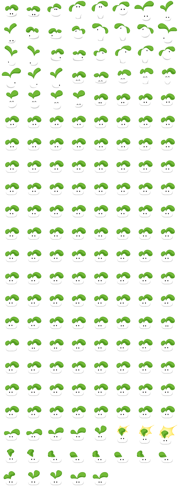
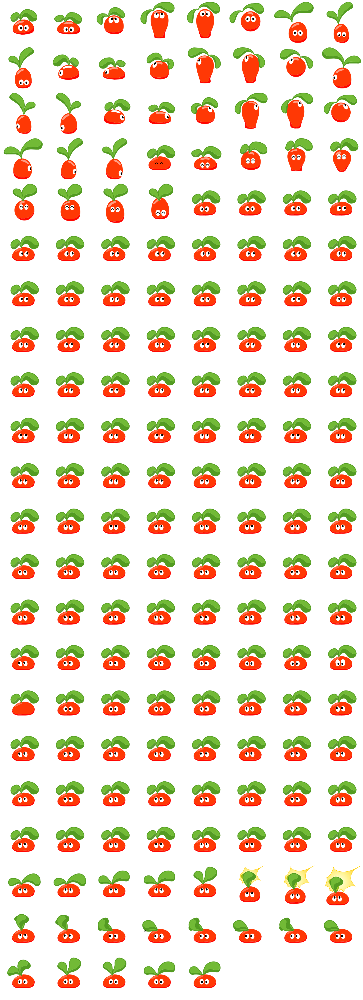
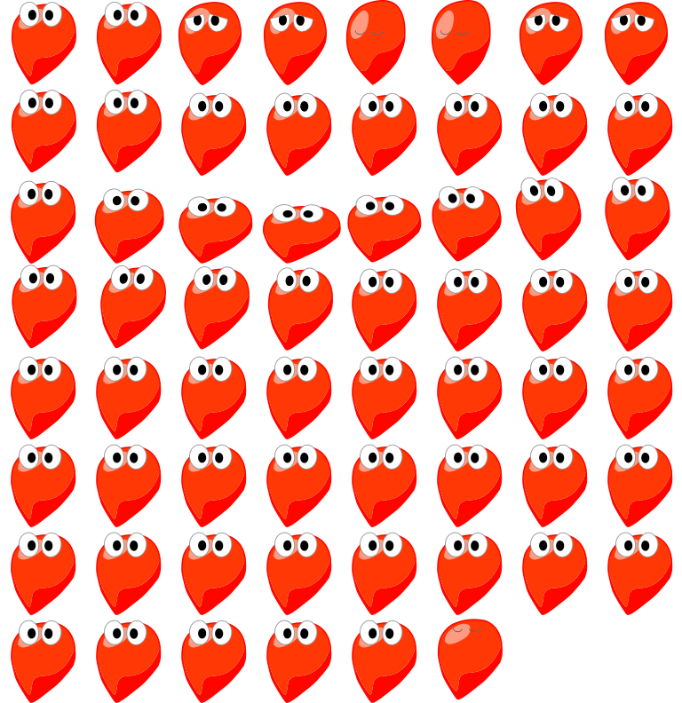

<!-- Generated by scripts/generate-asset-gallery.py. Do not edit. -->
# 设计参考和其他图片 · 5/10

[返回素材首页](../README.md) · [上一页](references-004.md) · [下一页](references-006.md)

本页 24 个文件，点击图片或「查看原图」可打开原文件。

### <code>artifacts/v28-edge-right.png</code>

[查看原图](../../artifacts/v28-edge-right.png)

### <code>artifacts/v28-edge-top.png</code>

[查看原图](../../artifacts/v28-edge-top.png)

### <code>artifacts/v29-source-spring-poses.png</code>

[查看原图](../../artifacts/v29-source-spring-poses.png)

### <code>artifacts/v3-adoption.png</code>

[查看原图](../../artifacts/v3-adoption.png)

### <code>artifacts/v3-food.png</code>

[查看原图](../../artifacts/v3-food.png)

### <code>artifacts/v3-home.png</code>

[查看原图](../../artifacts/v3-home.png)

### <code>artifacts/v3-native-pet.png</code>

[查看原图](../../artifacts/v3-native-pet.png)

### <code>artifacts/v30-source/butterfly-0.png</code>

[查看原图](../../artifacts/v30-source/butterfly-0.png)

### <code>artifacts/v30-source/butterfly-1.png</code>

[查看原图](../../artifacts/v30-source/butterfly-1.png)

### <code>artifacts/v30-source/butterfly-2.png</code>

[查看原图](../../artifacts/v30-source/butterfly-2.png)

### <code>artifacts/v30-source/butterfly-3.png</code>

[查看原图](../../artifacts/v30-source/butterfly-3.png)

### <code>artifacts/v30-source/hand-leave.png</code>

[查看原图](../../artifacts/v30-source/hand-leave.png)

### <code>artifacts/v30-source/hand-ready.png</code>

[查看原图](../../artifacts/v30-source/hand-ready.png)

### <code>artifacts/v30-source/hand-stroke.png</code>

[查看原图](../../artifacts/v30-source/hand-stroke.png)

### <code>artifacts/v30-source/interaction-props-sheet.png</code>

[查看原图](../../artifacts/v30-source/interaction-props-sheet.png)

### <code>artifacts/v30-source/junior-mask.png</code>

[查看原图](../../artifacts/v30-source/junior-mask.png)

### <code>artifacts/v30-source/junior-neutral.png</code>

[查看原图](../../artifacts/v30-source/junior-neutral.png)

### <code>artifacts/v30-source/junior-red.png</code>

[查看原图](../../artifacts/v30-source/junior-red.png)

### <code>artifacts/v30-source/middle-boring-original.png</code>

[查看原图](../../artifacts/v30-source/middle-boring-original.png)

### <code>artifacts/v30-source/middle-mask.png</code>

[查看原图](../../artifacts/v30-source/middle-mask.png)

### <code>artifacts/v30-source/middle-neutral.png</code>

[查看原图](../../artifacts/v30-source/middle-neutral.png)

### <code>artifacts/v30-source/middle-red.png</code>

[查看原图](../../artifacts/v30-source/middle-red.png)

### <code>artifacts/v30-source/net.png</code>

[查看原图](../../artifacts/v30-source/net.png)

### <code>artifacts/v30-source/seed-red.png</code>

[查看原图](../../artifacts/v30-source/seed-red.png)

[返回素材首页](../README.md) · [上一页](references-004.md) · [下一页](references-006.md)
