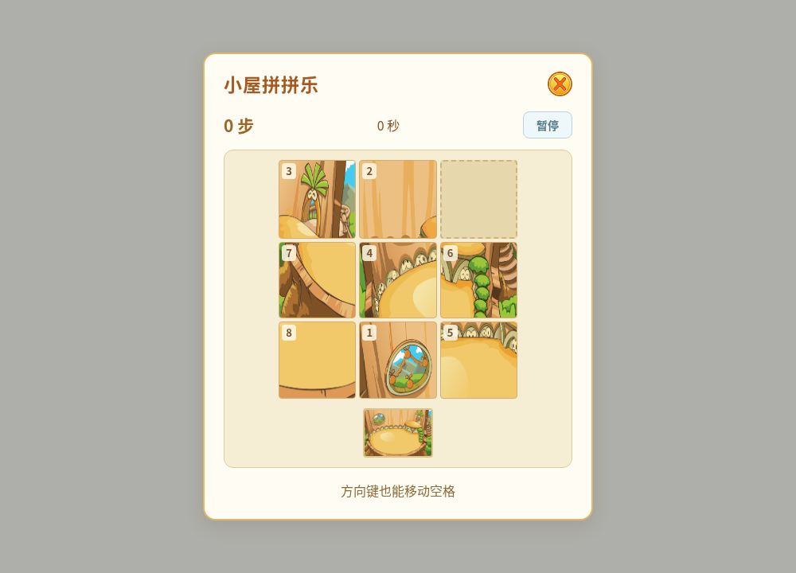
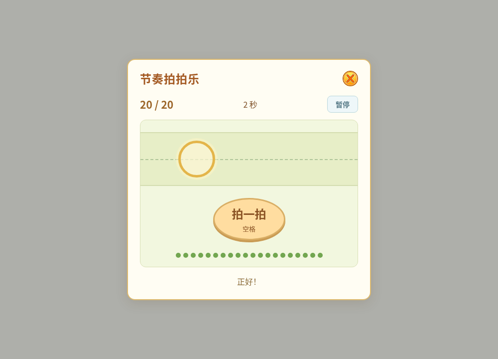
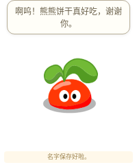
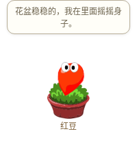

<!-- Generated by scripts/generate-asset-gallery.py. Do not edit. -->
# 设计参考和其他图片 · 6/8

[返回素材首页](../README.md) · [上一页](references-005.md) · [下一页](references-007.md)

本页 24 个文件，点击图片或「查看原图」可打开原文件。

### <code>artifacts/v6-game-puzzle.png</code>

[查看原图](../../artifacts/v6-game-puzzle.png)

### <code>artifacts/v6-game-rhythm.png</code>

[查看原图](../../artifacts/v6-game-rhythm.png)

### <code>artifacts/v6-native-compact.png</code>

[查看原图](../../artifacts/v6-native-compact.png)

### <code>artifacts/v6-native-seed.png</code>

[查看原图](../../artifacts/v6-native-seed.png)

### <code>artifacts/v6-native-sidecar.png</code>

[查看原图](../../artifacts/v6-native-sidecar.png)

### <code>artifacts/v6-room-night.png</code>

[查看原图](../../artifacts/v6-room-night.png)

### <code>artifacts/v6-room-shop.png</code>

[查看原图](../../artifacts/v6-room-shop.png)

### <code>artifacts/v8-evolution-picker.png</code>

[查看原图](../../artifacts/v8-evolution-picker.png)

### <code>artifacts/v8-native-backpack.png</code>

[查看原图](../../artifacts/v8-native-backpack.png)

### <code>artifacts/v8-native-seed.png</code>

[查看原图](../../artifacts/v8-native-seed.png)

### <code>artifacts/v8-seed-sleep-countdown.png</code>

[查看原图](../../artifacts/v8-seed-sleep-countdown.png)

### <code>artifacts/v8-water-sleep.png</code>

[查看原图](../../artifacts/v8-water-sleep.png)

### <code>artifacts/v9-native-backpack.png</code>

[查看原图](../../artifacts/v9-native-backpack.png)

### <code>artifacts/v9-native-seed.png</code>

[查看原图](../../artifacts/v9-native-seed.png)

### <code>artifacts/v9-seed-upright.png</code>

[查看原图](../../artifacts/v9-seed-upright.png)

### <code>artifacts/v9-social-contact.png</code>

[查看原图](../../artifacts/v9-social-contact.png)

### <code>artifacts/v9-square-backpack.png</code>

[查看原图](../../artifacts/v9-square-backpack.png)

### <code>research/references/ramu-2008-2010/images/body-still.png</code>

[查看原图](../../research/references/ramu-2008-2010/images/body-still.png)

### <code>research/references/ramu-2008-2010/images/fire-blue-idle.png</code>

[查看原图](../../research/references/ramu-2008-2010/images/fire-blue-idle.png)

### <code>research/references/ramu-2008-2010/images/fire-pink-idle.png</code>

[查看原图](../../research/references/ramu-2008-2010/images/fire-pink-idle.png)

### <code>research/references/ramu-2008-2010/images/fire-red-idle.png</code>

[查看原图](../../research/references/ramu-2008-2010/images/fire-red-idle.png)

### <code>research/references/ramu-2008-2010/images/fire-yellow-idle.png</code>

[查看原图](../../research/references/ramu-2008-2010/images/fire-yellow-idle.png)

### <code>research/references/ramu-2008-2010/images/junior-blue-idle.png</code>

[查看原图](../../research/references/ramu-2008-2010/images/junior-blue-idle.png)

### <code>research/references/ramu-2008-2010/images/junior-pink-idle.png</code>

[查看原图](../../research/references/ramu-2008-2010/images/junior-pink-idle.png)

[返回素材首页](../README.md) · [上一页](references-005.md) · [下一页](references-007.md)
