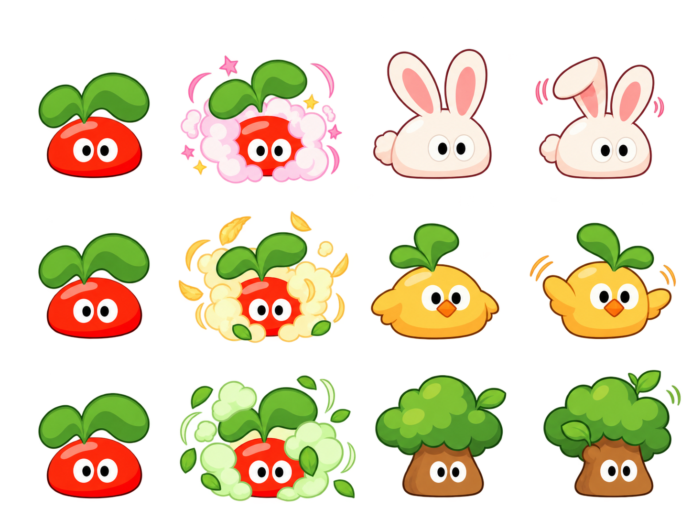
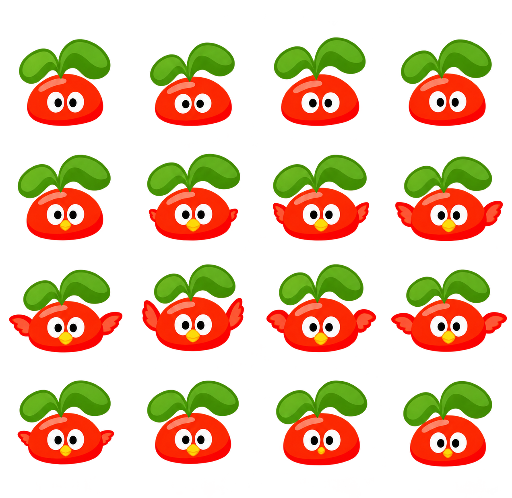
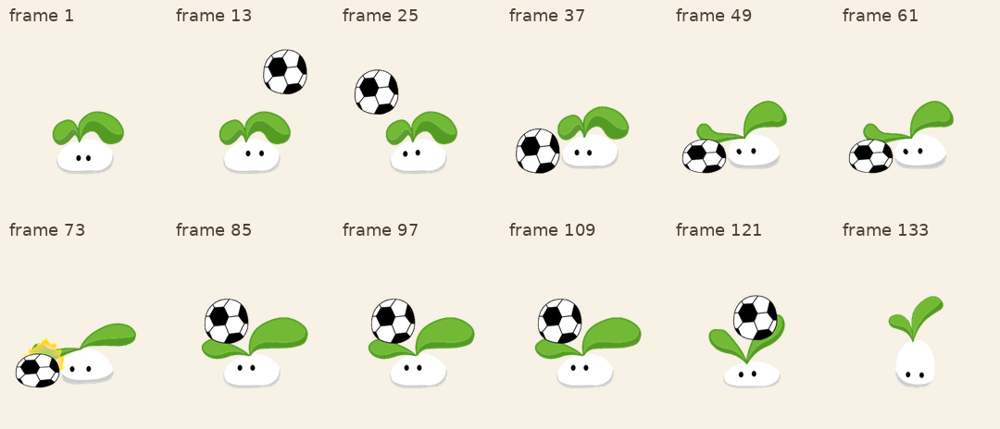
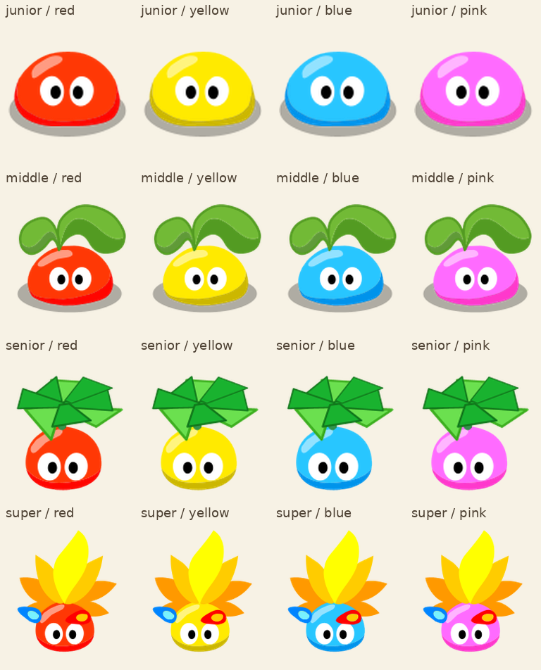
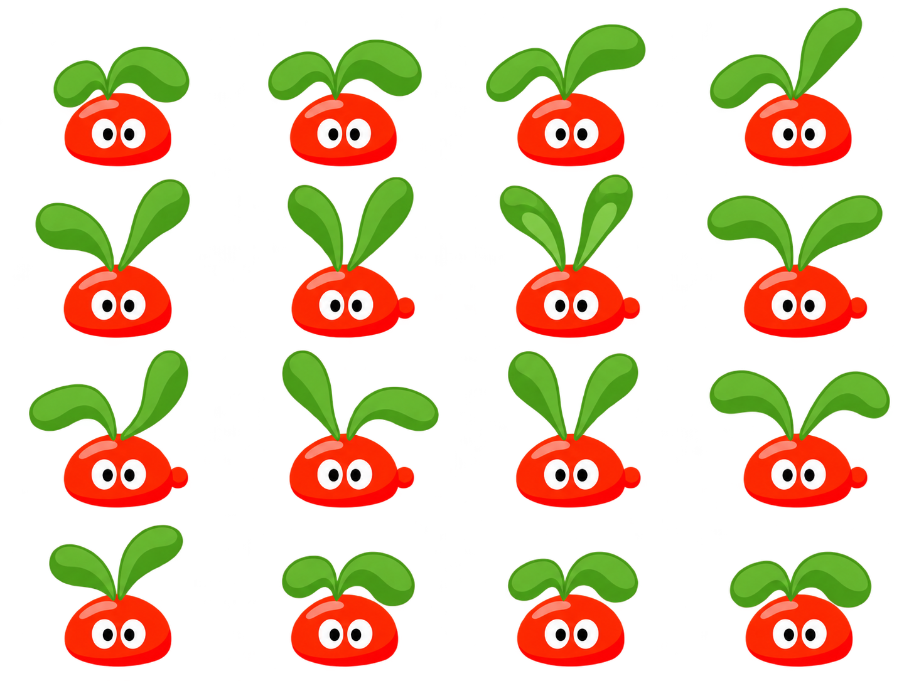
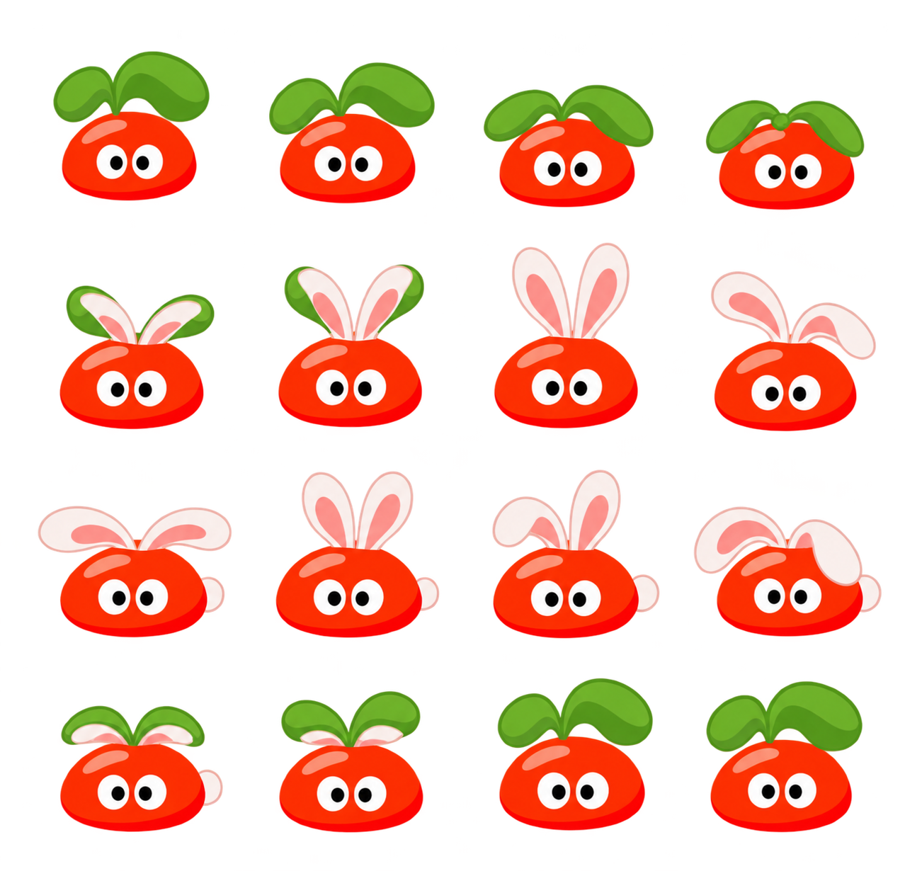
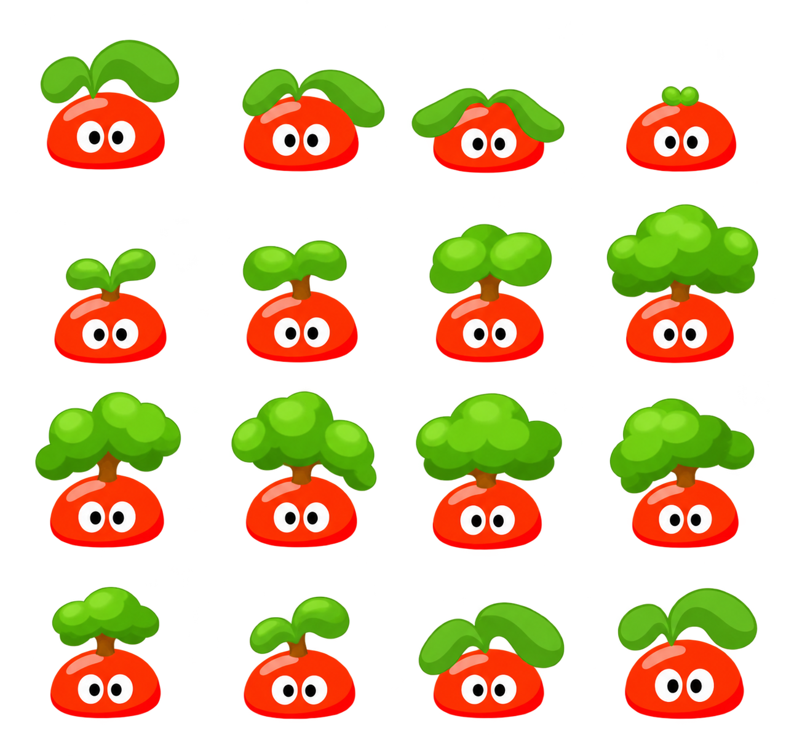
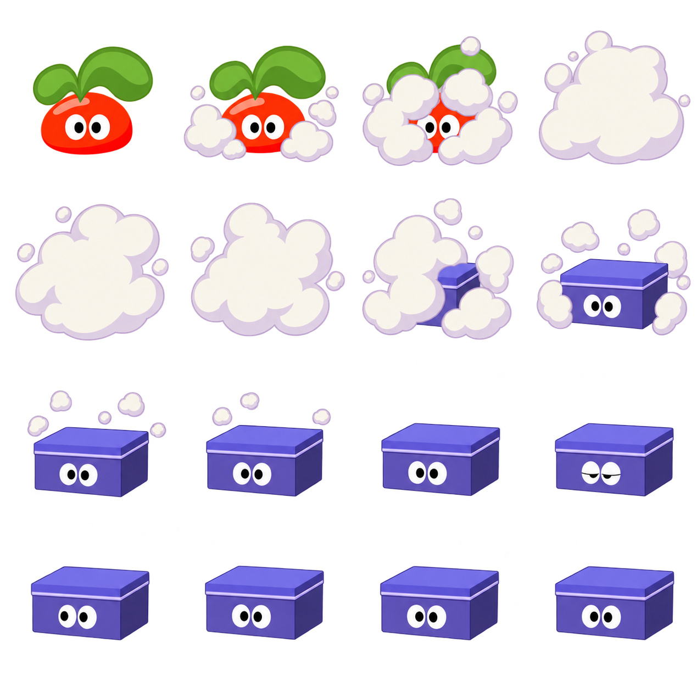
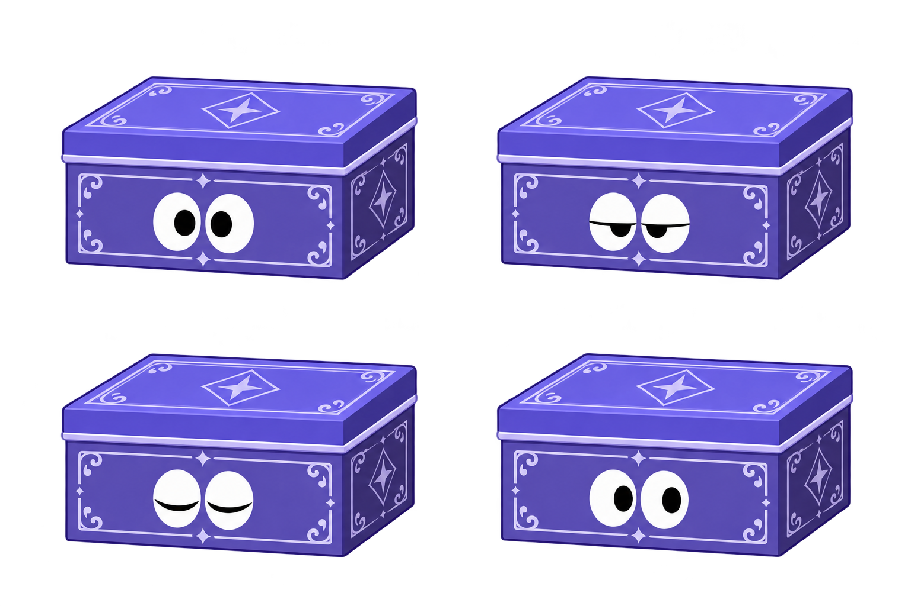

<!-- Generated by scripts/generate-asset-gallery.py. Do not edit. -->
# 设计参考和其他图片 · 9/10

[返回素材首页](../README.md) · [上一页](references-008.md) · [下一页](references-010.md)

本页 24 个文件，点击图片或「查看原图」可打开原文件。

### <code>research/references/ramu-2008-2010/images/water-blue-idle.png</code>

[查看原图](../../research/references/ramu-2008-2010/images/water-blue-idle.png)

### <code>research/references/ramu-2008-2010/images/water-pink-idle.png</code>

[查看原图](../../research/references/ramu-2008-2010/images/water-pink-idle.png)

### <code>research/references/ramu-2008-2010/images/water-red-idle.png</code>

[查看原图](../../research/references/ramu-2008-2010/images/water-red-idle.png)

### <code>research/references/ramu-2008-2010/images/water-yellow-idle.png</code>

[查看原图](../../research/references/ramu-2008-2010/images/water-yellow-idle.png)

### <code>research/references/ramu-2008-2010/images/wood-blue-idle.png</code>

[查看原图](../../research/references/ramu-2008-2010/images/wood-blue-idle.png)

### <code>research/references/ramu-2008-2010/images/wood-pink-idle.png</code>

[查看原图](../../research/references/ramu-2008-2010/images/wood-pink-idle.png)

### <code>research/references/ramu-2008-2010/images/wood-red-idle.png</code>

[查看原图](../../research/references/ramu-2008-2010/images/wood-red-idle.png)

### <code>research/references/ramu-2008-2010/images/wood-yellow-idle.png</code>

[查看原图](../../research/references/ramu-2008-2010/images/wood-yellow-idle.png)

### <code>skills/mole-classic-art/references/v38/elemental-keyframes.png</code>

[查看原图](../../skills/mole-classic-art/references/v38/elemental-keyframes.png)

### <code>skills/mole-classic-art/references/v38/furniture-sheet.png</code>

[查看原图](../../skills/mole-classic-art/references/v38/furniture-sheet.png)

### <code>skills/mole-classic-art/references/v38/original-reference.png</code>

[查看原图](../../skills/mole-classic-art/references/v38/original-reference.png)

### <code>skills/mole-classic-art/references/v38/study-service-keyframes.png</code>

[查看原图](../../skills/mole-classic-art/references/v38/study-service-keyframes.png)

### <code>skills/mole-classic-art/references/v39/elements-sheet-initial.png</code>

[查看原图](../../skills/mole-classic-art/references/v39/elements-sheet-initial.png)

### <code>skills/mole-classic-art/references/v39/hero-elements-with-haze.png</code>

[查看原图](../../skills/mole-classic-art/references/v39/hero-elements-with-haze.png)

### <code>skills/mole-classic-art/references/v39/magic-sheet.png</code>

[查看原图](../../skills/mole-classic-art/references/v39/magic-sheet.png)

### <code>skills/mole-classic-art/references/v40/transform-sheet.png</code>

[查看原图](../../skills/mole-classic-art/references/v40/transform-sheet.png)

### <code>skills/mole-classic-art/references/v41/bird-sheet.png</code>

[查看原图](../../skills/mole-classic-art/references/v41/bird-sheet.png)

### <code>skills/mole-classic-art/references/v41/football-middle-original-poses.png</code>

[查看原图](../../skills/mole-classic-art/references/v41/football-middle-original-poses.png)

### <code>skills/mole-classic-art/references/v41/original-form-colours.png</code>

[查看原图](../../skills/mole-classic-art/references/v41/original-form-colours.png)

### <code>skills/mole-classic-art/references/v41/rabbit-same-stage-alternative.png</code>

[查看原图](../../skills/mole-classic-art/references/v41/rabbit-same-stage-alternative.png)

### <code>skills/mole-classic-art/references/v41/rabbit-sheet.png</code>

[查看原图](../../skills/mole-classic-art/references/v41/rabbit-sheet.png)

### <code>skills/mole-classic-art/references/v41/tree-sheet.png</code>

[查看原图](../../skills/mole-classic-art/references/v41/tree-sheet.png)

### <code>skills/mole-classic-art/references/v45/blue-box-input.png</code>

[查看原图](../../skills/mole-classic-art/references/v45/blue-box-input.png)

### <code>skills/mole-classic-art/references/v45/box-edit-input.png</code>

[查看原图](../../skills/mole-classic-art/references/v45/box-edit-input.png)

[返回素材首页](../README.md) · [上一页](references-008.md) · [下一页](references-010.md)
