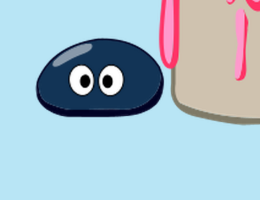
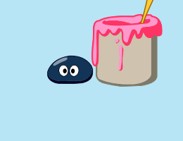

# v0.31.8 验证记录

用户要求修复桌面涂鸦突然放大的问题，自测后重新发布并附带安卓版本；安卓选择固定签名预览版。用户已配置签名 Secrets，预发布流程确认固定签名可用。私钥与密码不进入仓库。

## 涂鸦比例

问题可以按形态复现：初级拉姆的涂鸦一、二，开场身体约 127.3 CSS 像素，静态身体约 64.916 CSS 像素，接近 1.96 倍。原导出器按整个动作的身体宽度分位数归一化，而这两个动作后半段原本就有缩小，导致整段被过度放大。中级拉姆没有同等放大，因此不是每个用户都会复现。

现在按每个原片的第一帧身体校准一个固定 `registration.displayScale`，供画布和原生窗口边界共用。原片中的移动、伸缩和绘画道具保持原样，没有逐帧强行缩放。导出工具和现有 16 段元数据同步修正；[独立校准数值](tuya-size-calibration.json)记录原身体像素宽度、目标宽度和修正因子。

| 同一原始帧、相同桌面尺寸 | 截图 |
| --- | --- |
| 原显示比例复现 |  |
| 修正后 |  |

修改前截图用相同原始画布恢复旧版 CSS 比例，修改后截图来自实际修正画布。两张图均使用原图片像素，不是重绘的对比图。

## 本地验证

- 540 项检查通过（388 Vitest、152 Node）；发布依赖与回执相关 9 项 Node 检查另行通过。
- 生产构建通过，1126 张图片无损处理，全部透明度与可见像素核验通过。
- 实际 Chromium 画布覆盖四种形态、四种涂鸦、100%／125%／150%／200% DPR，共 64 组；真实画布身体宽度与静态参考一致，扩大视口不会放大角色。
- Linux 原生 Electron 35.7.5 与兼容运行时 Electron 22.3.27 均通过原动作检查，覆盖播放、取消／卡住不发奖励、完成仅结算一次、用品使用、四种形态和原生窗口锚点还原。旧运行时首次检查在清理重载时超时，增加原始错误日志后完整重跑通过，没有放宽断言或修改生产逻辑。
- 对比 v0.31.7：16 段涂鸦的 JSON 除新增 `registration.displayScale` 外全部一致，包括帧序、姿态、矩形、帧率、时长和纹理列表；没有修改任何原始 PNG／WebP 图集。

预发布 Mac ARM 检查还捕获了背包分类的短暂空白：分类先更新，物品列表经被动 effect 才更新。列表现在与分类在同次渲染计算，同时保留本次访问中已用完物品的位置。原生分类测试仍立即核对四类内容、16 个方格和键盘导航，没有放宽成重试。

Windows 的动作位置断言原本在原生窗口完成变化、React 尚未消费新偏移时立即取样；窗口边界与页面偏移分别通过 IPC 到达。现在使用有界轮询等待物理位置收敛，仍要求与原锚点偏差严格小于 1 像素，扩展和还原都检查。若最终位置漂移，测试仍失败。

## 发布门槛

正式标签发布依赖现代 Windows、兼容 Windows x64／ia32、Mac ARM／Intel，以及 Android。安卓必须使用固定密钥，运行实际 WebView／悬浮窗测试、实际 APK 差量重建及覆盖安装保留存档测试，并额外安装固定签名 release APK、领养拉姆、覆盖安装更高版本 APK 后验证名字和小屋控件。更高版本测试夹具不对外发布。

安卓最低 Android 8、WebView 108；厂商后台策略和具体真机的长时间锁屏仍需要对应设备验证。本地签名 Mac 未进行 Apple 公证。旧 Windows 检查使用 Electron 22 及 Windows 构建机，不能据此宣称已在实体 Windows 7 电脑全面验证。

正式发布结果在全部门槛完成后补入本文件。
