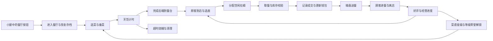

# 原版拉姆餐厅移植调研

调研日期：2026-11-05。目标是从小屋进入可实际经营的餐厅，让自己的拉姆工作，通过真实订单、库存和结算获得摩尔豆，并持续保存进度。

**结论：可以实现这个本地经营闭环。实现方式是复用原版素材、移植已确认的客户端规则，并在本地重建原服务器承担的经营与结算。现有资料不足以承诺原服全部联网玩法、历次活动和隐藏结算公式完全一致。** 本轮完成静态代码调查、配置解码、资源清单和官网资源抽样核验，尚未实现可玩的餐厅，也未连接官方游戏服务器进行营业对照。

## 实际取得的依据

来源仍为 [Miigon/RecMoleRes 固定存档](https://github.com/Miigon/RecMoleRes/tree/7a6d6b3c7037a85afb28ad6abd4d7f4adfddb5ff)。原件位于 `local-assets/raw/`，本轮的官网补取样本另存于 `local-assets/research/restaurant-port/official/`，没有覆盖固定存档。

| 已核对内容 | 结果 | 主要依据 |
| --- | --- | --- |
| 餐厅客户端逻辑 | 13 个核心类，4,211 行反编译文本；未检出本地审计使用的反编译错误标记 | `ClientAppDLL` 的 `com.module.restaurant` |
| 原物品配置 | 完整解出 14,986 个条目，消费完全部 1,307,573 字节 AMF3 数据 | `ClientConfigDLL` 的 `XMLInfo_itemXmlData`；`GoodsInfo.parseXML` |
| 常规菜品 | 72 道可烹饪菜，材料、制作时间、烧糊时间、份数、价格字段、星级阈值等均可读取；与 72 条菜谱介绍的 ID 集合一致 | `InfoRestaurantMenuObj`、AMF3 物品表 |
| 非常规菜品记录 | 另有 `1340038`“待定”和 `1340047`“五彩沙拉”，制作时间为 0，未混入常规菜谱 | 同上 |
| 食材 | 常规菜共引用 28 个材料 ID，均能在物品表找到名称 | 菜品 `Food` 字段；重复 ID 表示材料重复需求 |
| 餐厅成长 | 上限 60 级、等级经验表、按等级变化的雇员上限、16 项荣誉配置 | `InfoRestaurantUIObj` |
| 系统顾客 | 20 个预设顾客记录，包含名字、颜色、阶段和技能字段 | `InfoRestaurantGuestObj`；这是顾客表，不是完整雇员表 |
| 随机事件 | 17 条事件配置，包含选项、结果文案及部分奖励信息 | `InfoRestaurantEventObj` |
| 内饰容量 | 15 个含灶台、餐台和餐桌容量的内饰条目 | 原物品表 `Stove / FoodTable / Table` |
| 原声音 | 餐厅主模块中已有 6 个 MP3，包含 BGM 与操作音效 | `module/restaurant/restaurant.swf` 导出声音 |
| 网络依赖 | 同一街区/餐厅协议类包含 30 个发送命令，另有等级、荣誉、菜品升级推送 | `ClientSocketDLL` 的 `oneBigStreetSocket` |

例如“清炒毛毛豆”的原配置包含：烹饪时间 300 秒、完成后烧糊时限 600 秒、基础份数 15、售价字段 `SellPrice=10`、材料 `190196`。`Price=0` 只是该成本字段，不能据此宣称整道菜没有材料成本或已确定净利润。

物品表与菜谱介绍有两处名称差异，已保存在证据 JSON 中：`1340016` 的“彩虹/七彩浆果烩蝶鱼”，以及 `1340018` 的“神秘湖蟹蓉泡芙/神秘湖蟹蓉泡”。实现时应统一展示来源，保留原配置的对应关系。

## 可以还原的完整经营流程

原客户端已经提供了主要状态和动作的连接方式：

- `RestaurantFood`：选择菜谱、改变备菜状态，状态 3 烹饪、4 完成、5 烧糊、6 餐台供应；相同菜品可以合并到餐台，空位不足有检查逻辑。
- `RestaurantGuest`：顾客生成、找空桌、排队、等待食物、选择可供应菜品、占用空闲雇员、吃饭和离店。排队计数初值 14、等餐计数初值 15，进餐计时为 16 秒；实际排队与等餐还受轮询和移动影响。
- `addLamuByRestaurant.guestTimerFun`：根据好评计算顾客到店间隔，并设置至少 2 秒的间隔下限。
- `RestaurantGuest.empGetFood / addFoodToEmp / onFoodOver`：空手去餐台 → 切换 `1200042` 端盘服装 → 到顾客桌前 → 恢复 `1200043` 空手服装 → 顾客开始进餐。桌上的餐盘由进餐结束逻辑清除。
- `RestaurantEmp`：雇员空闲/忙碌状态、工作到期和解雇。自己的拉姆可以作为本地身份接入这套状态机。
- `RestaurantView / RestaurantUI`：进出餐厅、店名、资金、经验、好评、房型切换和管理面板。

原版的 `checkFoodNum` 请求发生在雇员取餐之后，响应 `1018` 返回剩余库存与 `userMoney`，随后才继续端盘动画。实现时应由成交事件驱动资金变化，并以订单/交易 ID 保证只结算一次。

## 服务端缺口及实现边界

| 功能 | 客户端里已有什么 | 本地移植需要做什么 |
| --- | --- | --- |
| 基础做菜、库存、送餐 | 状态机、原动画、制作时间、材料与产量字段 | 移植成 TypeScript 逻辑，处理材料扣除、位置占用、取消与恢复 |
| 金币与经验 | `1017 / 1018 / 1021 / 1026` 等响应返回资金、产量、经验或等级 | 实现本地交易账本；没有核实的经验修正公式须标为适配规则 |
| 自己的拉姆工作 | 服装切换、身份字段、空闲/忙碌和工作到期处理 | 绑定当前宠物身份，与睡觉、上课、外出互斥；不覆盖永久外观 |
| 系统员工 | 雇员列表结构、界面和部分描述；实际名单、工资、雇期由 `1022 / 1015` 返回 | 建立本地员工配置，补定薪资与雇期；无法声称当前已有完整原服雇员表 |
| 离线经营 | `1023` 接收离线金币、好评、星级和事件次数 | 重建本地离线结算；原服务器的销量、费用和随机处理公式没有随客户端提供 |
| 菜品星级、等级与荣誉 | 阈值、称号、解锁文案；`1046 / 1047` 返回制作次数、星级和额外奖励 | 保存本地计数，核对或明确适配奖励公式，处理跨级解锁 |
| 神秘商人与事件 | 触发流程、选项、部分奖励、收购数量检查 | `1043 / 1044` 报价和 `1031 / 1032` 事件由服务器返回；本地重建报价、概率、冷却与奖励 |
| 好友雇佣、互访、好友排名 | 协议、界面和好友列表引用 | 本地 NPC 可以提供单机体验；真实玩家之间的这些功能需要另建账号、存档与联网服务 |
| 原版食材来源 | 28 种食材的名称与菜品需求 | 原食材涉及其他庄园系统。独立桌宠可增加本地采购渠道；完整移植种植、采集等来源会扩大为餐厅之外的子系统 |

`houseMoney` 是可为负的经营统计，玩家可用钱包另由 `LocalUserInfo` 管理。移植时应继续区分净收益统计与可花费摩尔豆，避免重复加钱，也不能把原餐厅的负净收益直接塞进现有宠物钱包。

原代码还存在需要结合实际执行核对的历史分支。例如 `RestaurantGuest.isJoin()` 先计算营业时间，随后又执行 `ret = true`。不能只看前面的时段判断，就宣传此快照仍有该营业时间限制。

## 素材覆盖与官网核验

固定存档的 21,523 个文件已完整保存，但本次按餐厅实际调用清单检查，发现它并未覆盖餐厅引用的全部外部资源。

| 检查项目 | 固定存档中已有 | 本轮进展 |
| --- | ---: | --- |
| 72 道常规菜的独立制作模型 | 8 / 72 | 抽样补取到 `1340001`、`1340004` 的有效原 SWF，其余模型还需逐项补齐 |
| 对应独立菜谱图标路径 | 30 / 72 | 尚未逐项补齐；此统计未包含面板内嵌图形，不能据路径缺失断言图案完全不存在 |
| 15 个餐厅内饰模型 | 5 / 15 | 补取到 `1330006`；其余内饰仍需逐项核验 |
| 核心类中固定写出的 SWF 引用 | 5 / 12 | 已补取菜谱总览、收益、等级、好评 4 个面板；另有好友面板 2 个和宠物手册 1 个待核实 |

官网实际获取并验证了 8 个有效 SWF。当前官网的[餐厅主模块](https://mole.61.com/module/restaurant/restaurant.swf)与固定存档逐字节一致；补取的[菜谱总览](https://mole.61.com/module/external/restaurantMenuBtnMain.swf)、[收益面板](https://mole.61.com/module/external/restaurantMoneyMain.swf)、[等级面板](https://mole.61.com/module/external/restaurantLevelMain.swf)和[好评面板](https://mole.61.com/module/external/restaurantFavor.swf)均通过 SWF 头、长度和解压校验，SHA-256 已记录。

好友餐厅列表和他人餐厅状态两个探测请求仍出现连接中断或超时，不能据此认定文件已下线。`ModuleType.RESTAURANT_ACTIVE_PANEL` 还经过模块管理器间接加载，此处 12 个静态引用也不是整个客户端依赖树的总数。

因此，原版场景和管理界面具有继续补齐的依据；完整素材覆盖尚需在实现前列出最终清单，并逐项验证版本、嵌套资源及交互帧。无需重下此前完整缓存的客户端存档。

## 接入现有桌宠的建议

采用现有 React/TypeScript 界面与 Canvas 场景，把原图形导出成按需加载的图集。原版 Flash 模块同时依赖 `GV / GF`、全局场景管理器、寻路、事件分发和 Socket 宿主；当前应用没有这套宿主。直接运行原 SWF 仍需要补齐这些依赖。使用现有技术栈移植能沿用桌面与 Android 的存档、音效和窗口管理方式。

小屋增加一个“拉姆餐厅”入口，进入独立餐厅界面，退出回小屋。保留原版固定房型提供的灶台、餐台、餐桌容量及位置；房型升级按原配置改变容量。不要把小屋的任意家具摆放直接当成原餐厅布局规则。

建议增加带独立版本的可选 `restaurant` 存档字段，保存房型、解锁、食材、批次、员工、交易游标和离线时间。现有主存档 key `ramu-house-save-v1` 与记忆 key 保持原址。当前 `parseSave()` 按白名单重建对象，**只加 UI 字段会在重载或导入时丢失餐厅**，必须同时完善解析、默认值、备份导出与恢复。

还有三个必须处理的兼容点：

1. 现有背包解析拒绝未知道具，餐厅的 28 种食材应有自己的验证与库存，不能直接塞入现有照料用品背包。
2. 现有打工是 `120,000 ms / 180 豆` 的活动，`normalizeActivity()` 严格验证持续时间。旧玩家正在进行的工作要按旧规则结算一次；新经营收入由成交结算，避免两套奖励叠加或旧活动被吞掉。
3. 工作服、工作姿态是餐厅中的临时显示，继续使用玩家当前颜色和身份，不覆写永久颜色、成长形态或原穿戴。离开后恢复正常显示。

餐厅 BGM 和操作音效接入现有设置，进入、退出和后台恢复时统一切换，避免同时播放房间与餐厅音乐。手机需要适配触摸选菜、缩放后的点击区域和窄屏菜单，并验证后台暂停、杀进程恢复及内存占用。

## 实施与验收顺序

| 阶段 | 交付内容 | 验收重点 |
| --- | --- | --- |
| 资源与规则整理 | 补全所选餐厅资源；导出菜谱、材料、房型和动作表；列清原规则与本地适配 | 素材逐项对应、版本不混用、未知收益规则不冒充原公式 |
| 第一条可玩经营链 | 一间原版餐厅、几道基础菜、自家拉姆、顾客完整到店与送餐、实际扣料与成交、存档 | 从小屋进入即可经营；库存和钱与订单一致，反复进出不重复奖励。这是中间里程碑 |
| 扩展本地内容 | 72 道常规菜、房型、60 级成长、星级、员工、荣誉、事件和商人 | 每项确认资源与规则；适配部分明确记录，持续提供可玩预览 |
| 完成兼容与离线 | 旧存档迁移、离线补算、备份恢复、异常中断恢复、桌面与手机验证 | 旧宠物、旧钱、旧记忆保留；保存失败不吞材料；连续营业与一次离线补算结果一致或符合已公开的上限 |
| 真实多人功能 | 若目标包含真实好友互访、跨玩家雇佣和排行榜，另外建设服务端 | 多人同步、资金一致性与跨端存档；不将本地 NPC 当成真实好友 |

实现测试应覆盖：没菜、没人服务、餐台满、材料不足、客人超时离开、员工到期、制作中关闭程序、手机进入后台、重复点菜与重复结算、钱包和存档写入失败、旧打工进行中升级、导入旧备份、拉姆颜色和形态保持，以及多个角色同时移动时的性能。当前 11 秒送餐动图只证明原动作组合可以循环，不属于这些经营功能已经实现的证据。

## 本轮产物与复查

- [port-feasibility.json](references/restaurant/port-feasibility.json)：来源哈希、13 个核心类、协议清单、配置和素材覆盖、官网探测结果。
- [recipe-coverage.csv](references/restaurant/recipe-coverage.csv)：72 道常规菜的数值字段及原存档模型/图标覆盖情况。
- `scripts/client-library/amf3.py`：只解析数据的 AMF3 读取器，不执行原脚本。
- `scripts/client-library/audit_restaurant.py`：从本地原件重建本报告所用清单，运行方式：`python3 scripts/client-library/audit_restaurant.py`。

本轮没有修改游戏运行逻辑、玩家存档或自动更新渠道，也没有 push 或发版。
