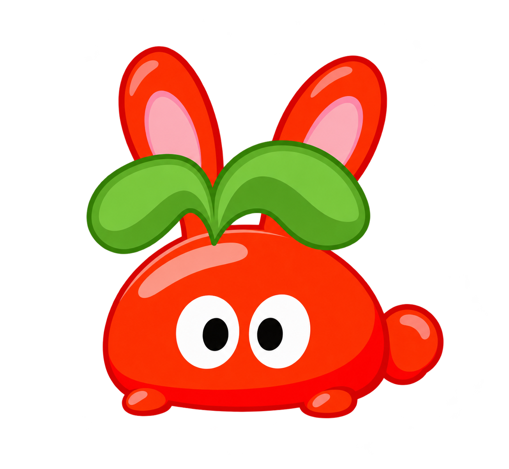
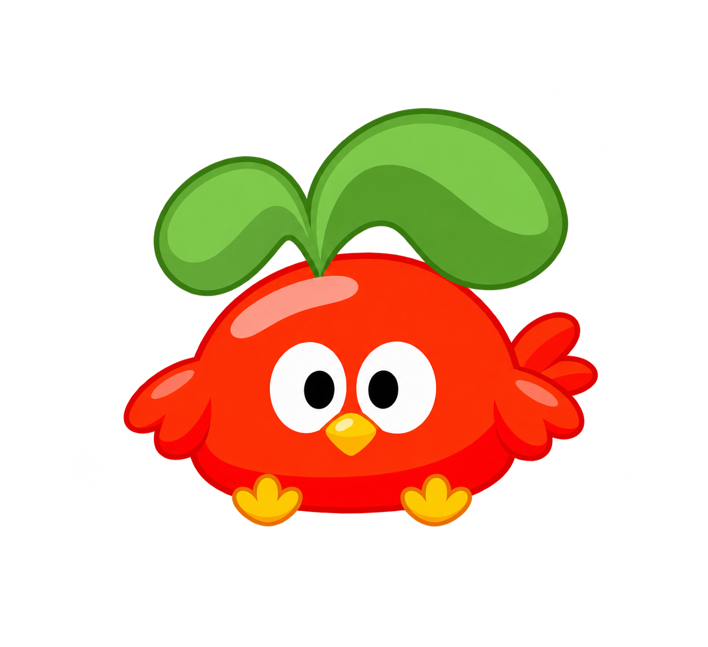
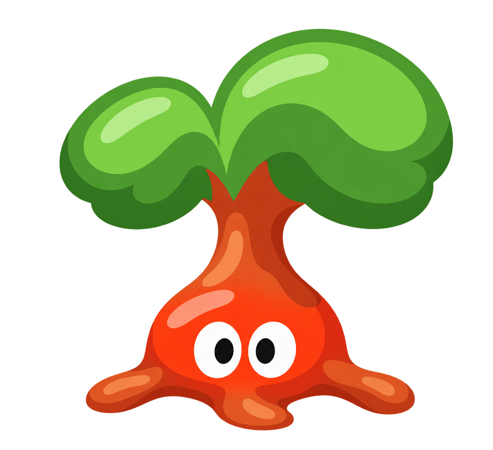
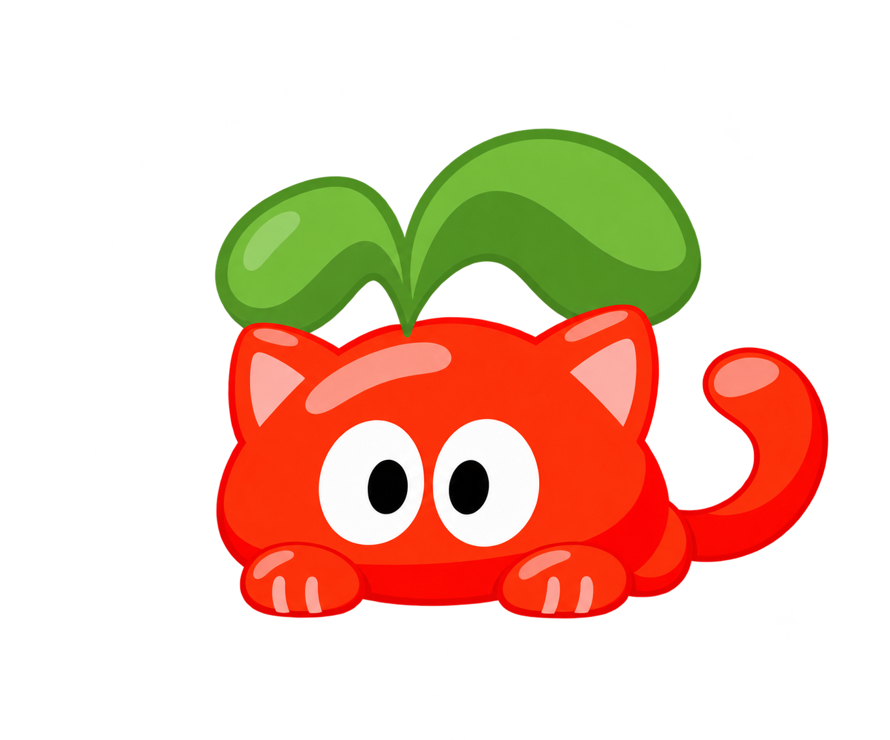
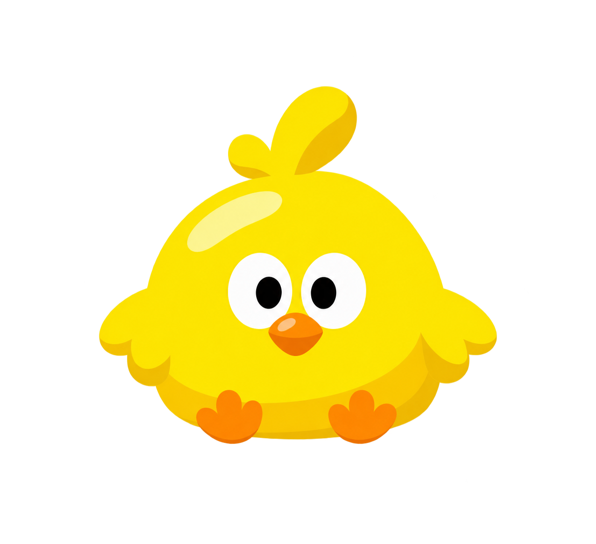
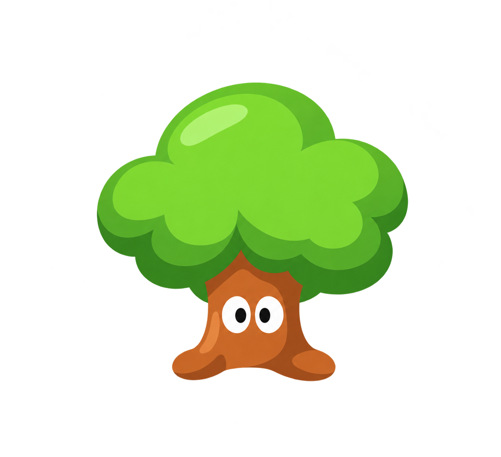
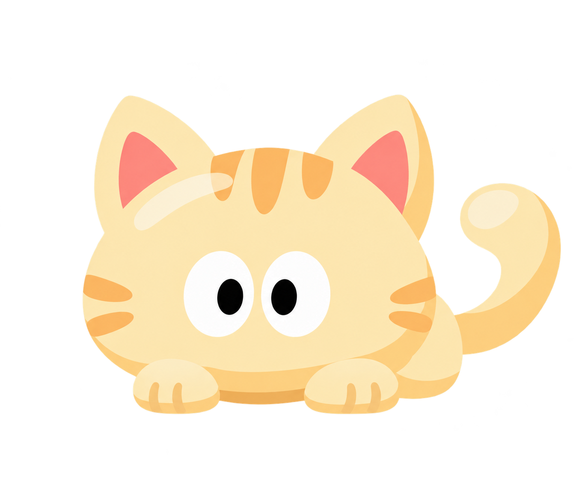

# 拉姆变身造型：重新绘制的静态候选

这组是在红色中级拉姆原帧的基础上重新设计的兔子、小鸟、小树和小猫：保留拉姆的白色椭圆眼睛、圆润身体和植物特征，分别加入对应物种的轮廓。图片是新绘设计，并非官方原帧，也尚未接入游戏或制作变身动画。

<table>
<tr><th>原始拉姆参考</th><th>兔子</th><th>小鸟</th><th>小树</th><th>小猫</th></tr>
<tr><td></td><td></td><td></td><td></td><td></td></tr>
</table>

## 旧候选与新候选

| 形态 | 旧候选 | 新候选 |
| --- | --- | --- |
| 兔子 |  |  |
| 小鸟 |  |  |
| 小树 |  |  |
| 小猫 |  |  |

[生成与参考记录](../skills/mole-classic-art/references/v43/transform-redraw.md)
