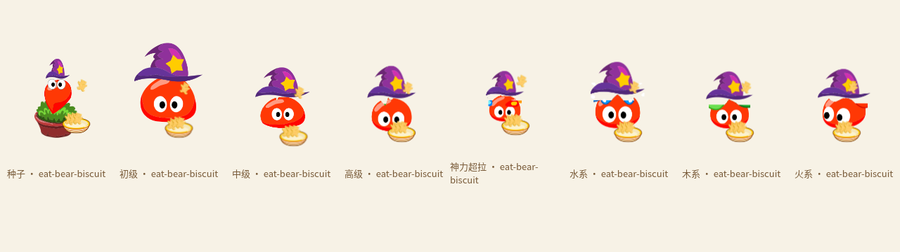
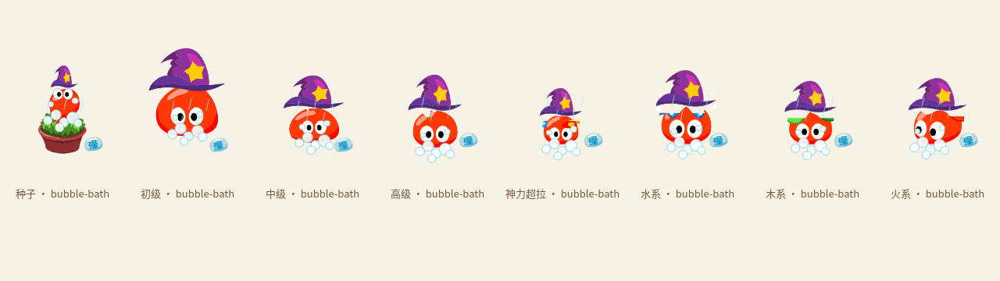

# v0.27.0 拉扯、挥网与统一照料

## 参考和范围

实际查看原树洞场景、原背包、熊熊饼干、原奶瓶图标和原浴盆。继续使用原拉姆及其四种身体遮罩配色、原小嘴、眼睛和服装，不生成替代角色。

- 轮廓：原道具以清楚的深棕/同色描边区分，新增道具保持小尺寸可读。
- 形状：玩具小网、浅盘、矮奶瓶各有明确剪影，不给拉姆补常规四肢。
- 色面：奶油白、金黄、青蓝的大色块，对应原库存图的明亮局部色。
- 高光：少量短白高光，不加木纹、电影光或写实纹理。
- 空间：三个独立透明单元；主体、眼睛、原服饰和鼠标命中区域保持独立。

`v27-care-props.png` 是图片模型生成的新道具，不是官方导出。原图未手工修改，2172×724的三个724px单元由CSS背景取样。完整提示词、参考和来源见相邻source.json。蝴蝶沿用v15图片；音效由本地Web Audio合成，并非原录音。

## 拉扯

窗口继续使用绝对系统光标和原生拖动定位，视觉弹性完全独立，不修改Windows工作区、四边吸附或抓取点。仅拖动期间查询系统光标位置；预览使用真实指针输入。

身体与已挂接服饰处在同一弹性层，用有阻尼的弹簧产生方向相反的滞后、轻微伸展与转动，松手后连续回弹。种子花盆是弹性层外的兄弟节点，始终端正。初级、中级、高级和超拉有不同幅度；飞行形态保留原正面飞行帧，不冻结整只。反向拉动触发轻微反抗，三次连续明显反向才触发头晕星星。气泡有冷却并尊重主动陪伴/安静设置，声音尊重音效开关。

弹簧采用小步积分和幅度上限，处理丢帧和重复时间戳；减弱动态时保持拖动功能但不拉伸。回弹停止后不继续运行额外动画循环。

[同一生产弹性Hook的五阶段录屏](../artifacts/v27-elastic-pull.webm)

## 蝴蝶

小网在身体侧面握持，握柄注册点约为图片单元(38%,90%)，网口约(38%,16%)。根据同一旋转矩阵计算网口坐标，蝴蝶先接近网口，再在两次挥动时闪开，最后绕回来；不是随机飘动的两张图片。种子不抬花盆，飞行形态保持悬浮。声音对应两次挥网和一声小回应。

## 统一照料

按用户本轮要求替代旧的逐个物品动作编排，保留旧物品ID与动作ID兼容存档。物品图片和效果仍按原物品区别。

| 类别 | 顺序 | 时长 |
| --- | --- | --- |
| 食物 | 餐盘进入、四小份图案依次落盘、逐口移到原小嘴、餐盘离场 | 4.6秒 |
| 饮品 | 奶瓶到嘴边、三次吸饮、液面视觉变化、空瓶丢开并淡出 | 4秒 |
| 清洁 | 泡泡揉洗、冲水、干净的闪亮 | 3.6秒 |
| 药水 | 小口吸饮，恢复药水/换色药水沿用真实效果 | 2.8秒 |

四块食物图案只表现库存一份的四口，不会扣四份或重复奖励。道具轨迹、原小嘴开合与音效共用接触时刻。身体保持正常原眼睛/小嘴；服装跟随原身体注册，不参与身体变色。洗净用品仍在旁边显示本次使用的图标。

点击时立即执行一次原库存/属性规则并保存，结束只展示回执、不再改数值。快速连续点击替换动作时，把尚未展示的实际增益合并到最后一次结束提示；按宠物ID隔离，导入、丢弃和阶段重设会清理旧提示。只显示实际受上限限制的增加量；没有人为加成长经验。

[实际100px、八种形态、原服饰与四类照料录屏](../artifacts/v27-care-and-butterfly.webm)

## Windows安装完成启动

原electron-builder辅助安装模板在Finish回调里同步通过Explorer打开快捷方式。自定义Finish页保留标准「运行」复选框，点击完成立即隐藏向导；普通用户使用非等待Exec直接启动EXE，管理员安装仍用原桌面用户令牌启动。没有用管理员身份强开桌宠，也没有更改系统安全设置。

服装动作表runtime.json与football头部注册数据改为动态导入：无服饰的首次领养不解析这块约520KB的脚本，已穿戴用户在需要绘制服装时载入。首屏脚本约993KB→480KB（未压缩），不是宣称所有机器上固定快多少毫秒。

Windows成品检查实际安装到临时目录，通过真实Finish按钮回调启动程序，检查向导在2秒内收起并出现已安装应用的可见窗口，记录测量值。Mac继续检查两种芯片的成品启动、菜单栏图标及原生拖动。Apple公证状态独立记录，不把启动优化说成通过Apple公证。

## 本轮检查

- 216项Vitest与37项Node规则/平台检查；正式TypeScript强制重编译和Vite构建。
- 生产浏览器：五阶段真实指针拖动、回弹、食物落盘、单击实际扣库存、连续点击后的合并上限增益、奶瓶/清洁、挥网，以及原背包、小屋与日常活动。
- Linux真实Electron：系统光标采样、双轴拖动、四边吸附、置顶/穿透、成品页面照料与服饰加载。
- 原服饰动作矩阵：9件×8类动作×8种形态，以及低动态偏好、购买和重启持有；新弹性层保留服饰与身体的共同父级。
- Windows和两种Mac在GitHub Actions打包检查，通过后发布安装包、ZIP与校验文件；Windows额外记录实际Finish按钮启动测量。
