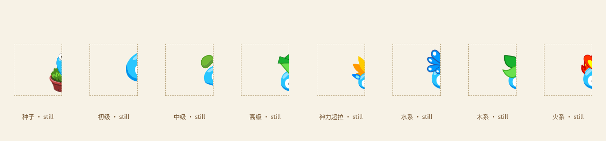
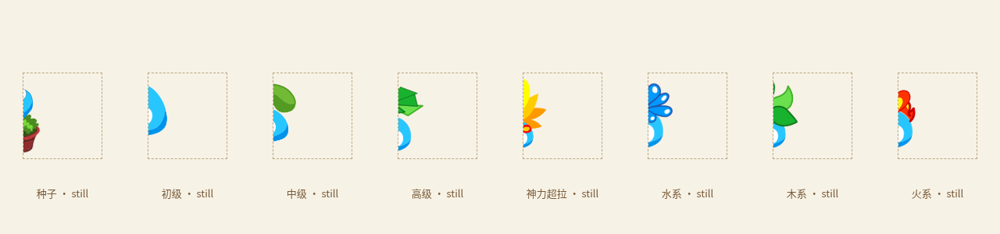
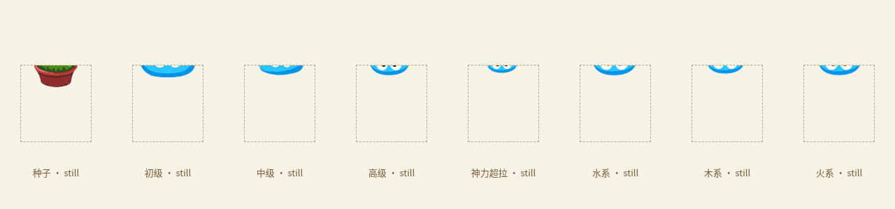
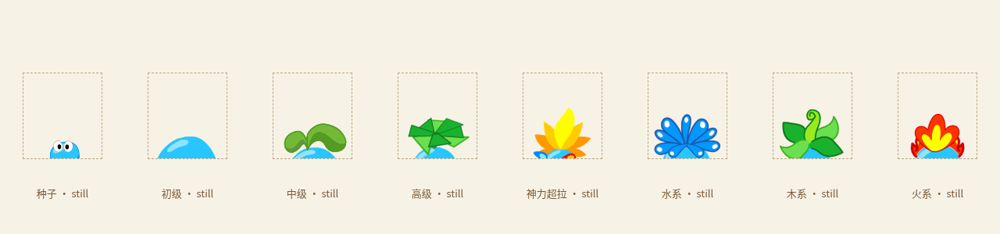
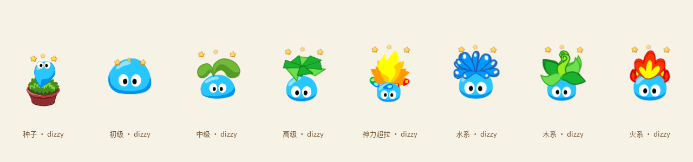

# v0.28.0 悬浮横框、边缘露出和眼内眩晕

截图里“拉姆 · mole-baby”与原托盘原生提示完全一致。Windows托盘改为空提示，桌宠和脚下按钮移除HTML title，保留aria-label、图标、功能和主动陪伴气泡。网页/原生窗口名称统一为「拉姆」。

另外保持Windows窗口创建时的frameless/thickFrame设置，切换模式时不再调用setResizable翻转CanResize；使用窗口尺寸上下限约束小宠物/背包，回到小屋时解除上限。原生边框检查会读取真实HWND的WS_CAPTION、WS_THICKFRAME和客户区屏幕坐标，在8次小屋、背包、桌面循环后检查是否出现标题栏或边框偏移。这个检查只在Windows运行，Mac/Linux保留原本的原生可缩放切换。

## 约30%身体露出

旧统一偏移82px/92px会把实际只有40–80px宽的身体完全遮住。现在在固定100×108桌宠视口中记录每种形态的原身体遮罩边界，左右分别校准遮挡位置；种子的横向按身体宽度计算，纵向包含原花盆。露出目标为身体宽度/高度约30%，不是按透明命中框算30%。鼠标悬停偏移缩小到隐藏偏移的60%，露出更多；收起动画、悬停只探头和手动拖出不变。

表格和数据在 `electron/edge-visibility.json`，由 `scripts/art/edge-visibility.py` 从原图计算。主进程和渲染器共用该表；成长或最高形态切换后更新同一原生外形配置。四色不改变轮廓。

图中虚线方格仅是复核用的屏幕裁剪边界，实际宠物窗口不会绘制这个方框。

## 原瞳孔绕圈

从原客户端正常down姿态拆出两层：原身体/眼白与只有原瞳孔的透明层。种子眼睛的嵌套sprite单独处理，其他形态清除祖先容器的叶冠/装饰后取得纯瞳孔。透明放置保持原导出边界，再沿原身体遮罩配准。

运行时只对原瞳孔层作约1–3原图像素的椭圆轨道位移，60Hz采样同一事件时钟。头顶星星同时播放，开始与结束用平滑包络收放；结束瞳孔回到原位置。身体和眼白不会旋转、换形或变大；服饰沿用原中性姿态挂接，四色仍只染原身体。

[眼内运动与恢复录屏](../artifacts/v28-dizzy-eyes.webm)。这是原素材的桌宠分层适配，不是官方完整眩晕片段，也不是新生成角色或重画眼睛。

## 检查

规则检查覆盖八种外形、四个边缘的30%露出和悬停偏移、真实主进程外形切换、Windows固定约束/无边框样式、瞳孔轨迹与归位。生产浏览器和Linux Electron执行真实连续点击眩晕并检查恢复，同时保留真实系统光标、四边吸附、照料、计时和服饰回归。原服饰矩阵检查仍覆盖9件×8类动作×8种形态。

Windows成品额外读取原生窗口样式，运行真正的安装器并点击Finish启动应用；两种Mac分别打包、启动、检查菜单栏与原生拖动。发布附件校验和成品检查均通过后发布。
